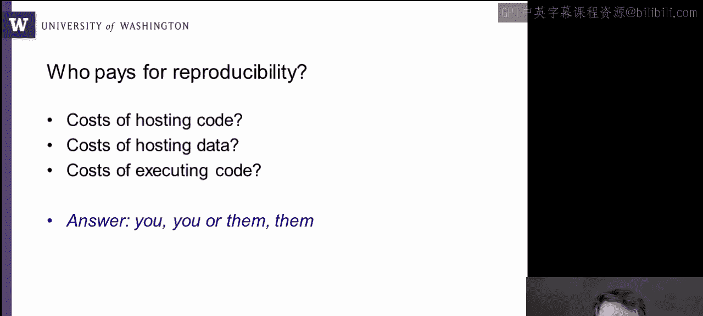
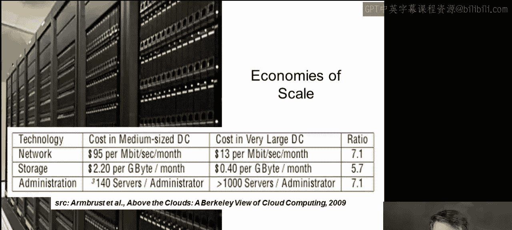

# 杜克大学《大规模数据科学（预测分析，交流数据科学结果，第2、3课⧸共3课有视频）｜Data Science at Scale》中英字幕 p109 39_规模经济.zh_en -BV1xf421Q7bH_p109-

。

So I want to talk a little bit about costs and cost sharing in this collaborative reproducible。

Data science context。So。question you can ask is who pays for reproducibility。

 especially as the costs increase if you're working with hundreds of terabytes。

Or significant computational models。Those aren't free。So the cost of hosting code。

 the cost of hosting data， the cost of executing executing code。 and the answer， I think is。

 you know， you， you or them and them for in a reibility context and this is。

Enabled by cloud computing。 So hosting code is actually not very expensive。

 And so that's that's essentially you。 you provide the code。

 you host it somewhere and you make sure people have access to it。

 either within your organization or externally。 Hoing data。

's what's unique is that that's a cost that's typically borne by by the data owner。

 and this was prohibited in a science context， right， Because if I have 30 terabtes。

 And now I want everyone else to have access to it for reproducibility purposes。

 I can't afford necessarily to make that stuff available。 That's that's expensive。

 I can maybe barely afford to store it somewhere at all。

 let alone hosted and provide open access to it。 however。Amazon in particular。

 and other cloud providers are solving this problem by。呃。Allowing you to。Configure the data sets。

Such that egress charges。network bandwidth charges are paid by the consumer of the data as opposed to the provider of the data。

 Moreoverover， those programs like public data sets with Amazon where if there's enough if your data will generate enough usage。

And you just somehow don't mind being public， which may not apply to many people in a commercial environment they'll host it for free And the reason they're interested in doing this is because you generate enough traffic to Amazon where the users of your data will launch EC2 instances and swipe their credit cards for other kinds of services that they don't mind paying for it for free so the economics of hosting data in a high use environment are changing and it's increasingly possible Now if you do have a massive data and you're going to put it out there for reproducibility purposes for posterity and no one actually is going to use it。

Someone still has to pay that bill， and that's still a difficult problem。

 but that's arguably difficult problem， even if you weren't going to。Make it available。Okay。

And in the cost of executing code， that's always going to be themm in the cloud right。

 They will swipe their credit card， launch these two instances using your chef scripts using your virtual machines。

 but you don't have to pay for that at all。 And that's very。

 very different from if you try to allow reproducibility on your own machines。 And this is again。

 even internal to the a single company， know who gets charged for the use of those resources can sometimes be the limiting factor in a collaborative。

Environment， why would I let the marketing department access to my machines when I paid for those out of my budget right this is for our data we don't want those people running their jobs on this machine If you do this stuff in a public or private cloud kind of environment。

 you can make sure that costs are allocated to the people who are incurring them。So that's fine。

 but overall。

You forgive me， I want to spend a little bit of time on why the public commercial cloud and other extreme centralization efforts are。

Able to save money at all， why should they be able to， why should they be cheaper？

And the answer is economies of scale。 and so this is a very early report from 2009 on。

Some of the economies of scale you see in larger and larger data centers and the categories here they looked at were。

You know， network storage and administration。And just to put some numbers on this and again。

 there from 2009， these are almost certainly changed dramatically。

 which it's now 2015 at the time I'm recording this。

But $95 per megabit per second per month for network versus the cost in a very large data center is $13 per megabit per second per month。

 so a ratio of 7。1 for storage， it's a ratio of 5。7。And for administration。

 you have about 140 servers for every one administrator。In a data center。

 they can have 1000 servers or more for every administrator。

 And these numbers are only going these ratios。Are only going up as you have more and more automation。

Okay， so。These savings can be passed on and so it's it's it's in the long run。

 you're never going to keep up trying to do many small。Server rooms， data centers。Clus and so on。

