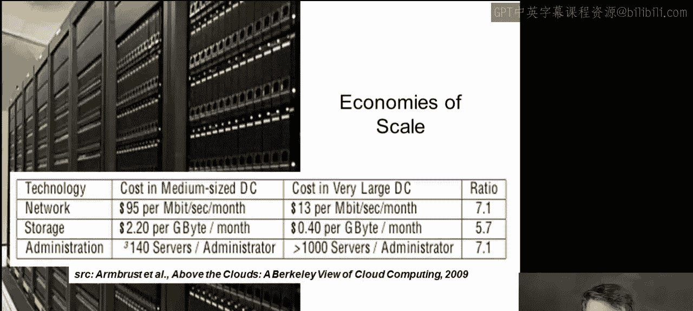

# 大规模数据科学：第2课：协作与可复现性中的成本与规模经济

在本节课中，我们将探讨在协作、可复现的数据科学工作中，成本如何产生以及如何分担。我们还将分析为何大型公共云服务商能够提供更经济的解决方案。

---

## 成本分担：谁为可复现性付费？

在协作和可复现的数据科学背景下，一个核心问题是：**谁为可复现性付费？** 当处理数百TB数据或运行复杂计算模型时，成本会显著增加。这些成本并非免费，主要包括代码托管、数据托管和代码执行三个方面。

以下是各项成本的分担方式：

*   **代码托管成本**：这部分成本通常由**代码提供者（你）** 承担。你需要将代码托管在某个地方（如GitHub、GitLab或内部服务器），并确保组织内外的协作者能够访问。这部分费用相对较低。
*   **数据托管成本**：这部分成本传统上由**数据所有者（他们）** 承担。在科研或商业环境中，公开托管大规模数据以供他人复现研究，曾因高昂的存储和带宽费用而难以实现。
*   **代码执行成本**：在云环境中，这部分成本总是由**代码执行者（他们）** 承担。他们使用自己的云账户启动计算实例来运行你的代码，你无需为此付费。

上一节我们讨论了成本的基本分担原则，本节中我们来看看云服务商如何改变了数据托管的经济模型。

## 云服务如何改变数据托管经济

云服务，特别是亚马逊AWS等提供商，正在通过创新的商业模式解决数据托管的成本难题。

以下是关键机制：

*   **转移带宽成本**：数据提供者可以配置数据集，使得数据流出（egress）产生的网络带宽费用由**数据消费者**支付，而非提供者。
*   **公共数据集计划**：对于使用率高且愿意公开的数据集，云服务商（如AWS）可能会提供免费托管。其商业逻辑在于，用户为了使用这些数据，会在该云平台上启动EC2实例并购买其他付费服务，从而为云商带来收入。
*   **内部成本核算**：即使在公司内部，使用私有云或公有云环境也能清晰地将计算资源成本分配给实际使用的部门（如市场部），避免了因预算归属问题阻碍协作。

然而，如果托管了海量数据却无人使用，存储账单仍需有人支付，这仍然是一个待解决的挑战。但值得注意的是，即使不公开数据，长期存储海量数据本身也是一个成本难题。

---

## 规模经济：为何云服务更便宜？

你可能会问，为什么公共商业云这类高度集中的服务能够节省成本？它们为何更便宜？

答案是**规模经济**。

下图展示了一份2009年的早期报告，揭示了超大规模数据中心在几个关键方面的规模经济效益。虽然具体数字在今天（2015年录制时）已发生巨大变化，但其揭示的原理依然成立。

报告主要对比了网络、存储和管理三个类别：

*   **网络**：小型数据中心的网络成本约为 **$95 / (Mbps·月)**，而超大规模数据中心的成本可低至 **$13 / (Mbps·月)**，成本比约为 **7.1**。
*   **存储**：存储成本的比例约为 **5.7**，大规模集中采购和管理能显著降低单价。
*   **管理**：在传统数据中心，约每 **140** 台服务器需要一名管理员。在超大规模数据中心，一名管理员可以管理 **1000** 台甚至更多的服务器。随着自动化程度的提高，这一比例还在持续上升。

这些因规模效应产生的成本节约可以传递给用户。从长远来看，试图通过维护众多小型服务器机房或集群来追赶这种效率是非常困难的。

---

本节课中我们一起学习了在可复现数据科学工作中的成本分担模式，以及云服务商如何通过商业模式创新（如转移带宽成本、公共数据集计划）来降低数据托管门槛。更重要的是，我们探讨了其背后的根本驱动力——**规模经济**，它使得超大规模数据中心在网络、存储和管理效率上远超小型部署，从而能够为用户提供更具成本效益的服务。