# 杜克大学《大规模数据科学（预测分析，交流数据科学结果，第2、3课⧸共3课有视频）｜Data Science at Scale》中英字幕 p11 10_示例：卡方检验.zh_en -BV1xf421Q7bH_p11-

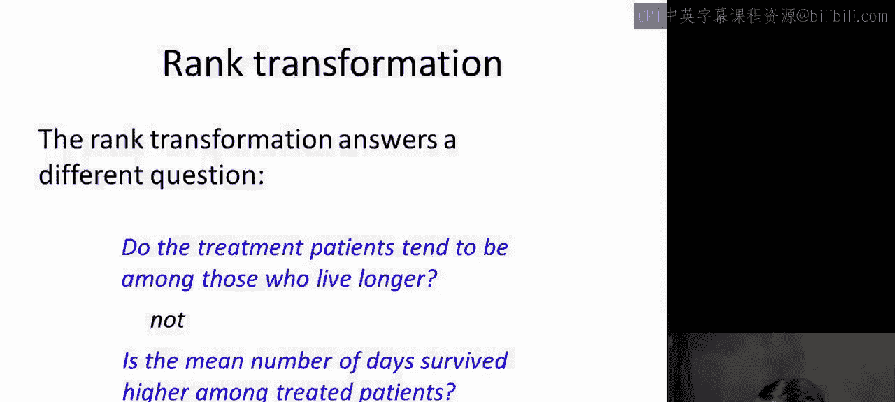

So I want to give you another example of how to apply these rembling methods in a different kind of statistical inference。

Context so the chi squared test is used for categorical data。 so for example。

 what is the relationship between health and wealth where we define health in terms of three categories。

 poor middle class and rich and wealth in terms of， let's say， sick or healthy。And we。

Perhaps do a survey to。Get tallies of each one of these categories。

 And we want to try to understand the relationship here。

 The chiis square test is used when we're trying to measure a the。

Relationship between two variables or the difference in observation from the expected distribution。

Okay， so if we tabulate these results like we have here。

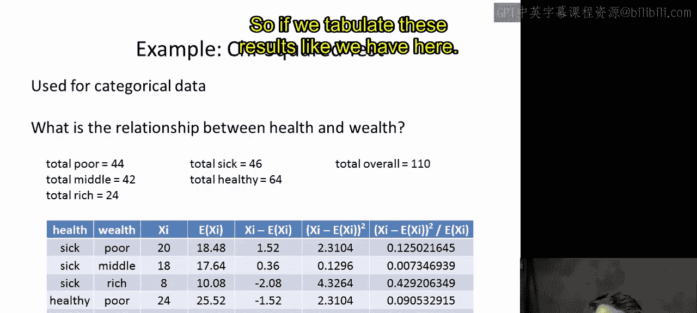

We have the measured count of those who reported being both sick and poor is 20 and so on。

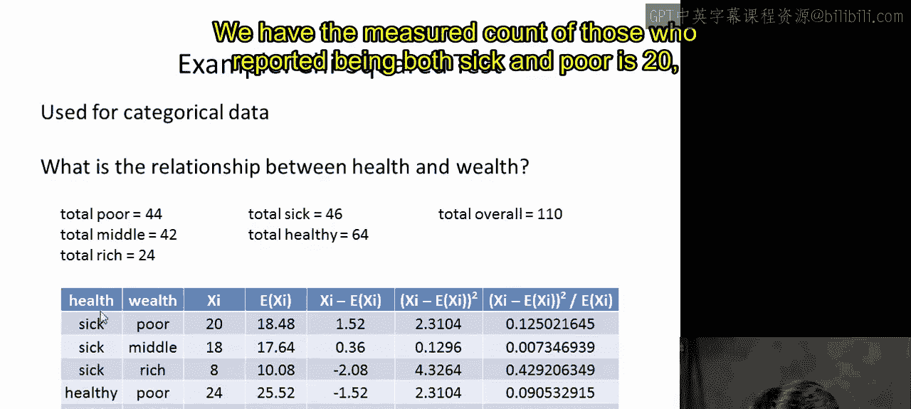

How do we compute the expected value that we're going to measure the difference from？

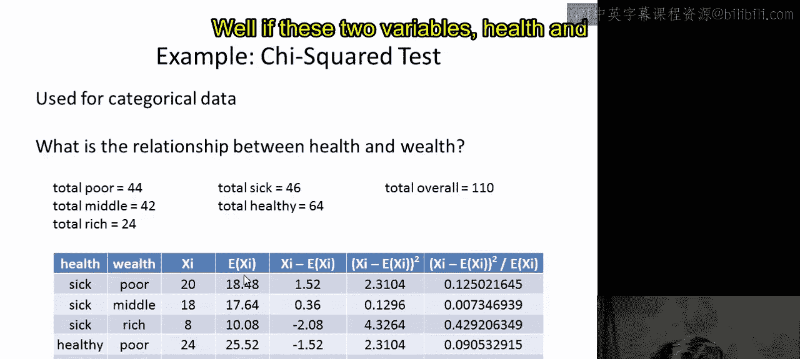

If these two variables， health and wealth are independent。

 then we'd expect the same ratio of sick to healthy。

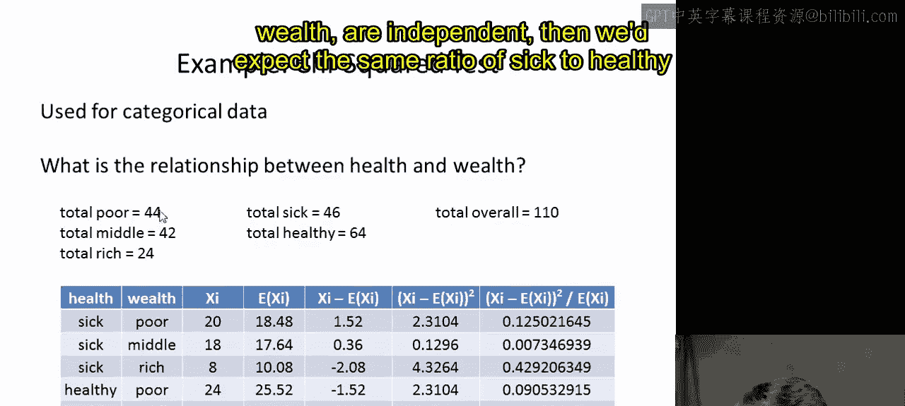

Exhibited in the poor to be the same ratio of sick to healthy in middle and the same ratio of sick to healthy in rich that it would have no effect。

 and so we can do is。

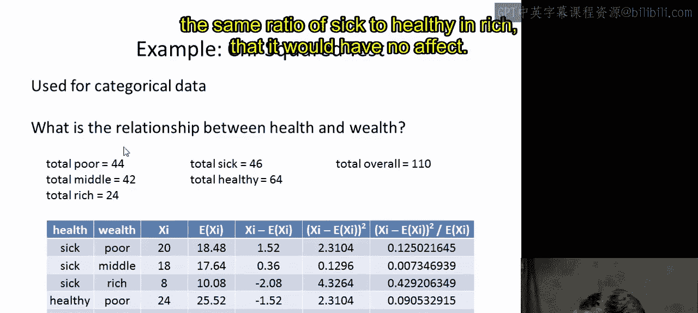

Count up the total number of overall subjects we have 110。

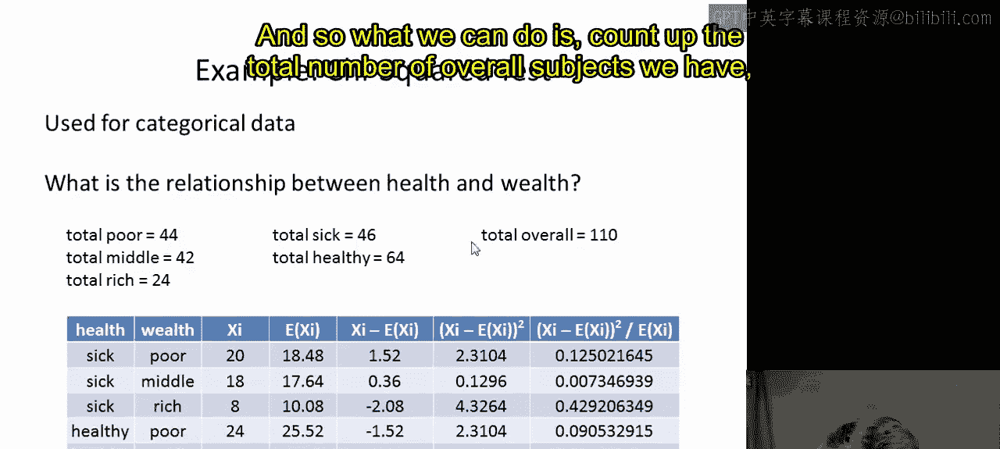

And take the ratio of sick over 110， there's 46 sick over 110 total。

And they multiply that by the number of poor， and that's the expected number of both poor and sick。

 which is 18。48。 and we could repeat that。

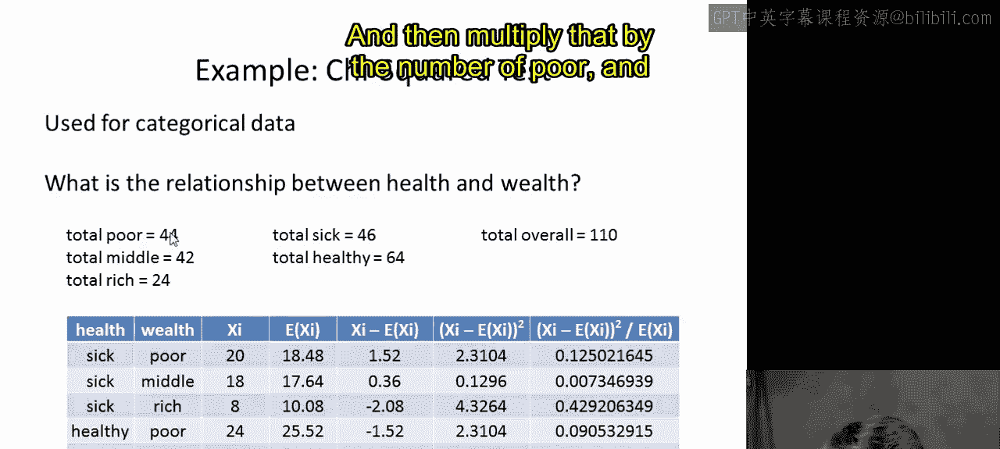

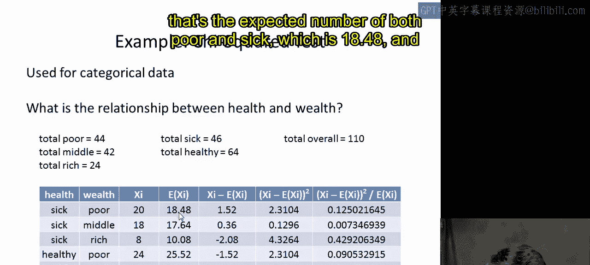

For each one of the combinations of variables。

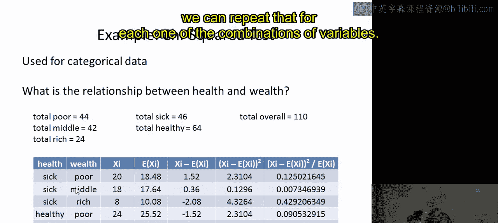

And then subtract subtract the expected value from our measured value to get a marginal residual rather。

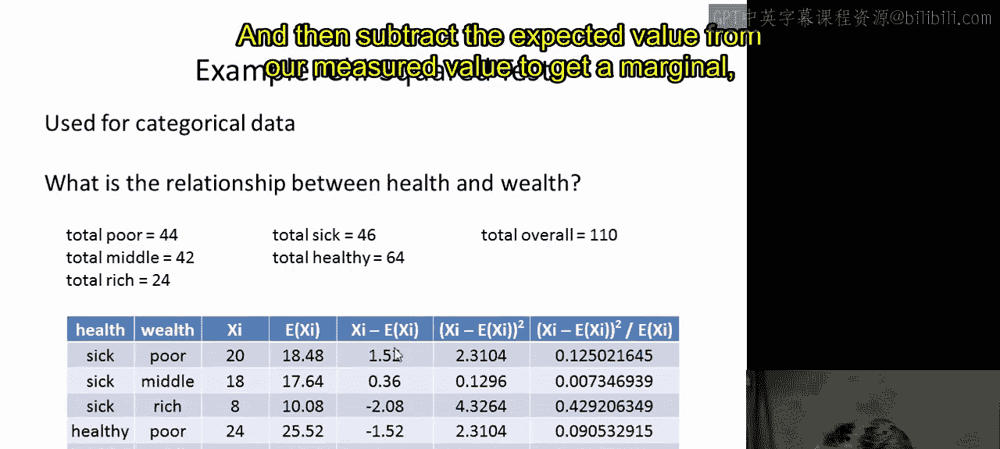

And then square that。And then divided again by the expected value。

 and that's the chi squared statistic。 And then we add that all up for the overall case。

 the overall experiment， the overall data set in order to get this。

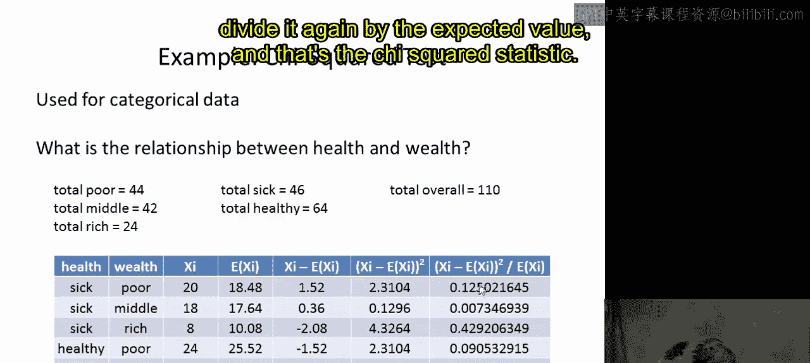

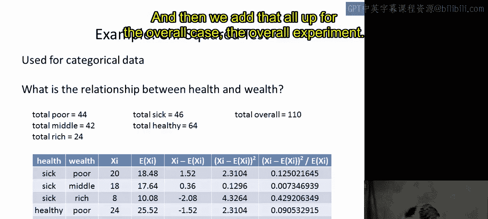

Drive statistic， and then this is the statistics we want to do the significance test on。Okay。

 so how do we do that？We talked about shuffling the labels。

 and we talked about bootstrap re samplingmbling methods here what you can notice is that the calculation depends on the。

Marginal values here， the total number of sick the total number of poor total in the middle and so on。

 So what you want to do is design a relabelling a shuffle。

Process that will keep the marginals the same。But still change the values now that it allow you to do the test。

So the way to think about this is that each observation has a single label rather than two labels。

 it has the sick pore label or the sick middle label or the sick rich label or the healthy pore label or the healthy middle label or the healthy rich label and sort of concatenate these two labels together。

 then you can do a shuffle test as。

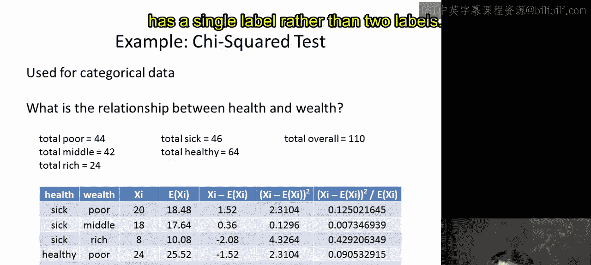

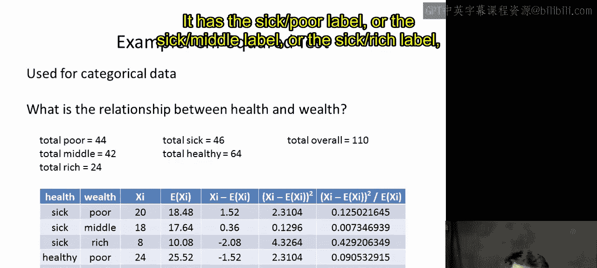

Usual。And the marginals will then necessarily stay the same。

 the total number of poor will stay the same， the total number of healthy will stay the same and so on。

Okay。One of the thing I should mention about the chi square test is it's only valid if every category has at least 10 observations in it。

 if that's fewer than that than you have。It's invalid to use the sample won't be distributed in Ka Squares。

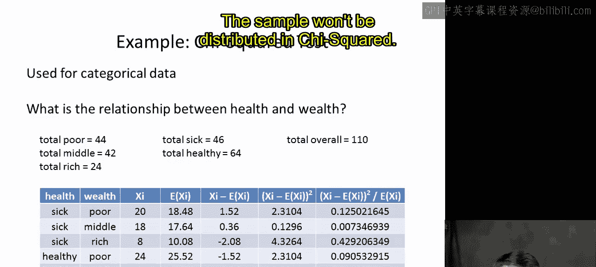