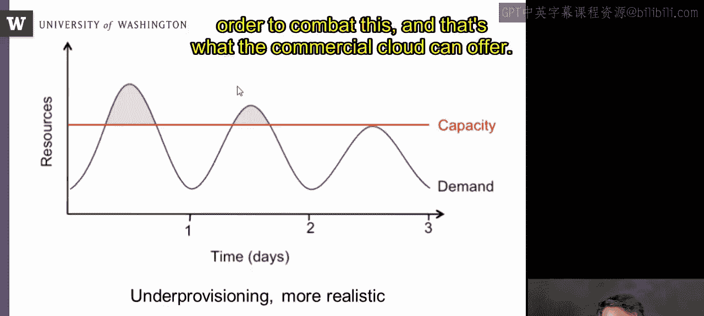
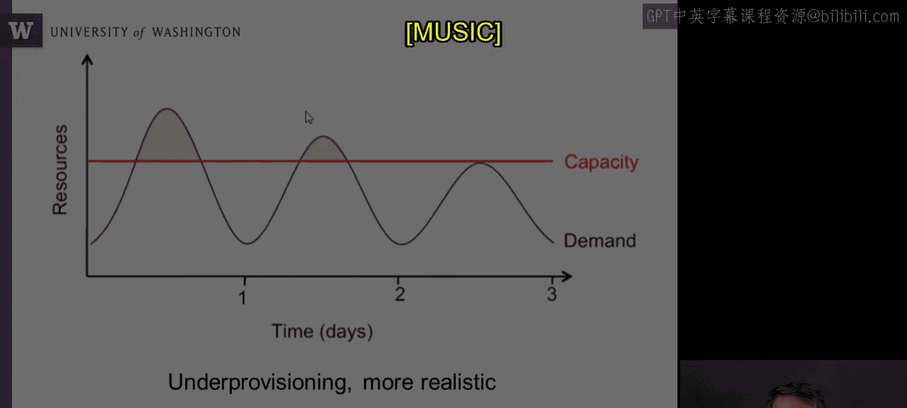

# 杜克大学《大规模数据科学（预测分析，交流数据科学结果，第2、3课⧸共3课有视频）｜Data Science at Scale》中英字幕 p110 40_为峰值负载配置.zh_en -BV1xf421Q7bH_p110-

。

🎼The other argument they made， which I like， is that when you're provisioning for。Load。

You know your only logical choice is to try to provision for your peak load， so if your're payroll。

 you know your end of month payroll processing。You have to buy enough machines to support that level of activity。

 and the rest of the month， they are。Idle for a lot of the time， if you're in the data science。

Group it may be that well you know analytics every once in a while gets really。

 really spiky and we really need a provision for that and we're tired everybody getting frustrated when the cluster is too busy we buy a bigger cluster。

And so on。Perhaps the ideal。Where you've。Managed to buy resources such that it just touches the peak capacity。

 But I think the argument they make， which I like， is that more realistically。

 you're going to miss a little bit。Okay， you're going to have some capacity that you pay for and the demand on that capacity is going to go above it。

the insidious thing here though， is that you won't know you're in this regime。

 you won't know that you've under provisioned because demand will naturally taper off and fit the capacity。

Right。Your your users will， you know， you say， let's say it's in a data science in the analytics department。

 Your data scientist will come to。Assume that of course I can'， of course。

 you know at the end of the month is when everybody's sort of finishing their deadlines。

Because of the reporting cycle， I know it's gonna be busy。 So I'm I'm just。

 there's a couple of there's certain jobs I'm not gonna bother doing because I know that I know the cluster will be will be will be too busy for that。

 There's other kind， know payroll is gonna to be too busy。

 I know I'm going just not do these other tasks because I won't be able to get them done in time。

 So demand will naturally kind of。Fit。😡，And if you're， if you're in。

 if you're actually selling products on the web， you'll see that you it'll be really bad。

 customers will just go someplace else to buy because they know that they know that you're。

know they're not getting the experience they want from your machines， perhaps。Okay。

 so this under provision view is probably more realistic。

And the argument is that only extreme centralization can help combat this。

 you have to give the illusion of more or less infinite resources。In order to combat this。

 and that's what the commercial cloud can offer。

