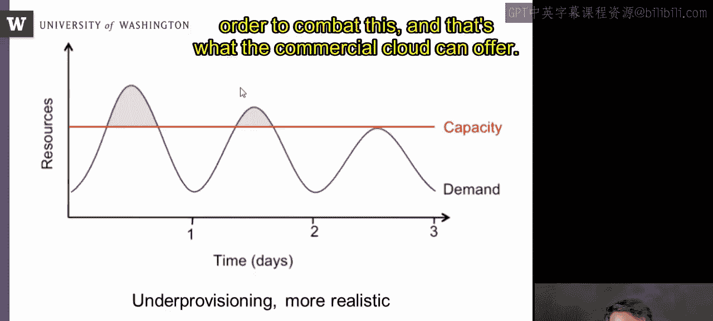
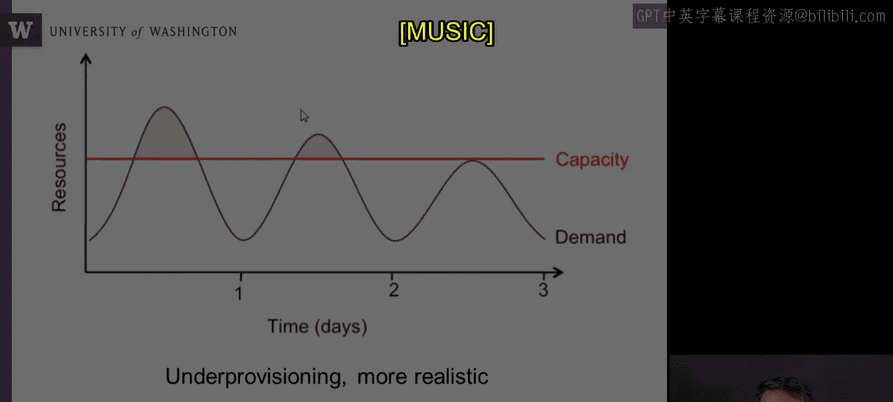

# 大规模数据科学：第2课：为峰值负载配置资源

## 概述

在本节课中，我们将探讨在数据科学和IT基础设施管理中，如何为系统负载配置计算资源。我们将分析传统的“按峰值负载配置”方法的局限性，并理解资源不足配置带来的隐性成本，最终了解集中化云资源如何为解决此问题提供方案。

## 传统配置逻辑：瞄准峰值

上一节我们讨论了资源管理的基本挑战，本节中我们来看看一个常见的资源配置策略。在传统模式下，为系统负载配置资源的唯一合理选择，就是尝试为峰值负载做准备。

以下是按峰值负载配置的典型场景：
*   **薪资处理**：例如，在月末薪资处理时，你必须购买足够多的机器来支持该级别的活动量。
*   **数据分析**：在数据科学部门，分析任务可能偶尔会变得非常集中和繁忙。为了应对这种情况，并避免大家因集群过于繁忙而感到沮丧，常见的做法是购买一个更大的集群。

理想情况下，你购买的资源量恰好能满足峰值容量。但现实往往更为复杂。

## 现实困境：资源不足配置

然而，我认为他们提出的一个更现实的观点是，你很可能无法精确匹配峰值。实际情况是，你会购买一定的资源容量，但需求有时会超过这个容量。

这里一个隐蔽的问题是，你可能不会意识到自己处于这种资源不足的状态。因为需求会自然地调整以适应有限的容量。

以下是需求如何“适应”有限容量的例子：
*   **内部用户调整行为**：在数据分析部门，数据科学家们会逐渐形成一种认知。例如，在月末报告周期截止日期前，大家知道集群会很忙。因此，他们会选择不去提交某些任务，因为他们知道这些任务无法及时完成。
*   **外部客户流失**：如果你在网络上销售产品，情况会更糟。客户如果无法从你的服务中获得良好体验，他们就会直接去别处购买。

因此，这种资源不足配置的观点可能更贴近现实。

## 解决方案：集中化与云资源的优势

那么，如何应对这个问题呢？论点指出，只有极端的集中化才能帮助对抗这种现象。你必须提供一种近乎无限资源的假象，而商业云服务正好能够提供这种能力。

## 总结

本节课我们一起学习了资源配置的核心挑战。我们了解到，传统的按峰值负载配置方法可能导致资源在大部分时间闲置，而现实中更常见的资源不足配置则会隐性抑制需求，导致内部效率降低或外部客户流失。最后，我们认识到，通过集中化的商业云平台提供弹性可扩展的资源，是解决这一困境的有效途径。