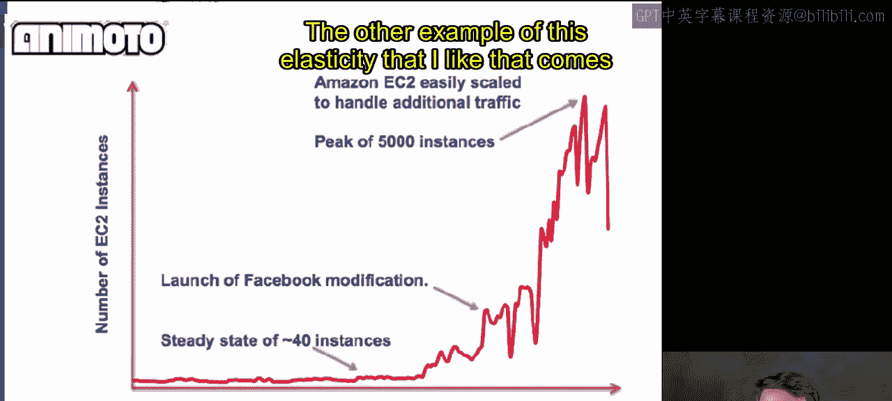
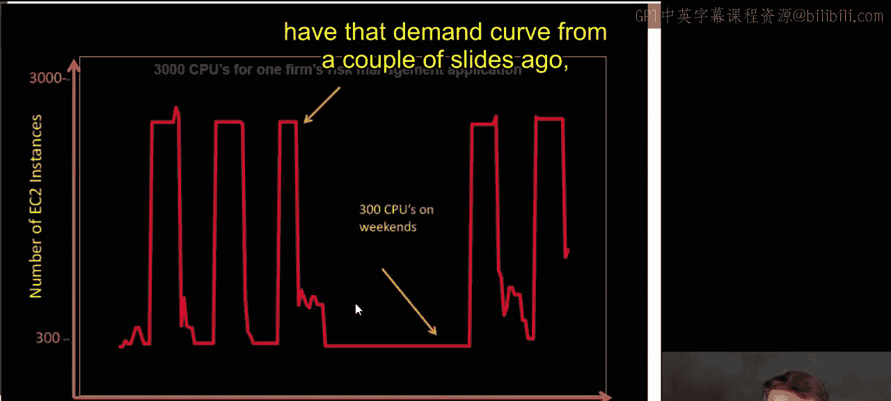
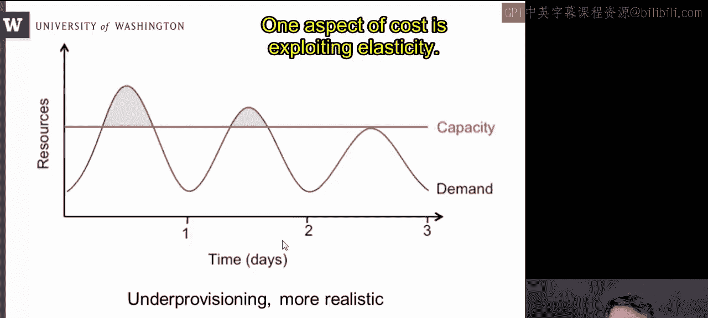
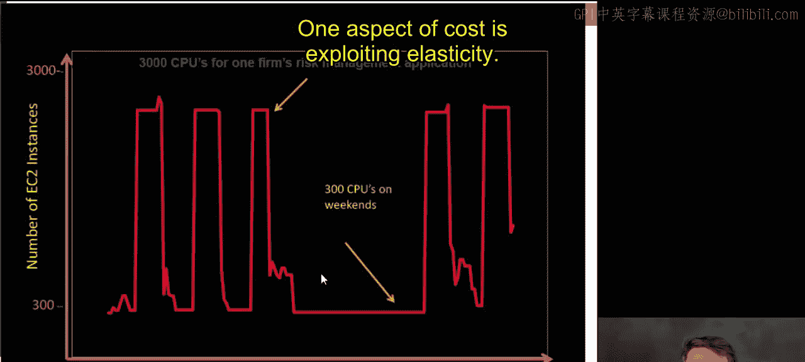
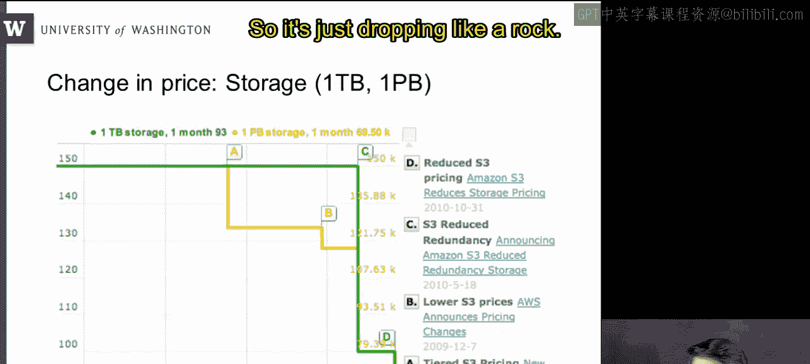

# 杜克大学《大规模数据科学（预测分析，交流数据科学结果，第2、3课⧸共3课有视频）｜Data Science at Scale》中英字幕 p111 41_弹性和价格降低.zh_en -BV1xf421Q7bH_p111-

。

So we talked about under provisioning and the idea that the demand was going to fit the capacity more likely than the capacity was going to fit the demand。

 and that motivated why you want more centralization in offering resources。

 And the example that Amazon used to give and still does， I suppose。

 but this an older example now is that this case of anmoto。 So anmoto。

Was or is a company that would synthesize。Vignettes。

 little video vignettes from a series of pictures。They were。

Moving along with their steady state of 40 instances on Amazon。

 and then they released a modification to their Facebook app that would do this that。

was picked up and know became very popular in a very short amount of time and so within within just this is this axis on the scale of days within just a few days they had bounced all the way up to sort of a peak of 5000 instances running at once and then crucially scaled back down when that peak was over。

Okay， and so this kind of elasticity is the advantage of using。Ascentralization， but but more。

 more realistically， what commercial cloud has already developed for us。

 And this burstiness is important for in a data science context。As well。

 because demand is unpredictable as we've argued。The other example of this elasticity that I like。

That comes from them is that it's not just。A spike because you got really popular。

But it's also these repeatable sort of spikes so this is。Finance。In the finance sector。And。

Y axis again， is a number of EC2 instances being used and the difference here is pretty broad。

 you know， 300 to 3000 factor a factor of a little less than 10。

But you can see what's happening here is that on weekends， you know， this is at night。

 and this is during the day。 This is during the trading trading hours， night trading hours， night。

 trading hours。 And then on the weekend， it was。You know， two straight days of of day and night with。

Down to 30 CPUs。 And so being able to recover those costs in those valleys。

And have that demand curve from a couple of slides ago。

Have the capacity track the demand exactly is very， very powerful。 and there's really nothing。

 nothing。 there's no other way to do this besides some version of what these cloud providers have already built for you。

Right， and then the other。 so that's one aspect of cost is exploiting elasticity。

 The other aspect of cost is that， you know， it maybe doesn't matter if the prices are so high。

 then it doesn't make any difference。 You know， we can't afford to do that。

 We have to sort of build our own stuff because ambulance。

And Microsoft and Google。Chahared too much。 And the argument here， though， is that。

This argument has actually gotten a lot stronger in the past two years because of the enormous competition between the three every time somebody lowers their price。

 everybody else's price， you know。Magically set to be the same within weeks or days。

But even when Amazon was really the only game in town， they were still dropping their price。

Precipitously， so this is the change in price for compute and memory for a single EC2 unit。

Running at steady state for about three years。 And every point on this curve where it dropped was a kind of a news release of various types of instances came down。

 or maybe those's across the board price cut or other kinds of。Ways to do cheaper things。And the。

 the difference is pretty extreme here。 from， you know。

 when it was when some of these services were first released， it was。有。2 and a half00 or 1。

5000 or$150 $2500。$200 for a unit of RAM and $1500 for a sorry。

 $15 unit of RAM and $500 for a unit of compute。And by the end， it was。You know。

A third of that or a fifth of that in compute and a third of that in Ram。

 and that was just within a few years on their own with essentially no competition in this space。

 just from the economies of scale。For storage， it was a similar kind of story。 for storing a single。

Terabyte or single petabyte。They came down quite significantly。

 and now it's gotten even cheaper since then where the。Yeah。

The storage we used to sort of track cloud computing versus these what we thought we could realistically build here on campus and it used to be。

Attractive for a lot of reasons， but the raw economics of raw data storage we could do better for quite a while。

 and they've recently passed that where there's where we can't hope to offer。

 even if we go down to buy a bunch of disks at fries with limited redundancy， limited safety。

You know， doing all the shortcuts that we would normally do at the university， we can't。

 we can no longer compete on that， at least not here。So it's just just dropping like a rock。

