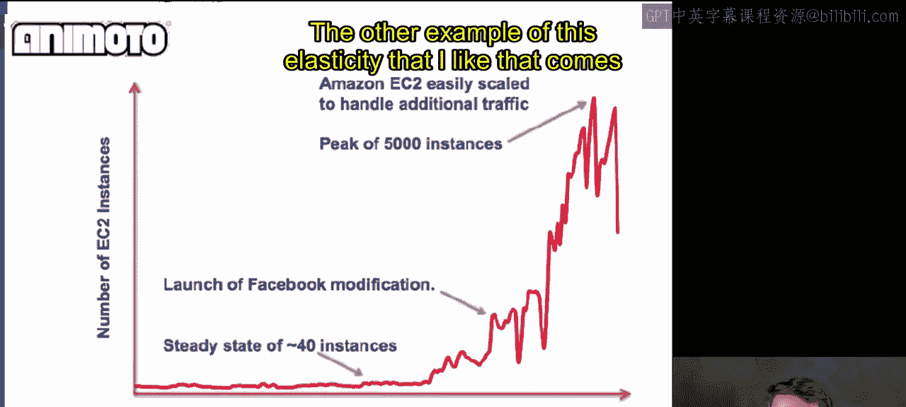
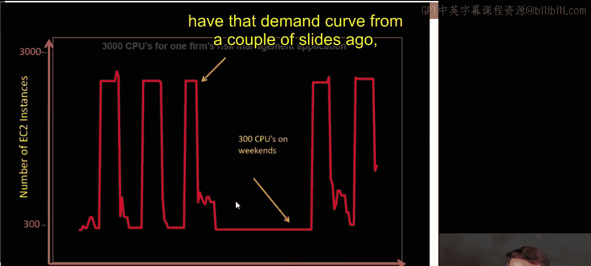
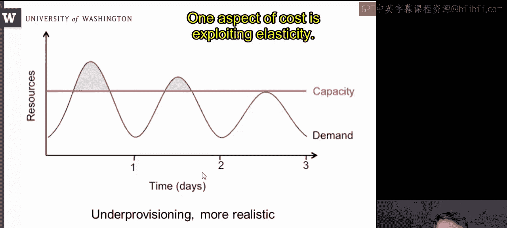
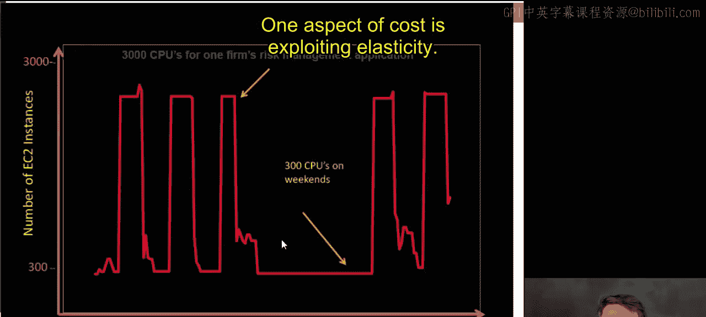
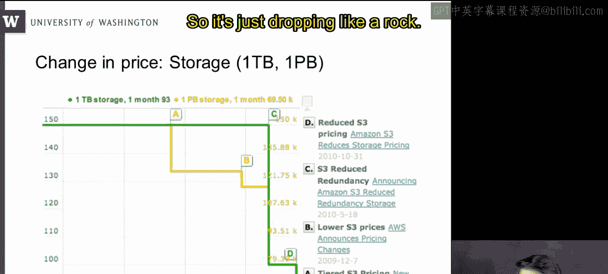

# 大规模数据科学：第2课：弹性和价格降低 💰

在本节课中，我们将探讨云计算的两个核心优势：**弹性**和**持续降低的价格**。我们将通过具体案例来理解弹性如何帮助企业应对突发的、不可预测的需求，并分析云服务价格持续下降背后的经济原理。

---

## 弹性：按需伸缩的能力

上一节我们讨论了资源供应不足的问题，即需求更可能去适应容量，而非容量去适应需求。这促使我们思考为何需要更集中的资源提供方式。

亚马逊经常使用的一个经典案例是Anmoto公司。该公司通过一系列图片合成短视频片段。他们原本在亚马逊云上稳定运行着40个实例。然而，当他们发布了一个修改版的Facebook应用后，该应用在极短时间内变得非常流行。结果，在短短几天内，他们的实例使用量激增至约5000个的峰值。关键在于，当这个需求高峰过去后，他们又能迅速将实例数量缩减下来。

这种**弹性**正是使用集中化云服务的优势，也是商业云平台已经为我们构建好的核心能力。在数据科学领域，这种应对突发需求的能力尤为重要，因为正如我们所论证的，需求通常是不可预测的。

---

## 弹性的另一种模式：可预测的周期性峰值

弹性不仅体现在应对突发流行事件上，也体现在处理可预测的周期性需求波动上。

以下是一个来自金融行业的例子。图中Y轴同样是使用的EC2实例数量，波动范围相当大，从300到近3000，相差近10倍。我们可以清晰地看到模式：在工作日的交易时段，实例使用量达到高峰；在夜间和非交易时段，使用量下降；而在周末，则持续保持在很低的水平（约30个CPU）。

能够在这种需求低谷期节省成本，并让**容量精确追踪需求曲线**，这种能力非常强大。除了云服务提供商已经构建好的方案，几乎没有其他方法可以实现这一点。

---

## 成本优势的另一面：持续下降的价格

弹性是成本优势的一个方面。另一个方面则是价格本身。如果价格过高，弹性带来的好处可能就无关紧要了。

关于云服务价格过高的论点，在过去两年里实际上已经被大大削弱了，这主要归功于亚马逊、微软和谷歌三大巨头之间的激烈竞争。每当一家公司降价，其他公司通常会在几周甚至几天内将价格调整到相同水平。

即使在亚马逊几乎是唯一玩家的早期，其价格也在急剧下降。下图展示了单个EC2计算单元在约三年内，其计算和内存资源的价格变化曲线。曲线上的每一个下降点都对应着一次价格调整公告，可能是特定类型实例降价，也可能是全面的价格削减。

价格差异非常显著。在服务刚推出时，一个计算单元的价格约为500美元，一个内存单元的价格约为1500美元。而到了后期，计算单元价格降至原来的三分之一或五分之一，内存单元价格降至原来的三分之一。这仅仅是在几年内，在几乎没有竞争的情况下，仅凭**规模经济**效应实现的。

---

## 存储成本的下降趋势

存储成本也呈现出类似的大幅下降趋势。无论是按每太字节还是每拍字节计算，价格都显著降低。

我们过去常常比较云存储和在校内自建存储的成本。有一段时间，在原始数据存储的纯经济成本上，我们自建方案可能更具优势。但云服务商最近已经跨越了这个门槛。即使我们采取各种捷径，比如购买大量廉价硬盘、降低冗余度和安全性（这通常是大学环境下的做法），我们也无法再在成本上与之竞争。云存储价格正像石头一样快速下落。

---

## 总结

本节课我们一起学习了云计算的**弹性**和**价格降低**两大核心优势。
*   **弹性** 允许资源容量精确追踪实际需求，既能应对Anmoto那样的突发流量高峰，也能适应金融行业那样的周期性波动，从而在需求低谷期显著节省成本。
*   **持续的价格下降** 则得益于云服务商的规模经济和激烈的市场竞争，使得计算、内存和存储资源的单位成本不断降低，让大规模数据处理变得更加经济可行。

这两点共同构成了在云平台上进行大规模数据科学分析的重要经济和技术基础。