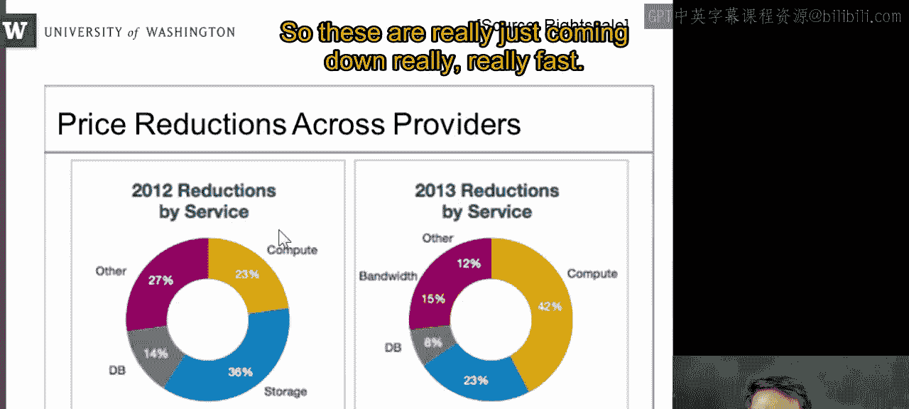

# 杜克大学《大规模数据科学（预测分析，交流数据科学结果，第2、3课⧸共3课有视频）｜Data Science at Scale》中英字幕 p112 42_服务器成本与电力成本.zh_en -BV1xf421Q7bH_p112-

。

The other argument I want to make is one that was put forward by James Hamilton。

 who's at Amazon and a data center expert。 He was a Microsoft previously many used him as a database guy originally。

 which is another reason why I like James， but he would argue you know there's a lot of work on green computing for a while where they were looking at things like powerware computing So you'd say。

 well in a cluster or in a data center we want to make sure we turn off the idle machines and concentrate the work onto the。

You know， on onto a few a smaller number of machines， thereby saving the power costs。

 And this doesn't make a lot of sense。 actually， this whole。

 this whole goal of that research doesn't make a lot of sense。

 And the reason is that an idle machine is incredibly expensive to own。

You had to buy the machine itself， which， as this plot shows。

 the servers themselves are the lion's share of the cost of running your data center。

 And you've got machines sitting there that you purchased that aren't doing any useful work。

 You had to run power to those machines。 You had to run cooling to those machines。

 You had to lay out all this infrastructure cost。Which is this purple slice here。

power power and cooling， I guess the red and the other research of the purple。

 you had to do all this， all this construction， all this capital expenditure to support the machines。

 and now you're going to turn them off。Okay。Amazon doesn't have to turn it off。 And the reason is。

 is they can So you you want to bend over backwards to avoid having。An idle computer。

 And one way you can bend over backwards is just to lower the price。

 Go find more work for that computer to do。 And that's exactly what Amazon can do。

 And that's why they have these spot instances。 They have auction。 They can they can。

Offer the compute to the lowest bidder。Or to the highest bidder rather。

 which is maybe lower than than what their prices they said at。

 And that's exactly what they can do that you will not be able to do inside your own data center。

 your only choice is to turn things off to try to save a little bit of power money to save a little bit of money going to power。

 which is just as green slice when you've already eaten the cost of everything else。

 So only Amazon can offer that kind of economy of scale。Right。

And here's another argument about price reductions that other people have done to show that。

Even across providers， not just Amazon。There's been a 42% reduction in compute in 2013。

 15% in bandwidth cost，8% in database cost，23% of storage cost and so on。

 So these are really just coming down really， really fast。

