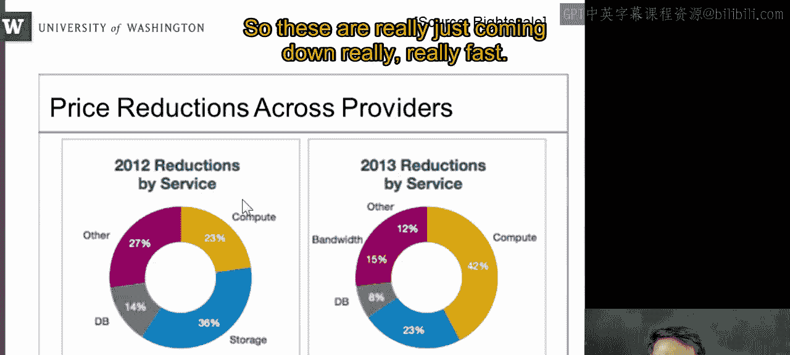

# 大规模数据科学：第2课：服务器成本与电力成本 💻⚡

在本节课中，我们将探讨数据中心运营成本的核心构成，并分析为何在云计算时代，单纯为了省电而关闭闲置服务器的传统策略可能并不经济。

---

上一节我们讨论了数据中心的总体成本结构。本节中，我们来看看一个由亚马逊数据中心专家詹姆斯·汉密尔顿提出的重要观点。

詹姆斯·汉密尔顿曾就职于微软，最初以数据库专家闻名。他针对“绿色计算”领域的一项常见研究提出了不同看法。这项研究旨在通过关闭集群或数据中心中的闲置服务器，将工作负载集中到更少的机器上，以达到节省电力成本的目的。

詹姆斯认为，这项研究的目标本身意义不大。原因在于，拥有一台闲置机器的成本极其高昂。

以下是支撑这一观点的几个关键因素：

*   **服务器硬件成本是主体**：图表显示，服务器本身的购置成本占据了数据中心运营成本的绝大部分（图中最大份额部分）。购买来的机器如果闲置不做任何有用功，本身就是巨大的资本浪费。
*   **配套基础设施成本已发生**：为了支持这些服务器运行，企业已经支付了电力供应、冷却系统以及所有相关基础设施的建设成本（图中紫色、红色等部分）。这些都属于沉没的资本支出。

既然已经为机器和基础设施支付了高昂费用，现在却要将其关闭，这并不划算。亚马逊不需要这样做，因为他们有办法避免计算机闲置。

一种竭尽全力避免计算机闲置的方法就是降低价格，为那台计算机寻找更多的工作。这正是亚马逊能够做到的，也是他们推出“竞价型实例”的原因。他们可以通过拍卖机制，将计算资源提供给出价最高的用户（这可能低于其标定价格）。

这种策略是你在自己的数据中心内无法实现的。在你的私有数据中心里，为了节省一点电力成本（图中绿色部分），唯一的选择就是关闭设备，而此时你已经承担了所有其他成本。

因此，只有亚马逊这类云服务商能够提供这种规模经济效应。

---

关于云服务成本优势的另一个论据是价格的持续快速下降。其他研究者的数据显示，不仅是在亚马逊，跨云服务提供商来看，成本都在显著降低。

以下是2013年一些关键资源成本的下降幅度：

*   **计算成本**：下降 **42%**
*   **带宽成本**：下降 **15%**
*   **数据库成本**：下降 **8%**
*   **存储成本**：下降 **23%**

这些成本正在迅速下降。

---

本节课中，我们一起学习了数据中心成本分析的一个重要视角：由于服务器硬件和基础设施的资本成本占主导地位，单纯为省电而关闭闲置服务器的策略在经济上可能低效。相比之下，大型云服务商（如亚马逊）凭借其规模效应和灵活的资源分配机制（如竞价实例），能够通过最大化利用率来摊薄固定成本，从而实现更优的经济性，并推动市场价格持续快速下降。