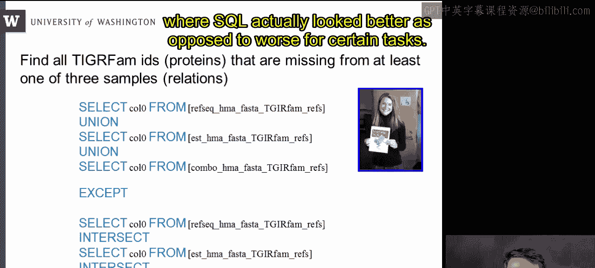

# 杜克大学《大规模数据科学（预测分析，交流数据科学结果，第2、3课⧸共3课有视频）｜Data Science at Scale》中英字幕 p113 43_大数据的可重复性.zh_en -BV1xf421Q7bH_p113-

。

All right， so this is this last series of points I want to make about data intensive experiments。

And we mentioned this a little bit briefly， but you know as data sets become larger。

The days of moving things around are are over。 right。

 It takes days to transfer a terabyte over the Internet and isn't likely to succeed That's。

Days is probably a bit of a。Ma someone assumptions about the failures that you're likely to encounter in practice if everything's going well。

 it probably shouldn't take days anymore， but copying a petabyte is operationally impossible。

And shouldn't happen So really the only solution available is to push the computation of the data rather than move the data of the computation this is the only solution available for just getting work done。

 but especially in reproducibility context right it doesn't make any sense to ask someone to reproduce your results by copying the data set down to their to their quote local environment。

Okay， so this immediately motivates。Having the resting place for your large data sets be someplace that is also shareable with everybody on the planet。

Those places are these cloud providers。 Now there's a discussion we had about vendor lockin and so forth and once the data is one place。

 can you move to another provider， but even then if you do want to move out from one provider to another。

 the odds of them having fat pipes between their two data centers is higher than the odds of you having fat pipes between your data center and theirs。

 so even though it's difficult it's more likely to be possible and the commercial context。ok。

So I find that the reproducible research community tends to emphasize computational reproducible research such as you write your scripts。

 did you attach your scripts to the paper when you submitted it。

 is everything available in GitHub and so on， and they either don't worry about the data or the data is assumed to be small enough or it's not very important。

All right。So。So that's a problem。Reexecuting the canned experiments。Is not enough。

 And this is actually a little bit contrary。 We'll mention this again in a second。

 but it's a little bit contrary to my argument about， oh。

 the virtual machines a good idea becauses it's kind of。

It's only really conducive for rerunning exactly what someone else ran it's not necessarily offering you much help in trying to build on that work right you a bunch you have a pile of scripts and a pile of dependencies and a pile librarys already installed and so you can run things but doesn't necessarily mean that you can make sense of any of it。

So as data sets get big and as code gets more complex。

I think databases and queries start to have a more important role to play。

 you need to support ad hoc Exploratory Q&A over the data， not just rerun the code。

Just as I ran it before。So asking someone to eat your dog food and sort of dig through your Python script。

Is is。Tough。If that's rerun this query and then modify the query to run your own query。

 my argument is that that tends to be a lower ask。 And so you need queries rather than programs and databases rather than files in order to get rid of some of the。

Lines of code and cognitive attention required to rerun experiments， right。

 There's too much code inside a Python file that has to do with managing files and parsing files and so on。

 that all that goes away when you it when you use a database。

And so a database as a service for research， just happens to be one that we put together for scientists who sort of targeting kind of long tail scientists that didn't necessarily have a lot of programming experience。

Where you could upload data， write some queries， share your queries with your friends。

 and so on and really。Build your computational pipelines as。

Series of nested queries and kind of see how far that got you。

 And what we found was that it was actually quite far。 Most of the logic could be expressed in SQL。

 as opposed to having to require a bunch of。A bunch of code。You know machineachine learning models。

 statistical models that may not be true， but a lot of it has had to do with table muing。

Any example that we had here。Was。Find all the。Tiger fam I Ds。

 which are essentially identifier as for proteins that were missing from at least one of the three samples from。

 you know， one one place in the water。 timer here one on the。1 one point in the river or the estuary。

 another point in the river， another point in the ocean。

 compareare the microbial populations among these three samples， try to understand how they differed。

 And the question was， find me things that were missing from at least one。 know， if。

 if they're common in all three samples， it's not very interesting， I don't care about it。

 If somethings different， I want to know about it。 And this could be concisely expressed as a sQequel query。

 but required an enormous amount of。Python code， we had to sort of build dictionaries and read files and sort of process this stuff and the actual logic of the query was difficult to tease out from this larger program。

And so these are the kind of examples we collected about where SQL actually looked better as opposed to worse for certain sort of tasks。

Okay。