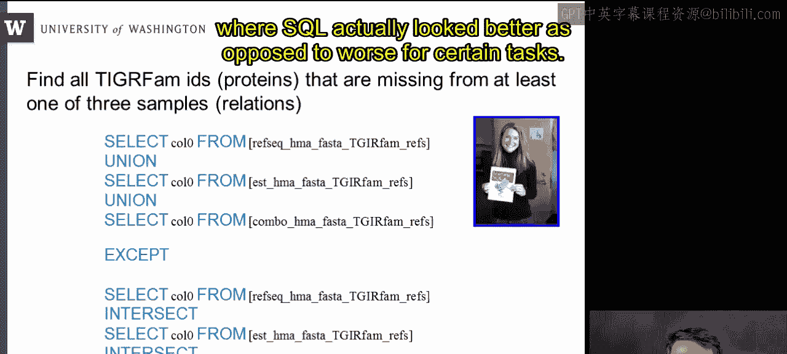

# 大规模数据科学：第2课：大数据的可重复性 🧪

在本节课中，我们将探讨在大数据背景下进行可重复性研究时面临的挑战与解决方案。核心在于理解为何传统的数据共享和代码执行方式在数据规模巨大时不再适用，以及如何通过改变数据处理范式来应对这些挑战。

---

随着数据集变得越来越大，移动数据的时代已经结束。通过互联网传输1TB数据可能需要数天，并且很可能失败。复制1PB数据在操作上几乎不可能，也不应该发生。因此，唯一的解决方案是将计算推向数据所在之处，而不是将数据移动到计算所在之处。这对于完成工作至关重要，尤其是在可重复性研究的背景下，要求他人通过将数据集复制到其“本地环境”来复现你的结果是毫无意义的。

上一节我们讨论了移动大数据的不可行性，本节中我们来看看这如何促使我们寻找新的数据存储和共享方案。

这直接促使我们将大型数据集的存储位置，设置为可以与全球所有人共享的地方。这些地方就是云服务提供商。虽然我们讨论过供应商锁定等问题，但即使你想从一个提供商迁移到另一个，他们数据中心之间拥有高速连接的可能性，也远高于你的数据中心与他们数据中心之间拥有高速连接的可能性。因此，尽管迁移困难，但在商业环境下，这更有可能实现。

---

当前，可重复性研究社区倾向于强调计算层面的可重复性，例如是否在提交论文时附上了脚本，是否将所有内容都放在了GitHub上等。他们要么不担心数据问题，要么假设数据足够小或不重要。这是一个问题。

仅仅重新执行预设的实验是不够的。这一点与我之前关于虚拟机是好主意的论点有些相悖，我们稍后会再次提及。虚拟机环境确实有助于精确复现他人运行过的内容，但它不一定能为你在此工作基础上进行构建提供太多帮助。你有一堆脚本、依赖项和已安装的库，可以运行程序，但这并不一定意味着你能理解其中的任何部分。

---

随着数据集变大和代码变得更复杂，数据库和查询开始扮演更重要的角色。你需要支持对数据进行即席的探索性问答，而不仅仅是重新运行代码。

要求他人“吃你的狗粮”，即仔细研读你的Python脚本，是很困难的。相比之下，要求他人“重新运行这个查询，然后修改查询以运行你自己的查询”，这个要求通常更低。因此，你需要的是查询而非程序，是数据库而非文件，以此来减少重新运行实验所需的代码量和认知负担。Python文件中大量与管理文件、解析文件等相关的代码，在使用数据库时都会消失。

---

因此，为研究提供数据库即服务，恰好是我们为那些不一定有丰富编程经验的“长尾”科学家们搭建的一个平台。在那里，你可以上传数据、编写查询、与朋友分享查询等，真正地将你的计算流程构建为一系列嵌套查询，并看看这能带你走多远。

我们发现，这实际上可以走得很远。大部分逻辑都可以用SQL表达，而不需要大量代码。机器学习模型、统计模型可能不适用，但很多工作都与表格操作有关。

---

我们这里有一个例子：找出所有在至少一个样本中缺失的Tigerfam ID（本质上是蛋白质标识符）。这三个样本分别来自水域的某个地点、河流或河口的某个点，以及海洋的某个点。比较这三个样本中的微生物种群，试图理解它们有何不同。问题是：找出在至少一个样本中缺失的东西。如果某个东西在三个样本中都很常见，那就不太有趣，我不关心它。如果有东西不同，我想知道。这可以简洁地表达为一个SQL查询，但却需要大量的Python代码来构建字典、读取文件、处理数据，而查询的实际逻辑很难从这个庞大的程序中剥离出来。

我们收集的这类例子表明，对于某些任务，SQL实际上看起来更好，而不是更差。

---

在本节课中，我们一起学习了大数据环境下可重复性研究的核心挑战。我们认识到移动海量数据的不切实际，从而转向将计算推向数据的云解决方案。我们探讨了仅靠共享代码和虚拟机的局限性，并强调了数据库和声明式查询（如SQL）在降低认知负担、支持探索性分析以及清晰表达数据逻辑方面的重要优势。最终，通过将数据处理流程构建为可共享和可修改的查询序列，我们可以更有效地实现和传播可重复的大数据科学研究。