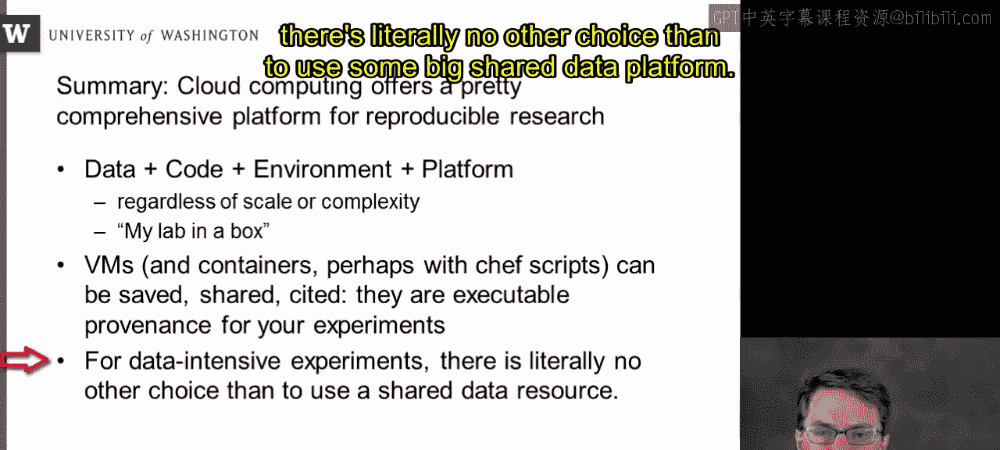

# 杜克大学《大规模数据科学（预测分析，交流数据科学结果，第2、3课⧸共3课有视频）｜Data Science at Scale》中英字幕 p114 44_反论和总结.zh_en -BV1xf421Q7bH_p114-

。

So there is a counter argument to。Uing virtual machines that I wanted to express and one person in particular that disagrees with me about this is Titus Brown。

 who's a really， really smart person who thinks very， very hard about reproducibility。

And his argument is that really， you just dumping a VM out there in the world encourages bad behavior that he's trying to work hard to convince people to not do。

 which is， you know here's all my code you figure it out。 Here's my entire crime scene， right。

You've got all the information you need to go figure it out。Good luck with that。

And that his view is reproducibility is more about building on the results of others。

 not just rerunning the exact experiments， in which case I need to have some instructions on how to。

Set up that environment or how to understand that environment。 And that transparency is not just。

Access， transparency is about documentation。Okay so I don't just want your messy environment。

 I want the full description of how to construct that environment so that I can change things as needed so that I can build my own somewhere else and actually truly kind of reproduce things in control for different variables。

Just because it works again in your virtual machine doesn't necessarily mean it's going to work again when someone else tries to actually do the experiment。

 so you actually do want to change some of the variables， you do want to have a separate lab。

Try your results and you want to have two wet lab experiments in two different locations。

 run the same and get the same result。 If you just walk into the same lab and do it。

 you don't necessarily know for sure whether you've reproduce anything。Okay。

My response to this is that the status quo is pretty terrible， reproducibility。

 there's a huge problem， nobody's sharing anything， the papers come out， there's no data。

 there's no code in data science， the same thing， you produce some result。

 but the code's hidden away， the data is hidden away。That's that's a problem to fix。

 even though so I agree with him that it' not it's not enough。

 but if we could get people all sort of sharing their virtual machines with their containers really nowadays。

That would be a big step forward， especially in this kind of long tail of data science and science that is。

 I think I think it's especially difficult for them to。

Do what what Titus and others are asking them to do right to acquire all those skills required to be a perfectly good citizen using Github for all your code and。

You know， Amazon for all your shared platforms for all your data and so on。Okay。

 the other problem that is sometimes leviage is that VMs are kind of a terrible beast right It's this big bloated thing and now I've got 50 of them for every different experiment I had。

 and I want to combine ideas from his experiment and her experiment and I can't put them together in a particular way。

 I end up having to sort of tear them apart anyway。

 but this problem is kind of going away because containers are solving it。

 this is one of the exact problems that containers are designed to solve。Okay。

So my summary here is that。Cloud computing offers a pretty comprehensive platform for reproducible research。

 and the centralization represented by cloud computing is maybe replicable in other ways besides literally using Amazon because in some industries or some context that may not be feasible。

But I think it ticks all the boxes and this was just a way to present some of the boxes that need to be ticked and these are data plus code plus environment plus the entire platform on which to run all that data and code environment is provided by these cloud services。

You know， regardless of scale。喂。Mgabytes to petabytes。Long running computations to simple scripts。

Regardless of complexity， large heterogeneous architectures， all this is supported。

 all these are common problems， they're all being addressed， you know it's really my entire lab。

 my entire resources， my lab bench is your lab bench right I have access to all these great tools in the cloud and you have access to the same ones by definition because it's a third partyy service。

Okay， and VMs and containers， perhaps combined with chef scripts can be shared， saved inside of。

 there's these digital artifacts that represent your research。

 They become executable providence for your experiments as opposed to just a description of how to set up the environment。

 they're actually executable units that can。Be run just to recreate the lab。Okay。

And then for data intensive experiments， there's literally no other choice than to use some big shared data platform because you can't move data around at certain scales。

