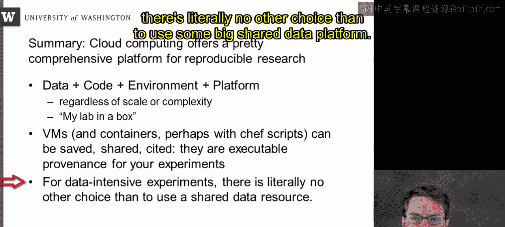

# 大规模数据科学：第2课：反论与总结

## 📖 概述
在本节课中，我们将探讨关于使用虚拟机（VM）和容器技术来确保研究可重复性的不同观点。我们将介绍一位专家提出的反论，分析其核心论点，并最终总结云计算平台如何为可重复研究提供一个全面的解决方案。

---

## 🔍 关于虚拟机使用的反论
上一节我们介绍了使用虚拟机来封装研究环境以促进可重复性的优点。本节中，我们来看看对此方法的一个主要反对观点。

提出这一反论的是Titus Brown，他是一位深入思考研究可重复性问题的专家。

他的核心论点是，仅仅将虚拟机公之于众，实际上是在鼓励一种不良行为。他努力说服人们避免这种行为，即研究者只是说：“这是我的所有代码，你自己去弄明白吧。” 这就像提供了一个完整的“犯罪现场”，虽然包含了所有信息，但缺乏指引。

Titus Brown的观点是，可重复性更多地关乎在他人的成果基础上进行构建，而不仅仅是原封不动地重新运行完全相同的实验。因此，研究者需要提供关于如何**设置**或**理解**那个环境的说明。透明度不仅仅是**访问权限**，更是关于**文档记录**。

他进一步阐述，研究者需要的不是一个杂乱的环境本身，而是如何**构建**那个环境的完整描述。这样，其他人才能根据需要修改环境，在其他地方建立自己的环境，并真正控制不同变量以实现复现。

仅仅因为实验在你的虚拟机中能再次运行，并不必然意味着当其他人尝试实际操作时也能成功。因此，研究者实际上希望改变一些变量，希望有独立的实验室来验证结果，就像希望两个不同地点的湿实验室实验能运行并得到相同结果一样。如果只是在同一个实验室里重复操作，并不能完全确定是否真正实现了复现。

---

## 🤔 对反论的回应
针对上述观点，我的回应如下。

当前研究可重复性的现状相当糟糕，存在巨大问题。在数据科学领域，情况类似：论文发表了，但数据和代码往往被隐藏起来。这是一个亟待解决的问题。

我同意Titus的观点，即仅分享虚拟机是**不够的**。然而，如果我们能让人们广泛地分享他们的虚拟机或容器（在当今时代主要指容器），这将是一个巨大的进步。特别是对于数据科学和科学研究中的“长尾”部分（指大量的小型、非主流研究），要求他们完全掌握使用GitHub管理所有代码、使用亚马逊等平台共享所有数据等技能，并成为完美的“科研公民”，是尤其困难的。

有时被提及的另一个问题是，虚拟机本身可能是一个“庞然大物”。如果我为每个不同实验都保存了50个虚拟机，当我想结合来自不同实验的想法时，可能无法以特定方式将它们合并，最终不得不将它们拆解。但这个问题正在逐渐消失，因为**容器技术**正是为解决这类问题而设计的。

---

## ✅ 总结与核心方案
本节课中我们一起学习了关于可重复性方法的辩论。现在，我们来总结云计算提供的解决方案。

云计算为可重复研究提供了一个相当全面的平台。云计算所代表的集中化模式，也许可以通过其他方式复制，而不一定非要使用亚马逊等具体服务，因为在某些行业或背景下这可能不可行。但我认为它满足了所有关键要求。

以下是实现可重复研究需要满足的核心条件，云计算平台能够全面支持：

*   **数据 + 代码 + 环境**：研究的所有组成部分。
*   **运行平台**：用于运行上述数据、代码和环境的完整平台，由云服务提供。

无论规模大小（从**MB到PB**），无论计算类型（从**长时间运行的计算到简单脚本**），无论架构复杂度如何（大型异构架构），云计算都能提供支持。这些都是常见问题，并且正在被解决。

本质上，我的整个实验室资源，我的“实验台”，就是你的“实验台”。我能在云中访问所有这些强大的工具，而根据定义，因为是第三方服务，你也能访问完全相同的工具。

**虚拟机**和**容器**（或许结合Chef等配置脚本）可以被共享和保存。这些数字制品代表了你的研究。它们成为了你实验的**可执行证明**，而不仅仅是环境设置的描述。它们实际上是**可执行的单元**，可以直接运行以重现整个实验环境。

最后，对于数据密集型的实验，除了使用某种大型共享数据平台之外，几乎没有其他选择，因为在某些数据规模下，移动数据是不现实的。

---

**本节课中，我们一起探讨了关于使用虚拟机确保可重复性的反论，理解了透明度与文档的重要性，并最终总结了云计算及其容器技术如何为不同规模与复杂度的研究提供了一个强大、共享且可执行的可重复性解决方案。**