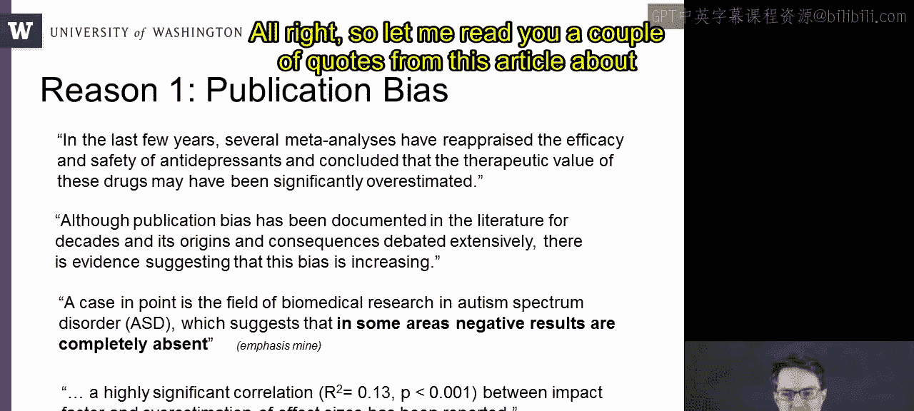
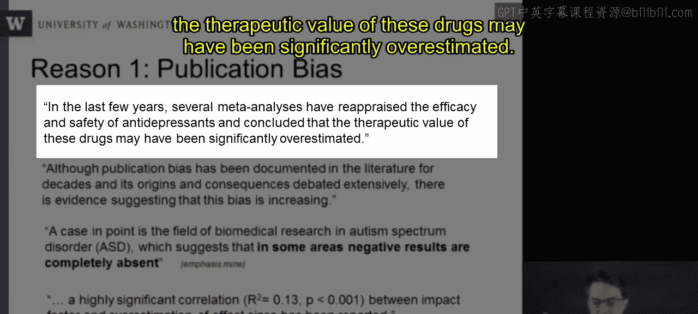
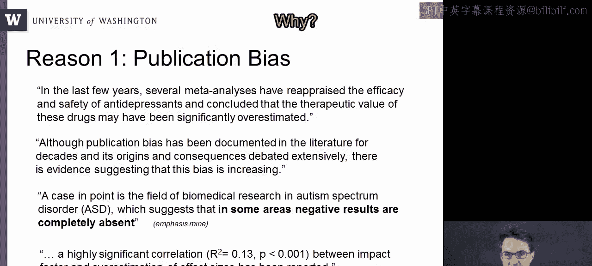
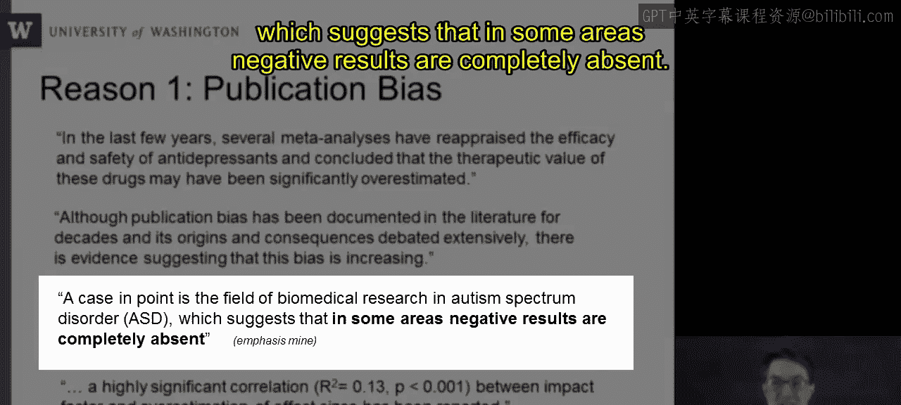
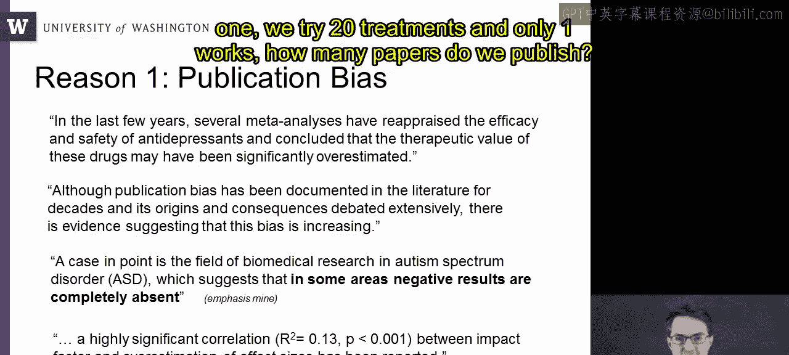
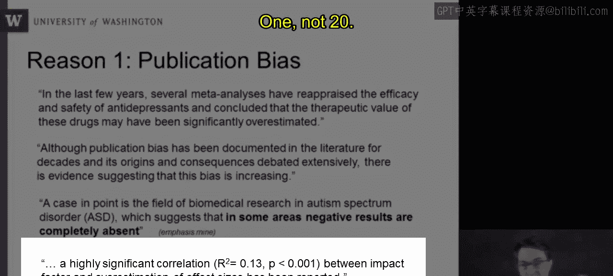
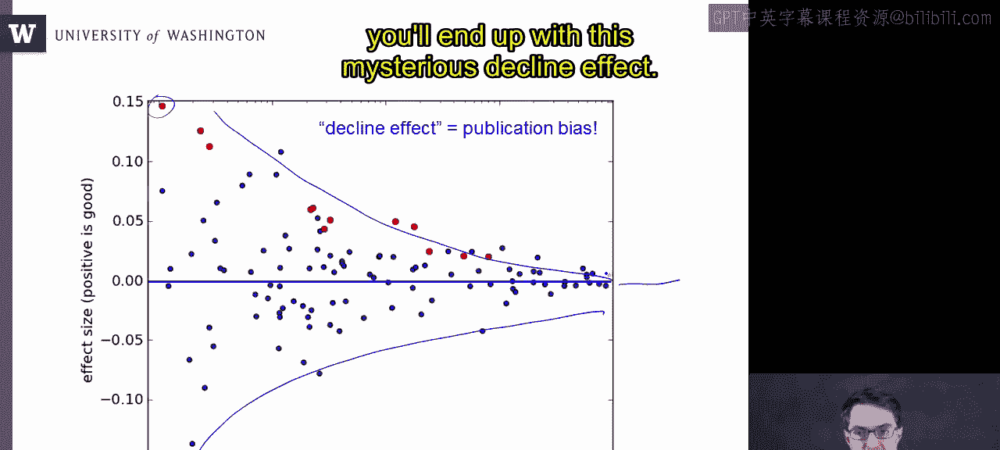

# 杜克大学《大规模数据科学（预测分析，交流数据科学结果，第2、3课⧸共3课有视频）｜Data Science at Scale》中英字幕 p12 11_重新审视坏科学：发表偏差.zh_en -BV1xf421Q7bH_p12-

。

So now that you're armed with a little bit of basic terminology， let's go back to。This first slide。

From this New York article。 And so the question that we raised was。

What accounts for this truth wearing off effect， how can we explain what's going on？ok。

So one reason is publication bias。All right， so let me read you a couple of quotes from this article about publication bias。

 so in the last few years's several meta analyses and we'll talk about what amount metaanalysis is in a little bit have reappraised the efficacy and safety of antidepressants and concluded the therapeutic value of these drugs may have been significantly overestimated。

Although public and there's other examples in this article as well。

So go back and review the literature and find out that。Things have been overstated。Wai。

So although publication bias has been documented in the literature for decades and origins and consequences are debated extensively。

 there is evidence suggesting that this bias is increasing。

All rightSo I haven't told you what publication bias is yet。

 but you may be familiar with the concept and these are some of the effects。

So a case in point in the field of biomedical research and autism spectrum disorder。

 which suggests that in some areas， negative results are completely absent。

All， so what does that mean， That means that you're only publishing papers that show significant positive gains。

 right if we try several treatments and none of them work except for one。

We try 20 treatments and only one works， how many papers we publish， one， not 20。

ok。So how is this a problem？So do we have an explanation for this decline effect？

With publication bias， so how does this actually work？

Let's make a plot where this study size is on the X axis and notice this is log scale so this is 10 and this is 100。

And this is  a thousand and so on， right？Well， study size meaning the number of patients that are involved in the study。

So the bigger the study size， the more statistical power you have。

 and will'll define what statistical power means precisely in a bit。

But the better you are able to determine actual effects， right？

And the assumption here is perhaps that as time goes on and you see some results。

You are able to you or other researchers are able to garner more money。

 more funding to do larger and larger studies right so this is maybe phase one， phase two。

 phase three trials of some new drug， they get bigger and bigger and bigger sets of patients as you get more momentum momentum behind it。

And this， this data is not real。 This data is simulated。

 But imagine you see this kind of decline effect where the results， Okay， well， the what sorry。

 the y axis， the y axis is the effect size。 And we'll talk about what the effect size is。

Precisely in a little while。 But this is the degree of positive outcome。 Let's say， right。

 let's say negative is bad and positive is good。So this is the number of smokers you were able to convince to quit with some。

Intervention counseling method。Or the number of white blood cells。

Increased as a result of some treatment or so on。So positive is good。 Well， this decline effect。

 let's imagine。Shows this sort of a pattern， right。

 where were the early studies with just with just 10。Participants is up here。

 and as the study went up， it sort of got worse and worse and worse。

So this is the effect that we see， how do we explain this？Well。This is directly explainable。

 this kind of an effect would be directly explainable just by publication bias。😡，Right。

 imagine that every dot now is a test that was done by some group somewhere。For this phenomenon。

What you'd expect is。This kind of funnel shape where。

 where the studies get more and more accurate as you get larger and larger and larger， right。

 And they will。 with a start， this is this is。You can't get around this right as the exercise size goes up。

 you do have more statistical power， you're able to better discriminate real effects from false effects and so on。

 But you'll notice that the actual effect that it's regressing to here is 0。0。 There is no effect。

And yet， of course， you're going to get some just due to variability out here。

 And so if you only report the positive ones。You。

End up with this mysterious decline effect。