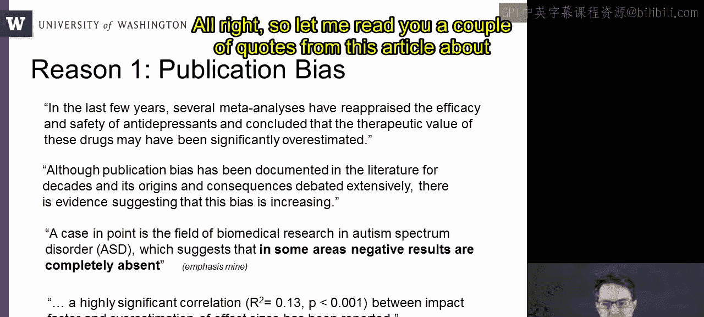
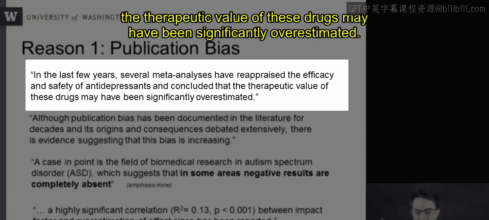
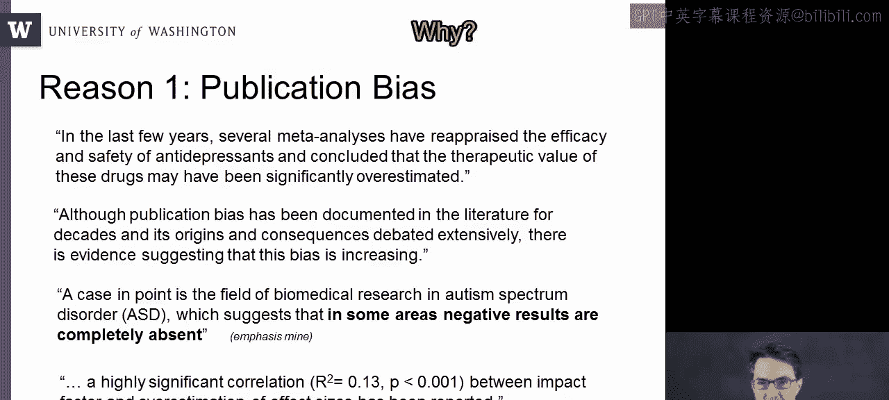
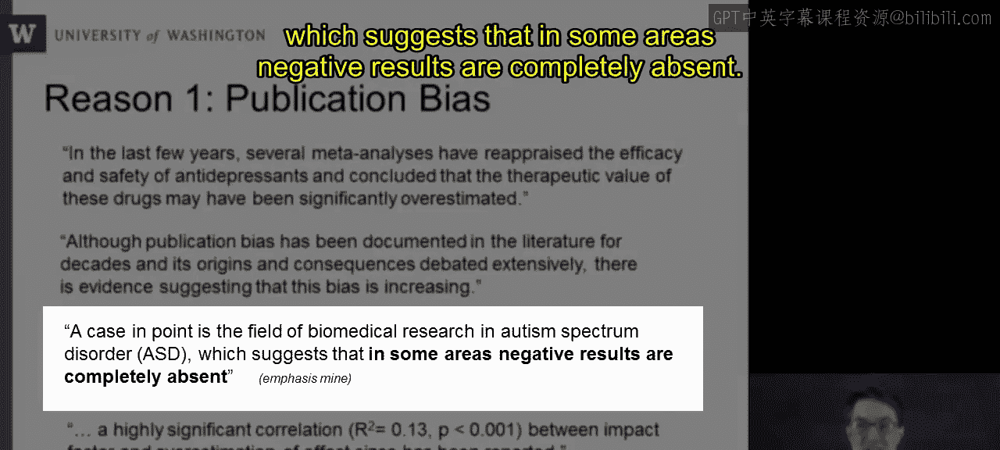
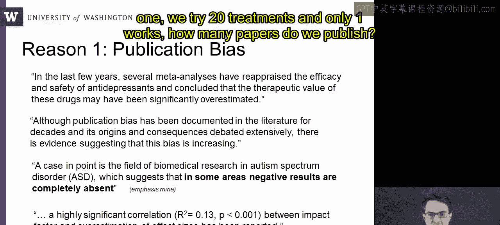
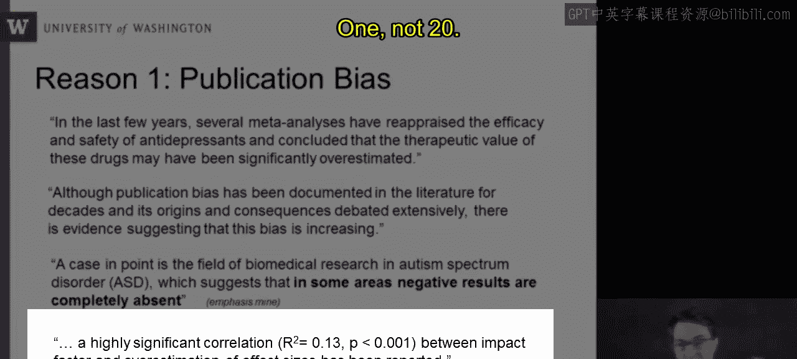
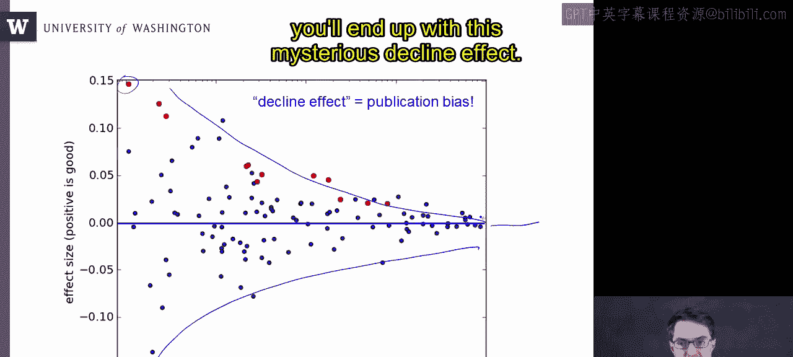

# 大规模数据科学（预测分析，交流数据科学结果）：第2课：重新审视坏科学：发表偏差 📉

在本节课中，我们将探讨一个在科学研究中常见的问题——发表偏差。我们将了解它的定义、成因，以及它如何导致“真相衰退效应”。通过简单的图表和概念，我们将揭示为什么某些研究结果会随着时间推移而显得不再那么有效。

现在你已经掌握了一些基本术语，让我们回到最初来自《纽约客》文章的那张幻灯片。我们提出的问题是：什么原因导致了这种“真相衰退效应”？我们如何解释正在发生的情况？

一个重要的原因是**发表偏差**。以下是文章中关于发表偏差的引述：过去几年，几项元分析（我们稍后会讨论元分析是什么）重新评估了抗抑郁药的疗效和安全性，并得出结论，这些药物的治疗价值可能被显著高估了。这篇文章中还有其他例子，回顾文献会发现，许多结论都被夸大了。

尽管发表偏差在文献中已被记录了几十年，其起源和后果也备受争议，但有证据表明这种偏差正在加剧。我还没有告诉你发表偏差具体是什么，但你可能已经熟悉这个概念，并且看到了它的一些影响。

一个典型的例子是生物医学研究和自闭症谱系障碍领域，在某些领域，负面结果的研究完全缺失。这意味着什么？这意味着只有显示显著积极效果的研究论文才会被发表。如果我们尝试了多种治疗方法，只有一种有效，我们尝试了20种，只有一种有效，我们会发表多少篇论文？一篇，而不是二十篇。

那么，这如何成为一个问题？我们能用发表偏差来解释这种衰退效应吗？它是如何实际运作的？

让我们绘制一个图表，其中X轴是研究规模（请注意这是对数刻度，所以这里是10，这里是100，这里是1000，依此类推）。研究规模指的是研究中涉及的患者数量。研究规模越大，你拥有的统计功效就越高（我们稍后会准确定义统计功效的含义），你也就越能确定实际效果。这里的假设可能是，随着时间的推移，当你看到一些结果后，你或其他研究人员能够获得更多资金，进行越来越大规模的研究。这就像某种新药的I期、II期、III期临床试验，随着研究的推进，患者群体越来越大。

以下数据是模拟的，但想象你看到了这种衰退效应。Y轴是**效应量**（我们稍后会准确定义效应量）。这指的是积极结果的程度。假设负值代表不好，正值代表好。例如，通过某种干预或咨询方法成功说服戒烟的人数，或者某种治疗后白细胞增加的数量。正值代表好。

这种衰退效应可能呈现出这样一种模式：早期只有10名参与者的研究显示很高的效应量，随着研究规模增大，效应量似乎变得越来越差。我们如何解释这种现象？

这种现象可以直接用发表偏差来解释。想象现在图表上的每个点，都代表了某个研究团队针对该现象所做的一次测试。你期望看到的是漏斗形状：随着研究规模越来越大，研究结果也越来越精确。这是无法回避的——随着样本量增加，统计功效更高，你越能更好地区分真实效应和虚假效应。

但你会注意到，这些点最终回归到的实际效应值是0.0，即没有效应。然而，由于变异性，在外围（小样本研究）你当然会得到一些（偶然的）正值结果。如果你只报告那些积极的结果，最终就会得到这种神秘的衰退效应图。

以下是发表偏差如何导致衰退效应的关键点：

*   **小样本研究的变异性**：小规模研究由于样本量小，结果更容易受偶然因素影响，可能偶然得出一个较大的效应量（正值）。
*   **选择性发表**：只有显示出显著积极结果的研究（通常是那些偶然得出大效应量的小样本研究）更容易被发表。
*   **大样本研究的精确性**：大规模研究结果更稳定、更精确，更可能接近真实的效应值（在这个例子中是0）。
*   **观察到的模式**：随着时间的推移，当后续进行更大规模的研究时，发表出来的效应量就会逐渐“衰退”，趋向于真实的零效应，从而形成了从左上到右下的衰退趋势。

本节课中，我们一起学习了**发表偏差**的概念。我们看到，由于研究者、期刊倾向于发表具有统计显著性的积极结果，而忽略阴性或不显著的结果，会导致对某现象真实效应的估计产生系统性偏差。这种偏差可以完美地解释为何某些早期轰动性的研究发现，会在后续更大规模的研究中效应量逐渐减小甚至消失，即“真相衰退效应”。理解这一点对于批判性地评估科学文献和新闻报道至关重要。