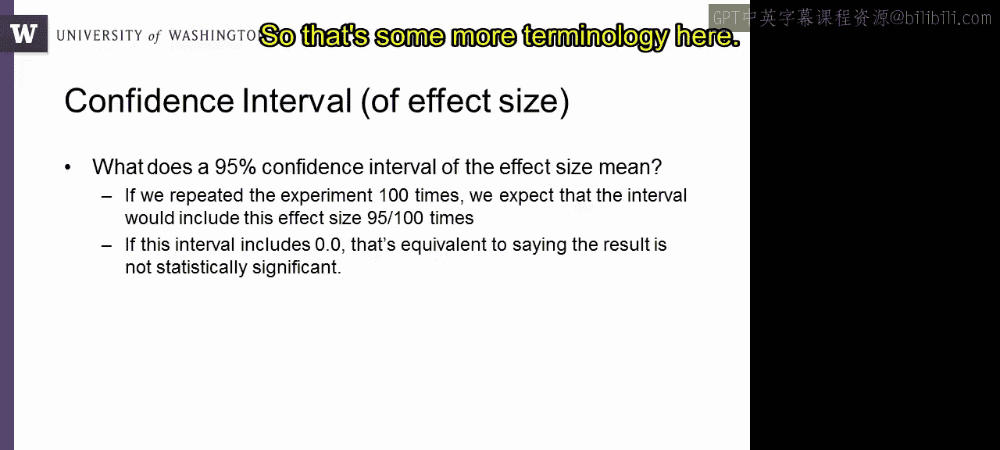

# 杜克大学《大规模数据科学（预测分析，交流数据科学结果，第2、3课⧸共3课有视频）｜Data Science at Scale》中英字幕 p13 12_效应量.zh_en -BV1xf421Q7bH_p13-

。

Okay， so we talked about publication bias and on the y axis of that plot， we had effect size。

 so what is effect size？Well， it， you know， if you call P value was just the probability of in repeated experiments getting an effect of at least that size or more extreme。

 Okay， And so all it tells you is yes or no， whether it was significant， according to some threshold。

 It doesn't tell you how。You know， significant was or how important it was。Okay。

 and that's what effect size tries to capture。 So the effect size in a。

Situation where you're comparing the mes of experimental group and control group。

 then the effect size is the mean of the experimental group minus the mean of the control group divided by the standard deviation。

And so this tells you not just significant， but how significant。

 And this measure is used prolifically in meta analysis to combine results from multiple studies and it's。

Useful to help standardize across studies with different parameters。

 different sample sizes in particular， for example， Okay and so in general。

 you have to be careful with this because average results from different experiments can produce nonsense if you sort of violate the assumptions under which the experiments were conducted。

 but。You know， it can be done Okay， and so another caveat here is that there's other definitions of effect size exist。

 There's odds ratio and correlation coefficient， but we're just going to talk about this one。

And so there's an argument here that the effects size should always be reported along with the P value。

 even though this is very rarely done， and that argument is delivered by Robert Coh in this paper presented at the annual conference of the British Educational Research Association in 2002 that's cited here at the bottom of the slide。

A little more precisely， the effect size of the standardized mean difference。Where the group one。

 mean of group one minus the group of two divided by， we said the standard deviation。

 and here I'm writing this as the standard deviation subpooled。Okay， and there's lots of ways to。

Computer value for this notion of pooled。 One simple way is just to take this inter deviation of the control group。

And you know one by one argument here， hey， the variation is supposed to be the same because the sample。

 the two groups are drawn from the same population。Okay。Another way is。To compute。

The actual pooled standard deviation， which is an expression that looks like this。

 and so we're not going to go into much more detail than that。

But just to point out that the overall notion is pretty simple and that it's。

Not unreasonable to use a straightforward definition of the standard deviation。

 So what's a big effect size， Well because it is standardized， you could。

 you can actually reason about what might be big and what might be small。 So this is， again。

 one of these cases where it's sort of made up on the fly， but you can。啊。

One heuristic by Jacob Cohen is a small effect size is 0。2。 A medium effect size is 0。

5 and a large effect size is 08。 So for， you know。Remember。

 this is dividing by the standard deviation。 So this is sort of for every。Bit of difference in mean。

How much variances are you accounting for？O。And then finally。

 I'm not going to talk too much detail about confidence intervals。

 but do you want to mention that the confidence interval the effect size just to give you the intuition for this so。

An advantage here is that these are。Maybe easier to interpret in terms of actual decision making。

 So what does the 95% confidence interval of the effect size mean。

 While it means that repeated the experiment 100 times。

 we expect that the that interval would include。This particular effect size measured in this experiment。

 95 out of 100 times。A corollary of this is that if that interval if the 95% constant from the interval includes 0。

0。That's equivalent to saying that that the result is not statistically significant。 That means that。

90% of the time that interval would include no effect whatsoever。And。

Equivalently if that interval does not include 0。0。Then it is statistically significant。

Some more terminology here。