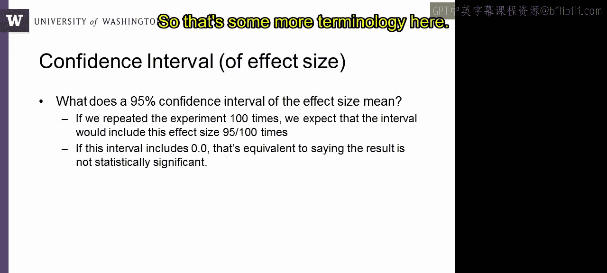

# 大规模数据科学：第2课：效应量 📊

在本节课中，我们将要学习效应量（Effect Size）的概念。效应量是衡量研究结果实际重要性的指标，而不仅仅是统计显著性。我们将探讨其定义、计算方法、常见标准，以及与置信区间的关系。

## 概述

上一节我们讨论了发表偏倚（Publication Bias），其图表纵轴使用了效应量。那么，什么是效应量？P值仅表示在重复实验中观察到至少同等或更极端效应的概率，它只回答“是否显著”的问题，而不说明“有多显著”或“有多重要”。效应量正是试图捕捉这种重要性程度的指标。

## 效应量的定义与计算

在比较实验组和对照组均值的情境下，效应量的定义如下：

**效应量 = (实验组均值 - 对照组均值) / 标准差**

这个公式不仅告诉你结果是否显著，还告诉你显著的程度。效应量在元分析（Meta-analysis）中被广泛用于合并多项研究的结果，它有助于标准化不同参数（尤其是不同样本量）的研究。

使用效应量时需要谨慎，因为如果违背了实验进行时的假设，对不同实验的平均结果进行合并可能会产生无意义的结果。此外，效应量还有其他定义，如比值比（Odds Ratio）和相关系数（Correlation Coefficient），但本节我们只讨论上述定义。

有一种观点认为，效应量应始终与P值一同报告，尽管这种做法目前非常少见。这一观点由Robert Coh在2002年英国教育研究协会年会上发表的论文中提出，该论文已在本幻灯片底部引用。

更精确地说，我们讨论的是标准化均值差的效应量。其计算公式为：

**效应量 = (组1均值 - 组2均值) / 合并标准差**

这里的“合并标准差”有多种计算方式。一种简单的方法是直接使用对照组的标准差。其依据是，由于两组样本来自同一总体，其变异度理应相同。另一种方法是计算实际的合并标准差，其表达式如下：

**合并标准差 = √[((n₁-1)*s₁² + (n₂-1)*s₂²) / (n₁ + n₂ - 2)]**

我们不会深入更多细节，但需要指出，总体概念相当简单，使用直接的标准差定义是合理的。

## 效应量的标准

由于效应量是标准化的，我们可以推理什么是大效应量，什么是小效应量。以下是Jacob Cohen提出的一个经验法则：

以下是效应量大小的经验分类：
*   **小效应量**：0.2
*   **中等效应量**：0.5
*   **大效应量**：0.8

请记住，效应量是均值差除以标准差。因此，它衡量的是，相对于数据的波动（方差），均值差异有多大。

## 效应量的置信区间

最后，我们简要提及效应量的置信区间，以帮助建立直观理解。置信区间的一个优势是，它可能更容易根据实际决策进行解释。

效应量的95%置信区间意味着：如果将实验重复100次，我们预计该区间会在95次中包含本次实验测量到的这个特定效应量。

由此可以得出一个推论：**如果该95%置信区间包含0，则等价于该结果在统计上不显著**。这意味着，在95%的情况下，该区间会包含“无效应”的情况。

反之，**如果该区间不包含0，则结果在统计上是显著的**。

## 总结

本节课中，我们一起学习了效应量的核心概念。我们了解到，效应量是衡量实验结果实际规模或重要性的标准化指标，计算公式为均值差除以标准差。我们介绍了Jacob Cohen提出的判断效应量大小的经验标准（小：0.2，中：0.5，大：0.8），并探讨了效应量置信区间的含义及其与统计显著性的关系。理解效应量有助于我们超越简单的“是否显著”，更全面地评估研究发现的实际意义。