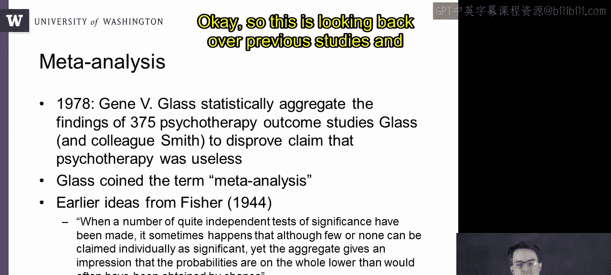
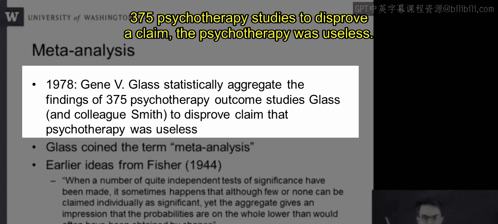
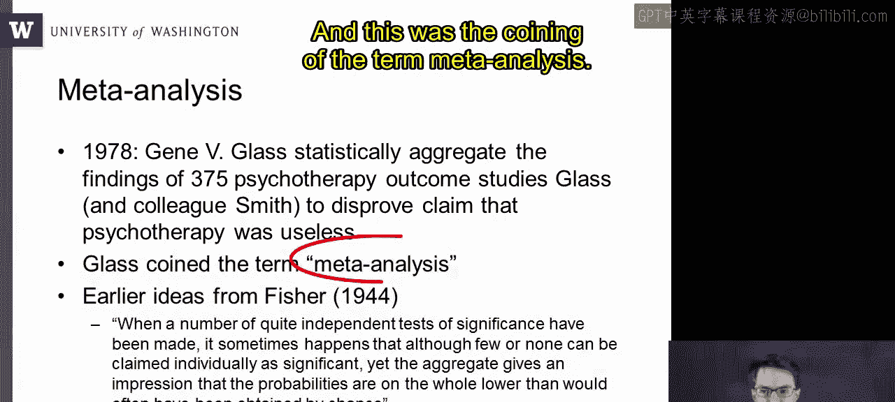
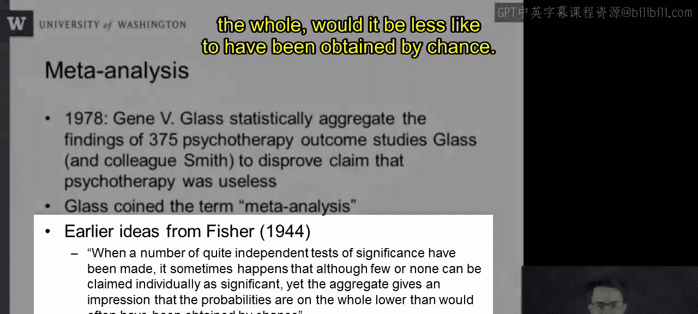
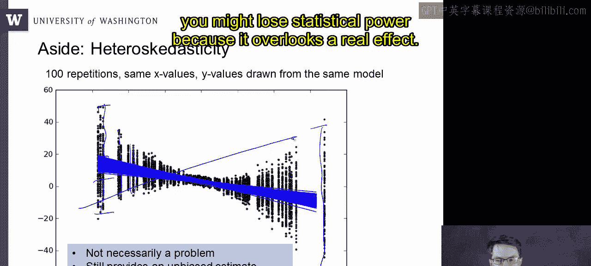

# 杜克大学《大规模数据科学（预测分析，交流数据科学结果，第2、3课⧸共3课有视频）｜Data Science at Scale》中英字幕 p14 13_元分析.zh_en -BV1xf421Q7bH_p14-

。

In talking about publication bias was the idea of a meta analysis。Okay。

 so this is looking back over previous studies and combining their results。 And so in 1978。

 glass sort of statistically aggregated the findings of。

325 psychotherapy studies。

To just prove a claim that psychotherapytherapy was useless。

 And this was the coining of the term meta analysis。

 And this built on early ideas from other statisticians， including。

Fisher。Who has this quote， You know， when a number of quite independent tests of significance have been made。

 it sometimes happens that although few or none can be claimed individually as significant。

 the aggregate gives the impression the probability is on the whole。Would have。

Be less likely to have been attained by chance。 Okay， so this is individually look weak。

 but we can aggregate them to get a more powerful。

Result。Okay and so reason I want to bring this up， this idea of meta analysis that it becomes even more important in the context of data science because you'll often be working with data that you did not yourself collect and so thinking of it as a meta analysis experiment is potentially useful。

And then another point is， you know that big data may have become big because it was combined from multiple different sources。

Understanding you when this is okay to do a win this isn't。Is important。

So how do we do this meta analysis？It's pretty simple。

 You just want to take a weighted average of the。Independent。Studies。Okay。

And you want to give so how do you want to define the weights， Well。

 you can define it different ways， but you want to give the weight to the more precise studies when possible。

 the ones with that have more power。So a very simple method is just weight by the sample size。

RightAnd so this expression here is the。系。Number in your group。

 so the weight for a group for a study I is the number of samples in study I over the sum of all the samples。

The total sample size。More sophisticated way is to use the inverse variance weight。

 which is one over the standard error squared。 And I'm not going to give you the formula for standard error。

 You can look it up。 but there's also， but there's lots of variances here。 The main idea is to。

Understand why it's called infer variance variance I that if the variance is very， very high on a。

Study， you want to give that lower weight。 right， That means it wasn't a very precise study。

 and this could be because the sample size was low。Or it could be for other reasons。Okay。

 and the standard error。Is one common method of of。

Associating with the variance in this particular case。 But again。

 it's important to understand the intuition rather than just memorizing the formulas。And then again。

 as usual there's a caveat here， this is all for a fixed effect model。

 it assumes that every individual study is measuring the same true effect。

 and there is random effects models that help account for the fact when they may not be。

And we're not going to talk about random effect models。Okay。So finally。

 one more term talked that was brought up in the context of publication bias was sorry。

 I didn't bring up the term， but one more effect that you saw in the plot。Was。This funnel plot。

 if you remember， the funnel plot was high variance on one side。

 and it went to lower variance on the other。 And so the general term for this that I just wanted to introduce you to heterochasticity。

 Okay， And so this is when the variance itself。Is not constant。So here， as an example。

 the variance is high。The variance is high over here and low in the middle。And high again over here。

Now， this is not necessarily a problem。 There are ways to correct for this。

 but it's not necessarily a problem， because the。Estimates that you'll generate are still unbiased。

But it can increase overall error estimates leading to a reduction in statistical power so you end up with this really high error numbers because all these guys count against you。

Even though you're actually doing a pretty good job in predictions。

So I just say how this plot was generated。Again， simulated data。Where。You know。

 I intentionally sort of varied the。Variance along the x axis。Okay。

 so chose chose some x values then and then sampled y values according to some distribution that varies in this way。

 And here I just took the exact same x values， but repeated the sampling of the y values many， many。

 many times。 So it gave me this clearer spread。 But you can see these solid bars。

A because the same x values were you use across all the experiments。And the point here is that。

Drawing the regression line over and over again。It didn't change all that much。Okay。

We didn't get anything that looked like this， for example。So again。

 the problem here is that you might increase the air and you might lose statistical power because it overlooks a real effect。

