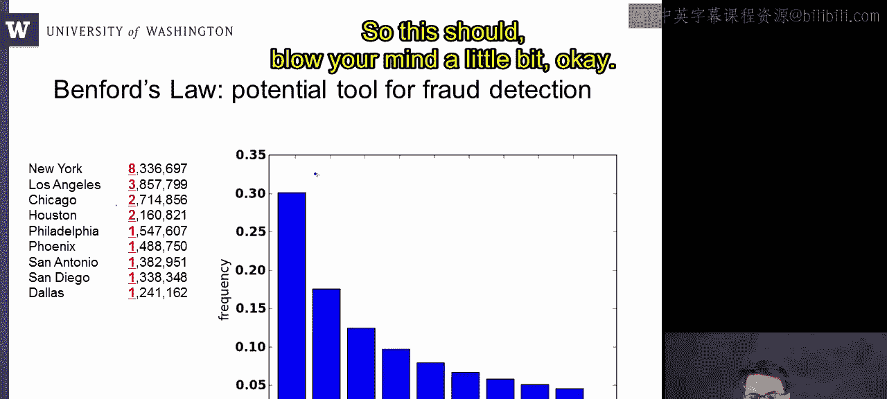

# 杜克大学《大规模数据科学（预测分析，交流数据科学结果，第2、3课⧸共3课有视频）｜Data Science at Scale》中英字幕 p15 14_欺诈和本福特定律.zh_en -BV1xf421Q7bH_p15-

。

Okay。So what's the second reason for this decline effect for the truth wearing off？Well。

 another one is just。People make mistakes， and in some cases， there's instances of fraud。

And so there's some evidence here that these kinds of things are going up as well as measured。

One way to measure this is by the number of paper retractions and the number of retractions has gone up fairly significantly。

 as Norden pointed out in 2011 in an article in nature。

 so from the period of time 2001 to 2011 there's been a  tenfold increase in number of paper attractionions。

 but only a 1。44fold increase in themselves。Okay and so this plot is from two different repositories。

 PubMed and web of science， neither one of which can include computer science papers， by the way。

But you can see this's gone up pretty significantly。Fine。

So not going to dive into too much detail into this phenomenon。

 but I do want to give you one statistical tool that is sometimes used to detect fraud and that's。

Binford's Law。Okay。So if you're not familiar with Binford's law， it's。A fun one to be familiar with。

 So this。Law predicts the distribution。Of the first digit。Of data。Okay。And。

If you think about it without。If you think about it without thinking too deeply。

You might intuitively think that this would be fairly uniform if you have random data。

You might see an equal number of8s and an equal number of threes an equal number of。Tos and so on。

But it turns out that the distribution is not。Random in some circumstances， in many circumstances。

Well， it' its not even。 I should say it is random。 It's is not even。

 The distribution looks more like this。 You will get more ones in the first position than you will。

 twos and more twos than threes and so on。 And so up to 30% of the numbers you measure are ones。

So this should。You know。Blow your mind a little bit。Okay， so some examples of this。

 before we explain what's going on， taken from there's a nice website testingbinfordlaw。

com where they pull real data in and show the plots。

 this is the number of Twitter users by their by the number of followers they have sorry not the number of Twitter users by the number of followers they have。

ok。So the list of numbers is just the number of followers。

The number of Twitter user to have whose number of followers begins with the digit1 is 32。62%。

 If you can see that。 And the red dot is the prediction made by Bford's law。 So not too bad。

 The number of。Instances with that have their two is leading digit。Is 16。

66% and there's the red dot predicted by Boer's Law and so on， so not too bad。The distance of stars。

From Earth in light years。Follow a similar pattern， this is remarkably。

Close to Benfer's law prediction。Government spending in the UK between the period of time May through September。

 2010。Again， remarkable prediction。 Now， you might imagine there's some selection bias on this particular website。

 and I can't guarantee that there's not， but。You know， with some reading。

 plus a little bit of trust that I hopefully have built up。I hope to convince you that this is not。

啊好。Fully explainable by this website choosing particular data sets for which this is true。Okay。

Google Book the number of unique one grams， and we talked about one grams several a couple of weeks ago。

Terms essentially what1 grams are。

Okay， again， pretty good prediction。