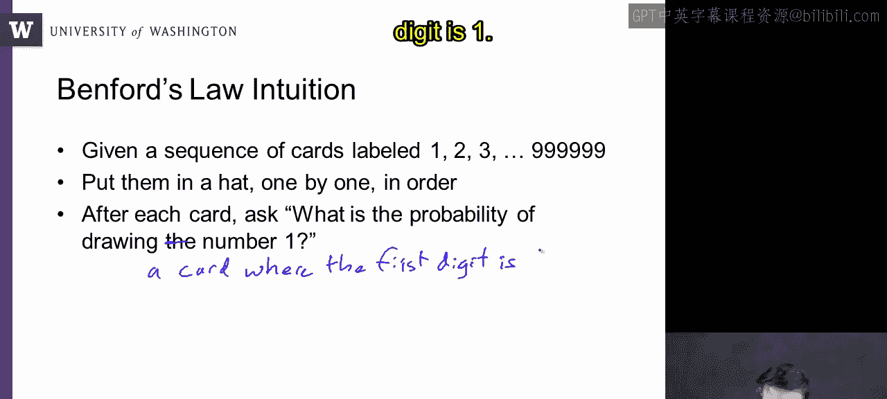

# 杜克大学《大规模数据科学（预测分析，交流数据科学结果，第2、3课⧸共3课有视频）｜Data Science at Scale》中英字幕 p16 15_本福特定律的直觉.zh_en -BV1xf421Q7bH_p16-

。

So before we say before we give the intuition for this， the inturusition is a little bit tricky。

 but before we attempt to give the intuition for this。You can use it to detect fraud。

 And so this was attempted in or this was an experiment was done by Deekan in 2007。

To see if this could be used for detecting scientific。Frad， and so what he found was。

The first and second digits of published statistical estimates were approximately beenford distributed in real studies。

Okay， or at the very least， they had kind of a monochotonically decreasing distribution。

 so ones more ones and twos and more twos and threes and so on， if not exactly Benfords law。

And then what he did is ask subjects to manufacture。Regression coefficients。You know。

 basically fitting a line manually。And found that the first digits were actually hard to detect as anomalous。

 but that the second and third digits deviated from expected distributions。

 And so this distribution that I gave you in the last few slides。

 and that I gave you in the actual formula here。 So the distribution that we'll be discussing is only for the first digit。

 And the skew in that distribution actually gets suppressed as you go to the second and third digits。

 But denford's law can also be used to express different。Yet， still measurable。

Distributions of a second and third digits。And so there， the second and third dig is deviated。

Significantly， and so the conclusion was this is it is potential potentially useful as a fraud detection tool in scientific data。

 and there are instances where Binford's law has been admissible as evidence in court in cases of fraud and it's been used。

By reporters and of to argue for evidence of fraud in cases of voting election and other kinds of accounting data on the sort of global scene。

 okay。So what's going on here？One way to think about the intuition here is imagine a sequence of cards labeled with a particular number。

1，2，3，4，5， all the way up to you know， 999，999 and so put them one by one in a hat in order。

And every time you throw a card in， measure the probability。

That a random selection from the hat would produce a card where the first digit is won。Sorry。

 this isn't very well said its。It's not drawing the number one drawing。A card。Where。The first。

Digit is。

1。