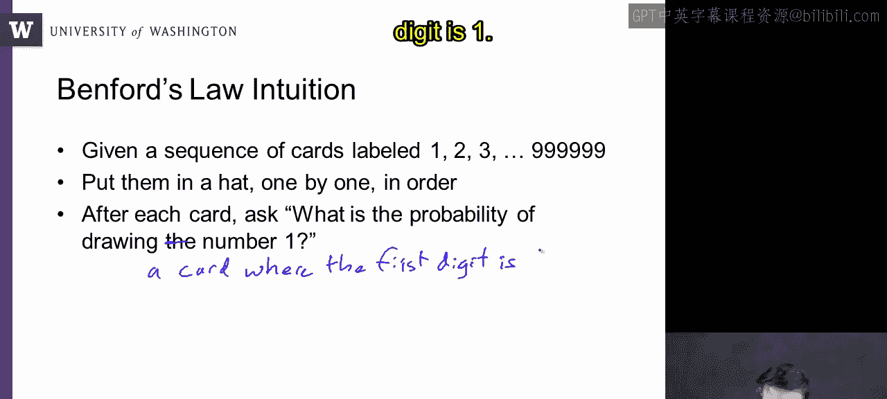

# 大规模数据科学：第2课：本福特定律的直觉 🧮

在本节课中，我们将探讨本福特定律背后的直觉，并了解它如何被应用于检测数据中的异常或欺诈行为。

上一节我们介绍了本福特定律的基本概念和公式，本节中我们来看看其背后的逻辑以及实际应用。

## 应用：欺诈检测

本福特定律可用于检测欺诈行为。迪肯在2007年进行了一项实验，旨在探索该定律是否可用于检测科学数据中的欺诈。

以下是该实验的主要发现：
*   在真实的研究中，已发表的统计估计值的第一位和第二位数字大致符合本福特定律分布。
*   至少，这些数字的分布呈现出单调递减的趋势（即数字1的出现频率高于2，2高于3，依此类推），即使不完全符合本福特定律的精确比例。
*   当要求实验对象手动“制造”回归系数（即手动拟合一条线）时，他们数据的第一位数字很难被检测为异常。
*   然而，他们数据的第二位和第三位数字的分布，则显著偏离了预期的分布。

我们之前讨论的分布和给出的公式，仅适用于数字的第一位。这种分布的偏斜性在第二位和第三位数字中实际上会被削弱。但本福特定律也可以用来描述第二位和第三位数字的不同但仍可测量的分布。在上述实验中，第二位和第三位数字的分布出现了显著偏差。

因此，结论是：本福特定律有潜力作为科学数据中的欺诈检测工具。事实上，在法庭上，本福特定律已被采纳为欺诈案件的证据。记者和分析师也用它来论证选举投票、会计数据等全球性场景中可能存在的欺诈证据。

## 定律的直觉解释

那么，这背后的原理是什么？一种理解其直觉的方式是进行一个思想实验。

想象有一系列标有数字的卡片，数字从1开始，一直到999,999。我们按顺序将这些卡片一张一张地放入一顶帽子中。

每放入一张卡片，就测量一次概率：此时从帽子中随机抽取一张卡片，抽到的卡片上数字的**第一位是1**的概率是多少？

随着我们放入的卡片越来越多，这个概率会如何变化？最初，当我们只放入数字1到9的卡片时，抽到首位为1的卡片的概率是100%。当我们放入数字10到19时，概率开始下降，因为出现了首位为1的新卡片（10-19），但也出现了首位为2的卡片（20-29）。这个概率会不断波动，但本福特定律描述的是，当数字范围覆盖多个数量级（例如从1到一百万）时，这个概率会稳定在约30.1%。

本节课中我们一起学习了本福特定律在欺诈检测中的实际应用，并通过一个思想实验直观地理解了为何自然产生的数据中，数字1作为首位的出现概率会远高于其他数字。掌握这一原理，有助于我们利用数据本身的分布特征来识别潜在的人工篡改痕迹。