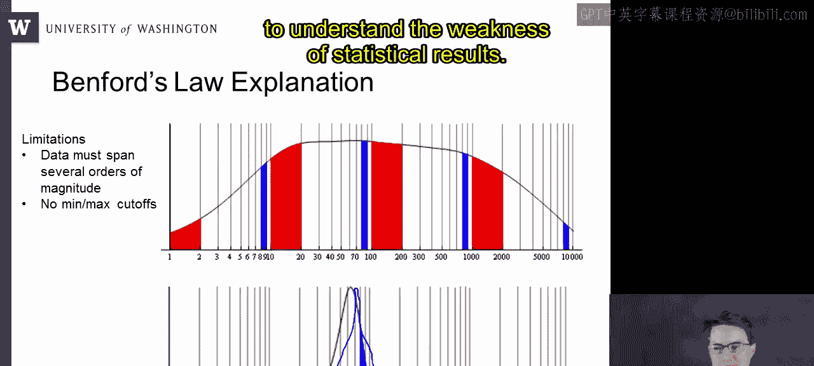

# 杜克大学《大规模数据科学（预测分析，交流数据科学结果，第2、3课⧸共3课有视频）｜Data Science at Scale》中英字幕 p17 16_本福特定律的可视化解释.zh_en -BV1xf421Q7bH_p17-

。

So what does that probability look like， Well， this figure is a little bit misleading because the x axis is on the log scale。

But if you just look at the heights。What's going on here is。

On the y axis is the probability of drawing a particular digit。

 The blue line is associated with the digit 1。 The green line are digit 2 and so on。

 And this was generated。By a simulation where I really did select random numbers from a distribution。

And then I really did order them in the manner described in the previous slide。

And put one in and then measure the probability of drawing it a value with the number one or where the first dig is one。

ok。And so if you think about this。The numbers。You know what's happened here， this is where one。

 and this is 10， and this is 100 and so on。Well， as soon as I put a one in。

The chance of drawing a card with a one in the front is 100%。When I put a two in it's now 50%。

 When I put a three in is' now 33% and so on。 But then as soon as I get to 10。

It goes back up to a higher percentage again。And it stays there，10，11，12，13，14， and so on。

 And then as soon as I get to 20。It drops down a little bit。And so that's why it's climbing here。

It's through the tens， and then it starts dropping again sharply。

OkayAnd so the point here is that under this model。

 values where the first dig is1 always are in the hat already by the time you get to the twos。

And the twos are always there before you get to the threes and the threes are always there the fours and so on。

And so you end up with these height， these peaks are led by the ones and the area under of this curve。

 although remember this is a log plot so the area is not quite right。

 represents the probability of drawing this， and so the probability does actually get higher。Okay。

And there's a few different other models you can find if you read up on this， and I encourage you to。

 there's other ways to sort of think about the probability here。

 and there is actually a closed form expression for Bford's law as well。

One are the limitations here is's not always true。 And one of the key or the key situation in which it's applicable is the data set has to span many。

 many order， well， many many orders of magnitude。 It can't be values between， I mean。

 think about if you have values between 50 and 90 and you select those randomly。 Well。

 you're not get to get any numbers with the。Fage it is one。Okay。

 and similarly if you do from1 to 100， well， you have this effect a little bit， but not。

Unversely you want to span a lot of orders of magnitude。

This is sort of illustrated by this plot here is that the red areas are。

Represent the probability of selecting something where the first dig is1 and the blue areas are where the first dig is8。

Okay， and so as long as you span enough。Orders of magnitude。

 you get much more area where the first digit is one。Okay。But if you take a narrow case， well。

 then the probability is more defined by the distribution itself and there's not enough。

Chance for this。Ay end of the curve under the digits 1 to get big。So fine。

 so I just want to introduce you to that law， mention that it can be used to detect fraud and then connect the fraud。

plus change of mistakes back to this original。Context we're in of trying to understand the weakness of。

就是这个。Results。perceivedced increasing weakness of his statistical results。

