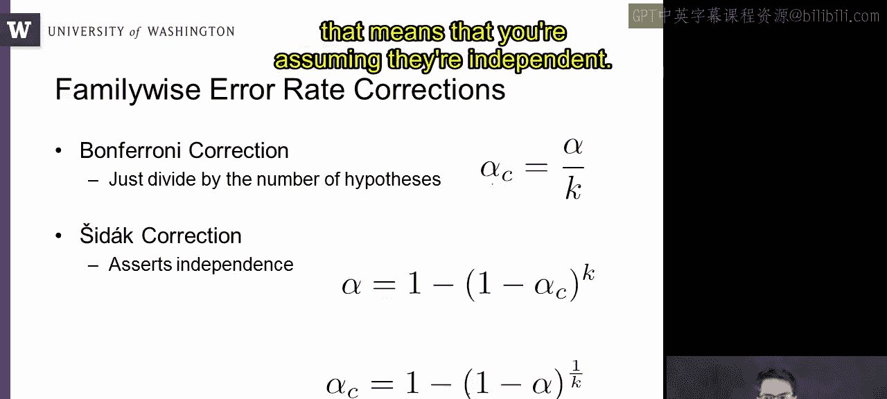

# 杜克大学《大规模数据科学（预测分析，交流数据科学结果，第2、3课⧸共3课有视频）｜Data Science at Scale》中英字幕 p18 17_多重假设检验：Bonferroni和Šidák校正.zh_en -BV1xf421Q7bH_p18-

。

Okay， so a third potential explanation of this decline effect。Is。Exceedingly simple。

 but exceedingly common。 And this maybe the most important one to。Learn to apply in your own。

Work you're when you're doing statistical analysis。 Okay。

 And so this is the idea of multiple hypothesis testing。

So the problem here is that if you perform experiments over and over and over again。

You're bound to find something， right， That's sort of。The definition， in fact， right。

 if you keep rolling dice long enough， you know you can't just keep rolling dice and then yell yatszi。

You get one shot at it， and the same is true with these experimental design。

And so this is related to the publication bias problem in that you're only showing your positive results。

 but it's a little bit different because here you're talking about the same sample and you're testing different hypotheses over the same data。

And so in these situations。Either you shouldn't do it at all。

Or if you do have to do it for various reasons， you need to adjust the significance level down。

 that means you need to not settle for 0。05 as the threshold， you need to do something much。

 much lower。Okay。So。To understand why。You know。Consider something pretty basic over completely random data。

And we set the threshold at 0。05 is alpha 0。05， so the probability of detecting effect where there is none。

Is 0。05， then the probability of detecting an effect when it exists。Is1 minus alpha。

Then the probability of detecting an effect when it exists on every experiment you do out of k experiments is 1 minus alpha times 1 minus alpha times 1 minus alpha times 1 minus alpha assuming that they're independent it's okay to multiply probabilities together if those probabilities are independent。

Finally， the probability of detecting an effect where there is none。On at least one experiment。

Is one minus that total， right？So first， we build up the probability of being perfect。😡。

And then one minus that is the probability of not being perfect。 if I'm making at least one mistake。

 Okay， so if you plot these numbers， what you get is on the X axis here is the number of tests and the y axis is the probability of at least one spurious finding。

 right， making at least one mistake。 Well， it goes up like this。

So as you get up to sort of 50 hypothesis tests。You're up at the 90% chance of at least one spurious finding。

Okay。And so controlling this is known as controlling the family wise error rate。

This is the family wise error rate of at least one mistake。 So this is a pretty stringent。Constraint。

 so how do you correct for it， How do we control the family wise error rate well。

One solution is the bonferoni correction， which is just to divide by the number of hypotheses。Okay。

 so if your significance level is alpha 0。05 and you do。20 experiments。

0 you're testing 20 hypotheses。 you just divide 0。05。By 20。

So another correction is the Shiak correction which has this extra condition where the tests are need to be independent。

 so even though we talked about in the last slide that in order to make that plot。

 we were assuming that they were independent。But the bone for any correction in general does not need to assume that。

 Okay， so if you're doing hypothesis tests that are related to each other。

 you can still do the bone for correction。 However， to derive this should that correction。

 we're going to rely on the fact that we're going to multiply the probabilities together whenever you see probabilities be multiplied together。

 that means that you're assuming that they're independent。 Okay so let's see we can build this up。

