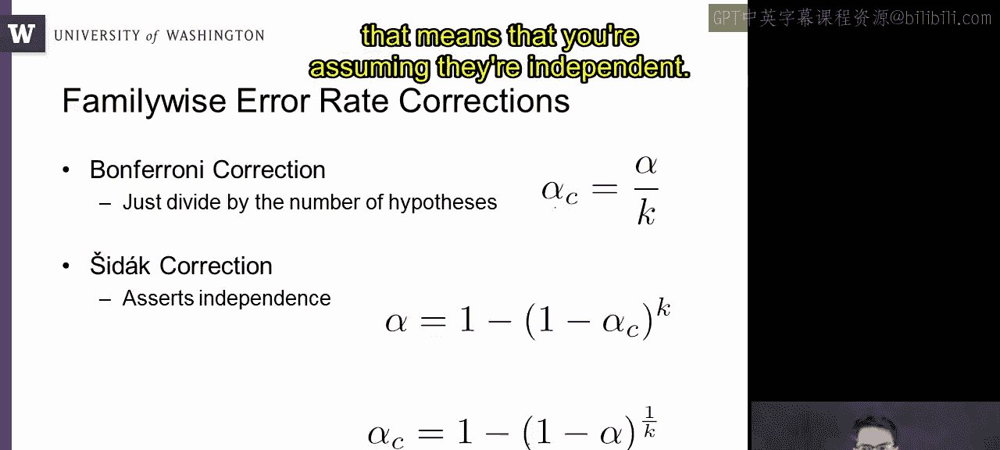

# 大规模数据科学：第2课：多重假设检验：Bonferroni和Šidák校正 📊

在本节课中，我们将要学习多重假设检验的概念，以及如何通过Bonferroni和Šidák校正来控制因多次检验而导致的错误发现风险。理解这些方法对于确保数据分析结果的可靠性至关重要。

## 多重假设检验的问题

上一节我们讨论了可能导致“衰退效应”的几种解释。本节中我们来看看一个极其简单但极其常见的原因：多重假设检验。

这里的问题是，如果你反复进行实验，你几乎必然会发现一些“显著”的结果。这就像反复掷骰子，掷的次数足够多，总有一次会得到你想要的组合。在实验设计中也是如此，你不能无限制地测试直到得到一个阳性结果。

这个问题与发表偏倚相关，因为你可能只展示阳性结果。但它又有所不同，因为这里讨论的是在同一份数据上测试不同的假设。

在这些情况下，要么你根本不应该这样做，要么如果出于各种原因必须这样做，你就需要降低显著性水平。这意味着你不能满足于0.05作为阈值，而需要设定一个低得多的标准。

## 为什么需要校正？

为了理解原因，让我们考虑一个基于完全随机数据的基本场景。

我们设定显著性水平α为0.05。这意味着，当效应不存在时，错误地检测到效应的概率是0.05。相应地，当效应存在时，正确检测到效应的概率是1 - α。

现在，假设我们进行k次独立的实验。在所有k次实验中都正确检测到效应（假设效应存在）的概率是(1 - α)自乘k次。这个计算成立的前提是各次实验的概率是独立的，可以相乘。

那么，在至少一次实验中，当效应不存在时却错误地检测到效应的概率，就是1减去上面那个“完美”的概率。换句话说，就是至少犯一次错误的概率。

以下是这个概率随检验次数增加的变化趋势：

*   随着检验次数（X轴）增加，至少出现一次虚假发现（Y轴）的概率迅速上升。
*   当进行大约50次假设检验时，出现至少一次虚假发现的概率高达约90%。

因此，控制这个“至少犯一次错误”的概率，被称为控制**族错误率**。这是一个相当严格的要求。

## 如何校正？

那么，我们如何控制族错误率呢？以下是两种常用的校正方法。

### Bonferroni校正

一种解决方案是**Bonferroni校正**。其方法非常简单：将原始的显著性水平α除以假设检验的总次数。

**公式**：`校正后的α = α / k`，其中k是假设检验的次数。

例如，如果你的原始显著性水平α是0.05，而你进行了20次假设检验，那么校正后的显著性水平就是`0.05 / 20 = 0.0025`。只有p值小于0.0025的结果才能被认为是统计显著的。

Bonferroni校正的优点在于它不要求各次检验之间相互独立，适用范围更广。

### Šidák校正

另一种校正是**Šidák校正**。它的公式略有不同，并且有一个额外的条件：要求各次假设检验是相互独立的。

**公式**：`校正后的α = 1 - (1 - α)^(1/k)`，其中k是假设检验的次数。

这个公式的推导基于概率的独立性假设。当我们计算“所有k次检验都不犯错误”的概率时，需要将(1 - α)连乘k次。为了控制整体错误率，我们反过来求解单次检验应满足的、更严格的α值。

因此，如果各检验之间存在相关性，Šidák校正可能不是最合适的选择，而Bonferroni校正则更为稳健。

---

本节课中我们一起学习了多重假设检验带来的风险，即随着检验次数增加，出现虚假发现的概率会急剧上升。为了控制整体的族错误率，我们介绍了两种校正方法：通用的Bonferroni校正和基于独立性假设的Šidák校正。在实际数据分析中，尤其是进行大量探索性检验时，应用这些校正对于维护结论的严谨性至关重要。