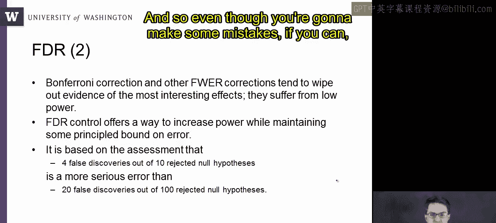

# 杜克大学《大规模数据科学（预测分析，交流数据科学结果，第2、3课⧸共3课有视频）｜Data Science at Scale》中英字幕 p19 18_多重假设检验：错误发现率.zh_en -BV1xf421Q7bH_p19-

。

So here we're going to derive。The individual test， the corrected significance level from the overall significance level。

 so we're going to set the overall significance level alpha equal to the probability that at least one of the tests is significant。

So at least one is significant。Well， what's that， That's one minus the probability that none of them are significant and the probability that none of them are significant。

 assuming independence。Is。The probability that the first one is not significant times is probably the second one is inign is not significant and so on。

 So that's 1 minus alpha C。Raised to decay experiments。

1 minus alpha c times 1 minus alpha c times1 minus alpha Z and so on。

 and that's what this expression says。So fine， so now we just solve for alpha C。

And we get this expression，1 minus 1 minus alpha raised to the 1 over k。The K root of 1 minus alpha。

Okay， so showing the same plot from before， but now zooming the scale in down around 0。

05 significance level was you can see the difference between these two corrections。

 so the Shadak correction is more conservative than the Boferoni one。Correction。

 so Bo Run evens it out across。 So instead of instead of。

Increasing the likelihood of making a mistake quickly， which is what the previous plot shows。

 this is zooming in at zero points survive and showing that the bone phos makes it constant across。

Regardless of how many tests， which makes sense because you're just dividing it by the number of tests you're done。

 okay？In the Shaette correction。啊。Is even more conservative。

So that's what to remember both of these are。Considered to be more conservative than is perhaps necessary。

 You lose too， you give up too much statistical power when you use these。 And， in fact。

 any correction for the it goes back to the actual definition of family wise error rate is considered to be too conservative。

 So another。Way of controlling for multiple hypothesispo tests that is less conservative。

By considering the false discovery rate， and so the false discovery rate you can understand by going back to our grid and labeling it a slightly different way。

The p mnemonic here is that。The total， let's see。T and F stands for true and false and D stands for discovery No discoveryy。

 So false discovery is FD。 True discovery is TD。 True non discoveryy is TN and false non discoverycovery is FN。

With this notation。The false discover at FDR， which is sometimes called Q is。

The number of false discoveries。Over the total number of discoveries。 And so here in this notation。

 by the way， D is equal to FD plus TD。So these are counts， these are the number of。Of， of。You know。

 true relationships and false relationships and so on。

So this is the rate you're trying to control for。The bump for any correction and other family rise error rate corrections tend to wipe out evidence of the most。

Interesting effects。We say they suffer from low power。

 so the false discovery rate controls offer a way to increase power while maintaining still some principle bound on error。

Okay，More intuitively its based on the assessment that you know。4 false discoveries out of 10。

If you reject the null hypothesis 10 times you make five quote discoveries。

For having four of those be false is really bad， but it's you know。

 much worse than making 20 false discoveries out of。100。Get idea here is that。You know。

 finding true effects is a good thing， and so even though you're going to make some mistakes。

 if you can the more you find the more sort of value you've added。

