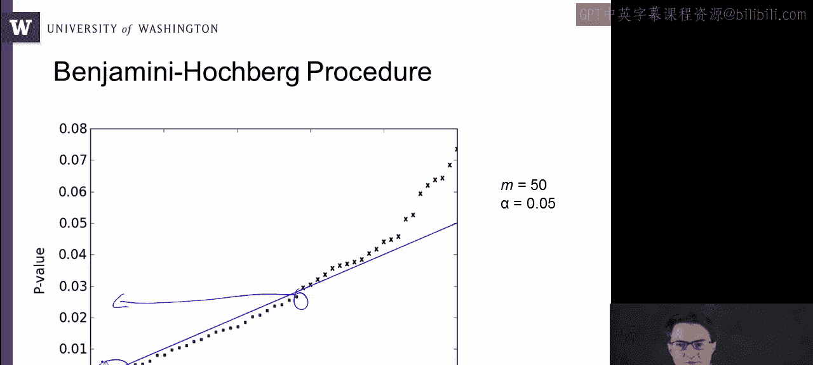

# 杜克大学《大规模数据科学（预测分析，交流数据科学结果，第2、3课⧸共3课有视频）｜Data Science at Scale》中英字幕 p20 19_多重假设检验：Benjamini-Hochberg程序.zh_en -BV1xf421Q7bH_p20-

。

🎼So how can you control the false discovery rate， Well。

 the Bennjamini Hopeberg procedure gives you a way to do this。 And so here's how it works。

 You compute the P value of your hypotheses， and then you sort them in ac order。

 such that the ones are the lowest P value， which are the most likely hypotheses。

 the ones that are best supported by the evidence come first。Okay。

 and then you apply this condition where the P value is subject to a more stringent condition than just alpha remember alpha is your 0。

05， you're cutoff and what we're trying to do is correct for the multiple hypothesis testing so we want a much more stringent。

Alpha， and so that more stringent alpha is this ratio I over M。 And so I is just the rank order。

Of the hypothesis you're testing。And M is your total number of hypotheses。Testing。

Number of hypotheses。All right。And。The procedure says， well。

 find the highest eye for which this condition holds and then reject the null hypotheses for all eye lower than that。

 except everything up until that point。O。And so here's what it might look like with 50。

The first it's and 0。05， I suppose I you should have put that。So the first。

 your first hypothesis has to。The first hypothesis is compared with a pretty stringent condition zero know in one in1 thousand。

 and the second one is double that and the third one is triple that and so on。

All the way up to the 50th one， which would be 50 over 50， which is just your original alpha。0。05。

 Okay， so this is a much tighter condition。 And so what they're able to prove is that they under these conditions。

 know， following this procedure， the false discovery rate is less than T over M。Times alpha。

 where if you remember T was。The total number of。Cases where the null hypothesis is true。

So here's what it looks like。Graphically， the little x's are me are above this line， and the dots。

Are below this line， and the X X is is rank order。 And these are all your 50 hypotheses sorted。

In increasing key value。And the line represents that threshold condition。

 and it slopes up with rank order as we expect。And so here we'd say we'd find the。

Highest eye for which this is this condition holds， and except。Everything lower than this。

 And here we had a， know， pretty good run， we accepted sort of 30 out of 50。

Hypotheses and notice that these actually are above the line， but we would still accept them。

