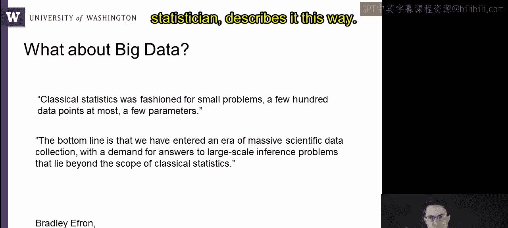
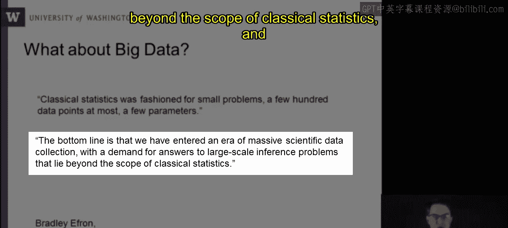
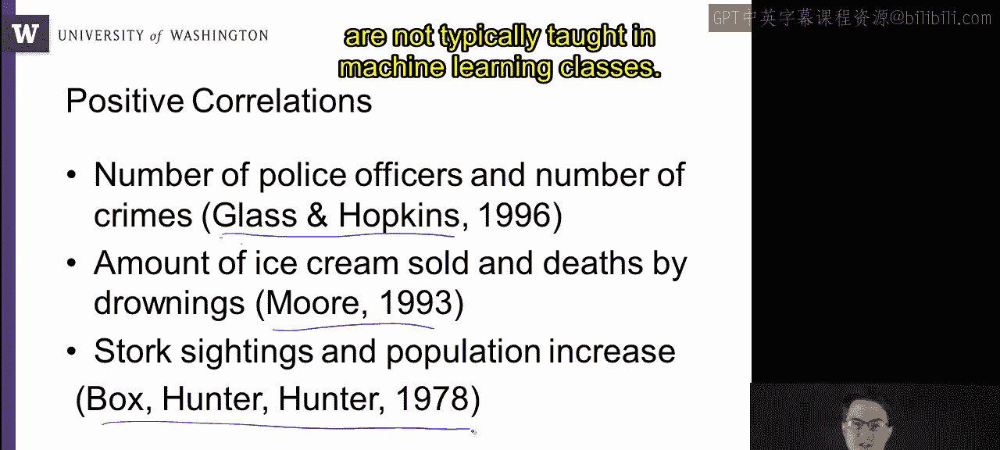

# 杜克大学《大规模数据科学（预测分析，交流数据科学结果，第2、3课⧸共3课有视频）｜Data Science at Scale》中英字幕 p21 20_大数据和虚假相关.zh_en -BV1xf421Q7bH_p21-

。

Okay， so where are we now， So we motivated the discussion of statistical inference and estimation。

By bringing up this so called decline effect， where the。

Effect size of scientific results seem to be going down over time， and reproducibility。

Is suffering and so we gave some reasons for this publication bias。You know。

 mistakes and fraud and this multi hypothesis testing problem。 And so we use these motivations。

 these scenario to bring up various topics and techniques。

 So we talked a little bit about basic statistical inference， where I just give you。An overview。

And that's it。We talked about effect size， we brought up the specific term hetero scasticity。

For fraud detection， we brought up Binford's law， and then we multi hypothesisesis testing， which is。

Perhaps the most important part of the discussion。 We talked about the family wise error rate and the false discovery rate and gave correction procedures for both of these。

 Okay， And so this hopefully was a tour of not just some basic concepts， but also some。

If not advanced， at least things that don't necessarily come up in a。You know， stats 101 course。

 but I think it's pretty important for data scientist to understand， in fact， as a data scientist。

There's a view among statisticians that。These topics are not very well understood。 And， in fact。

 they'll point to typical machine learning classes where。Understanding the population。

 understanding the various biases， understanding how to correct for the problems that can arise is not taught at all。

 And it's more of of a， you know， blind application of algorithms。

 And so I think it's pretty important to sort of go over。This choice of topics now。So。

What about big data， what changes。Bret Ephron。Who's a world renowned statistician？

You know， describes it this way， says classical statistics was fashion for small problems。

 a few hundred data points at most and just a few parameters。

 and the bottom line is that we've entered an era of massive scientific data collection with the demand for answers to large scale inference problems that lie beyond the scope of classical statistics and so suggests that something is changing in the era of big data now。

What can go wrong here， Well， as we talked about。You can find spurious relationships in。Big data。

 and so this is a picture that I。God from a colleague recently that was emailed to him。

 which is a plot that someone took the time to make may or may not have been as a joke。

 But as you can see here， it says。Internet Explorer versus the murder rate。Okay。

And so this is the murders in the US。In blue， along with the market share of Internet Explorer in the green and the you corresponding discussion that went along with this。

Pud。You know， it was was。Somewhat amusing right， talking about various theories for why。

The murdery might be going up as an exporter market share or murderary goes down as an exporter market share also goes down。

 but the point here is that。Without some common sense or without the the application of understanding the。

Sceario， the problem。You can make discoveries of this form， okay？All right。

 and so other examples that have been talked about in the literature again， brought up。

As bad examples， the number of police officers and the number of crimes。

So why might these two things be correlated， you know， maybe police officers cause crimes？Well， no。

 probably because in densely populated areas， there are both more police officers and there are more crimes。

By the way， just to point out again， these authors here。嗯。Are not authors that claim me these claims。

 These are authors that brought up the。Mistake。Okay， amount of ice cream sold in deaths by drownings。

Why would these things be correlated？Well， there's a seasonality， right， in the summertime。

 you sell more ice cream and more people go swimming。And then one is， you know。

 storeork sightings and population increase used as evidence that storks do indeed。

Bring newborns to families。Well， again， in more densely populated areas。

 there's more people to actually see the storage and so you get an increase in sightings。

These kind of。Procedures to remove bias and these procedures to understand the population you're sampling from。

And to understand。The possibility of spur correlations。

 These things are taught in statistics programs， but are not typically taught in。

Machine learning classes。