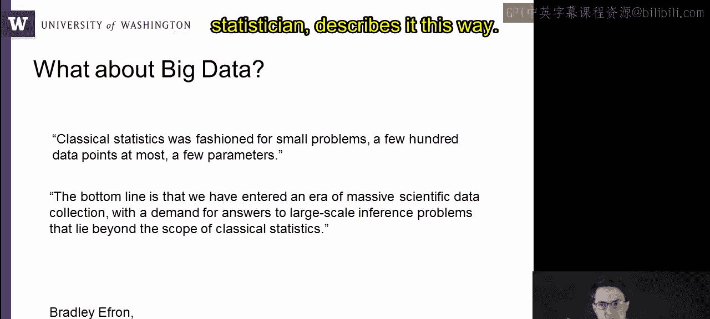
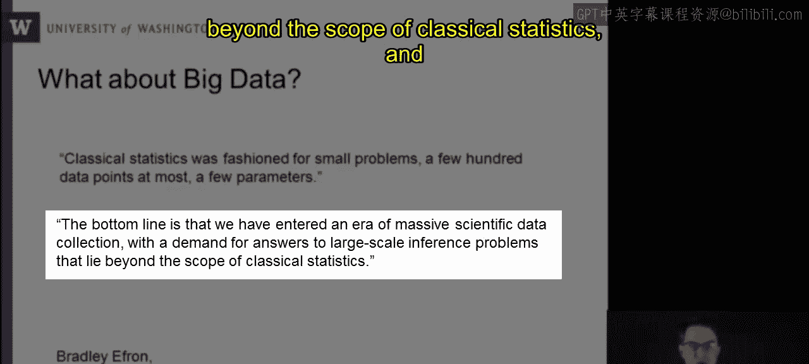
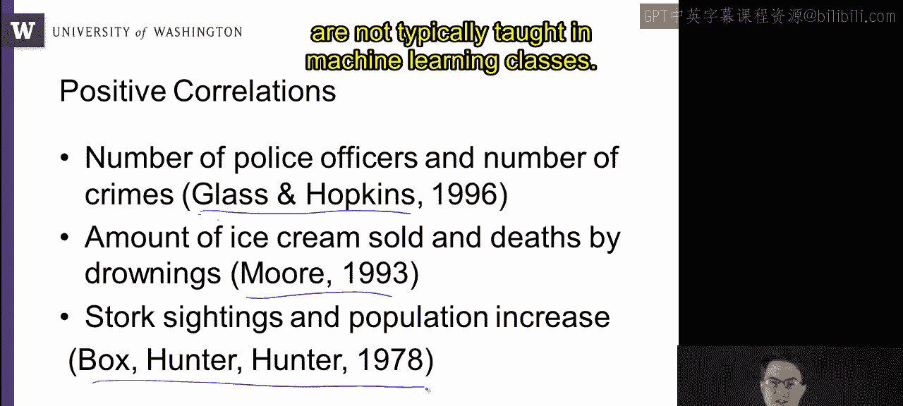

# 大规模数据科学：第2课：大数据与虚假相关

在本节课中，我们将探讨大数据时代下统计推断面临的新挑战，特别是虚假相关性问题。我们将回顾之前讨论的统计推断基础，并分析大数据如何改变了传统统计学的应用场景。

## 课程概述

上一节我们介绍了统计推断、效应量、异方差性、本福德定律以及多重假设检验等核心概念。本节中，我们将重点讨论大数据环境如何加剧了虚假相关性的风险，以及为什么理解数据背后的真实场景至关重要。

## 大数据时代的变革

著名统计学家布拉德利·埃夫隆对此有如下描述：

> 经典统计学是为小规模问题设计的，最多处理几百个数据点和少数几个参数。如今，我们已进入大规模科学数据收集的时代，对解决超出经典统计学范围的大规模推断问题提出了需求。这表明，在大数据时代，某些情况正在发生变化。

## 虚假相关的风险

在大数据中可能出现什么问题？正如我们之前讨论的，你可能会发现**虚假关系**。

以下是一个近期在同事间流传的图表，它可能是一个玩笑，但清晰地说明了问题：

该图表展示了美国的谋杀率（蓝色线）与Internet Explorer浏览器市场份额（绿色线）之间的关系。附带的讨论甚至幽默地提出了各种理论来解释为何谋杀率会随着IE市场份额的上升而上升，或随着其下降而下降。

这里的核心观点是：**如果缺乏常识或对问题场景的理解，你可能会做出此类“发现”。**

## 其他虚假相关的例子

文献中还讨论过其他被引为反面教材的例子：

以下是几个著名的虚假相关案例：
*   **警察数量与犯罪数量**：这两者为何相关？难道警察导致犯罪？很可能不是。真正的原因是在人口密集区域，警察数量和犯罪数量都更多。
*   **冰淇淋销量与溺水死亡人数**：这两者为何相关？存在季节性因素。夏季，冰淇淋销量更高，同时游泳的人也更多，导致溺水风险增加。
*   **鹳鸟目击次数与人口增长**：有人以此作为“鹳鸟确实给家庭送来新生儿”的证据。同样，在人口更密集的地区，有更多人可能目击到鹳鸟，因此目击次数增加。

需要指出的是，引用这些例子的作者并非声称这些因果关系成立，他们恰恰是在指出其中的谬误。

## 统计学与机器学习的教学差异

用于消除偏差、理解抽样总体以及识别虚假相关可能性的这些方法，通常在统计学课程中教授，但**在典型的机器学习课程中却很少涉及**。

## 课程总结

本节课中，我们一起学习了大数据如何放大了虚假相关性带来的挑战。我们认识到，仅仅依靠算法从海量数据中发现模式是远远不够的，必须结合领域知识、常识和对数据生成过程的理解，才能避免得出荒谬或误导性的结论。这对于每一位数据科学家都至关重要。