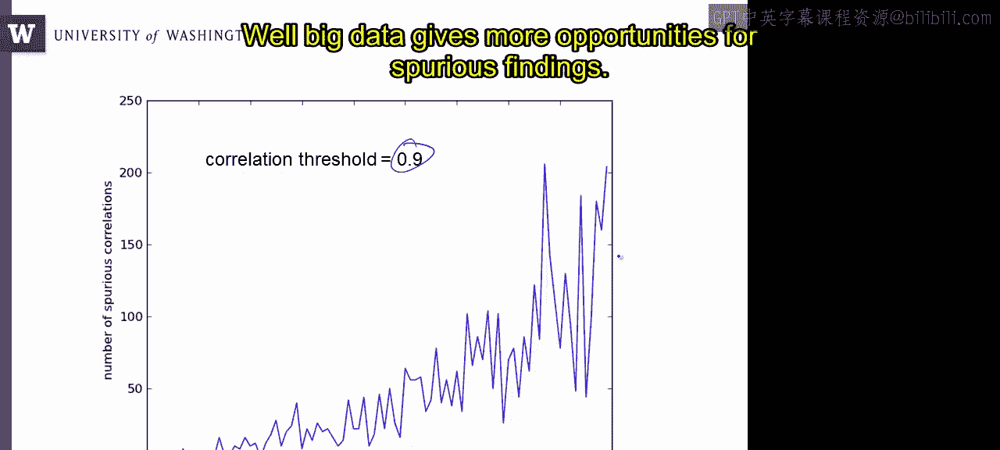

# 杜克大学《大规模数据科学（预测分析，交流数据科学结果，第2、3课⧸共3课有视频）｜Data Science at Scale》中英字幕 p22 21_虚假相关：股票价格示例.zh_en -BV1xf421Q7bH_p22-

。

So what does it have to do with big data？It might be a view that there's the curse of big data as Vincent Granville put it is the fact that when you search for patterns in very。

 very large data sets with billions or trillions of data points and thousands of metrics。

 you were bound to identify coincidences that have no predictive power。 And so the example he gives。

Is to consider stock prices for some large number of companies over a one month period。

 and then you check for correlations in all pairs。And actually doesn't stop there because that would be over the exact same one month period。

 but you might want to account for lags， you know， perhaps the stock price of Google。

A few days later affect the stock price of smaller companies that depend on Google。 Okay。

 and so now you're not just comparing every every。You know， 500 square。

 you're not just checking the parawise correlation of these time series。

 but you're also checking the parawise correlation among the slightly offset one。

And so these are just cross correlation procedures。So。

Very basic time series analysis is just to measure the correlation and I just wanted to throw the formulas up here。

Where the covariance of two。Data sets is measured this way。So you take the data point X。

And subtract the mean of x and multiply that by y I minus the mean of y and add all that up。

 and that's the covariance。And then you divide the covariance by the standard deviation。

Of each data set multiplied by each other， and so this gives you a correlation。

So what does this experiment look like Well I generated this plot by running random walks for stock prices that started at $10。

 They all started the same same。Point。And at each step， which is an hour of simulated time。啊。

Draw a sample from a normal distribution where the mean is the current stock price。

 and the standard deviation is 1% of that current stock price。Okay。And this is。

Not especially defensible， but you can see just sort of visually that it does generate stock price looking things。

 and you do get some variances here。All right。So。Clearly， this is random。

This plot shows the number of correlations at a level of。0。9。That's a pretty strong correlation。

As a function of the number of stock prices tracked。 So as I went up from 10 to 100。

 I didn't go all the way up to 500， which is what。Vincent Granville。

Described in the thought experiment。This is the number of spurious correlations you find。Okay。

 and this is also not doing the lagged cross correlation。

 This is just directly completely to the correlation of these two time series across this month。

 And that's a pretty long period， too， across a month。So what's the point。

 well bigating is more opportunities。For spurious findings。

