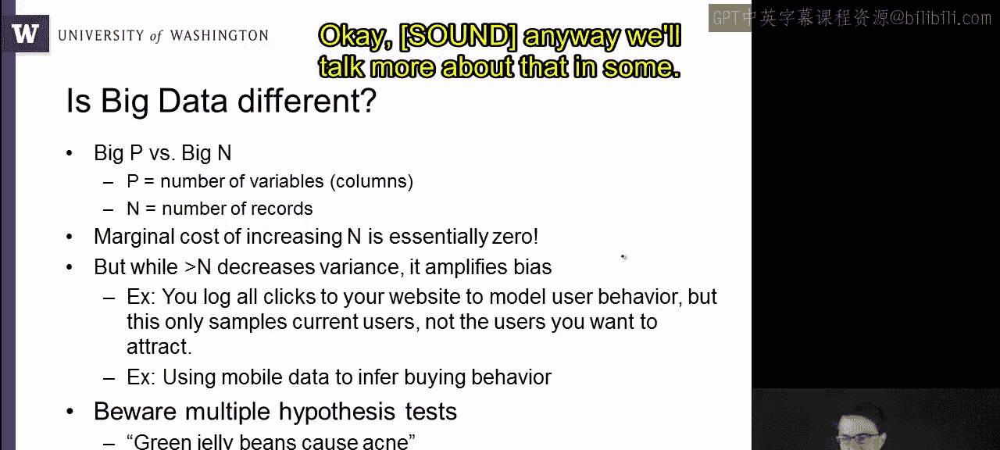

# 杜克大学《大规模数据科学（预测分析，交流数据科学结果，第2、3课⧸共3课有视频）｜Data Science at Scale》中英字幕 p23 22_大数据有何不同.zh_en -BV1xf421Q7bH_p23-

。

So how is big data different Well， there's a notion of big P versus big n where big P is sort of the number of columns and big n is the number of rows and in this experiment we just did with the time series。

 this was sort of a big P scenario。 we looked at more you know an increasing number of companies and then we looked at all possible correlation between them so this was growing sort of quadraically。

周。The thing about big data though， is that the marginal cost of increasing the number of records is essentially zero。

 it's gotten cheaper and cheaper and cheaper to collect data。Okay。Great， now that's very。

 very powerful， right， We want to increase the number of records add statistical power。

And helps us sort of get lower and lower P values。But it also amplifies bias if you're collecting the wrong data。

 if you're looking at the wrong populations。You're going to make you know so called discoveries that are simply false。

 and so for example， if you。Log all the clicks to your website。 You have a very。

 very large data set and you can very precisely model user behavior。

 but that would only model your current users when your know perhaps the whole point of modeling user behavior is to try to attract new customers。

 Well， for example， if you have early adopters and your current user base's early adopters。

 you're only going be modeling their behavior。 you haven't actually sampled the population at large。

Another example is mobile data， and this comes up in polling。For say the presidential election。

You know， you're only sampling people that have cell phones and this may or may not be the same population you want you want to be sampling okay。

 so this may ignore lower income groups。Or。Different age groups。

you need to be careful on multiple hypothesis tests as well。As we pointed out。

 so there's a fantastic comic from XKCD that makes this point very， very clear。

Where they sort of demonstrate that green jelly beans cause acne， right。

Story here is that there's 20 different。Colors of jelly beans。And for a P value of 0。05。

 we do 20 experiments， and sure enough we find one of the colors indeed causes acne。

 but that would be expected purely by chance。 and so I encourage you to look up that comic。

And then the other comment I make that we will。Probably come back to is Nessim Tebbs。

Black swan events。 So this is。Things that are sort of inherently。

Unpredictable or the distribution of them does not follow a normal distribution or a bell curve distribution。

Where the tails of the bell curve mean that extreme values become exponentially more rare。

 That's the sort of definition of the normal distribution。 But in some cases， extreme values are not。

Expenentially less common they happen， okay。And so the。

Example that he uses in this case is that you know if if a turkey was to model your behavior。

It would get increasingly more confident that。That you mean it it no harm And you mean it you know。

 good will， right every day you come and feed the turkey and every day you take care of it and you look out for its well being。

 But then on the， you day before Thanksgiving， it gets slaughtered， perhaps。And so that was。

Taleb's argument for a Black Swwaann event and Black Swwaann itself refers to the fact that people didn't believe black Swwans existed and then Fran out that they did。

 And so it was an unexpected event。

Okay， we'll talk more about that in some。

