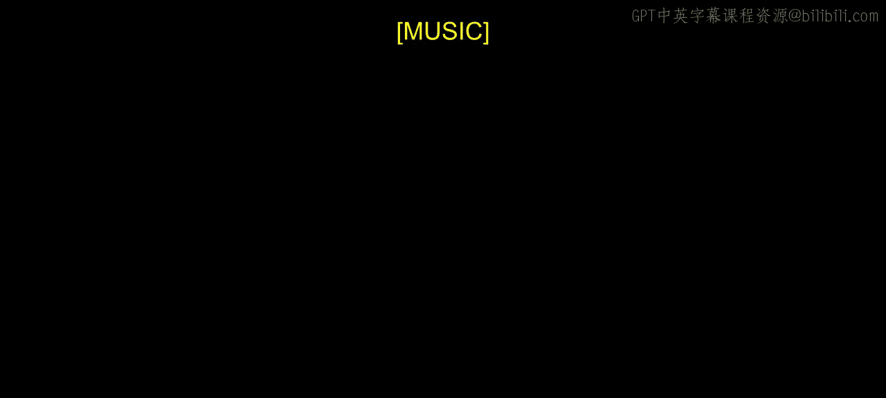
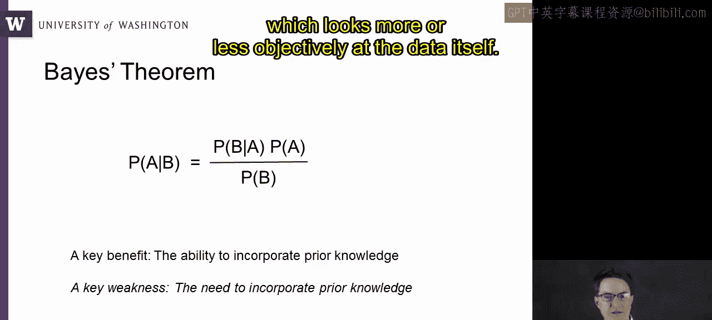

# 杜克大学《大规模数据科学（预测分析，交流数据科学结果，第2、3课⧸共3课有视频）｜Data Science at Scale》中英字幕 p24 23_贝叶斯vs频率派.zh_en -BV1xf421Q7bH_p24-

。So so far we've been discussing statistical inference from a particular perspective。

 which is the frequentest perspective。And so frequencies are concerned with the probability of seeing a particular data sample。

 given the null hypothesis。 Okay， and that's what the P value gives you。

 But there's another perspective to statistics called the Bayesian approach。

 which is concerned with the probability of。Having a certain outcome。

 given the data that we've already seen。 Okay， and so I want to talk a little bit about。

Baesing approaches and give an example of power。What are the differences here， Well。

 you can think about the differences in terms of what is fixed。

 So the frequency perspective is that data are repeatable random sample， right。

 You're always allowed to go do another experiment the same way。 And in fact， you need to。

 at least virtually to reason about the probabilities that get produced by these methods。 Okay。

 so there is some sort of frequency you can reason about frequency of achieving a certain outcome。

Okay。And the underlying parameters。Of the population remained constant during this repeatable process。

 right， your， your， the population stays fixed and you run experiments。 Okay， mean。

 with a baesing approach， the data observed from a realized sample and the parameters of the population are unknown。

 but can be described probabilistically， right， So they're not sort of。Fixed values。However。

 the data are fixed， right， you don't you don't think about going back and sampling more data。

 You just have the observations you have。The baesing approach is。

100% concerned with the application of Bayes's rule， which is this。

What Thomas Bays did was relate these。Conditional probabilities with the prior beliefs。

so it allows you to take your belief about the probabilities of certain events happening and update them when more data is collected。

Here's what it says， says the probability of event A happening。

 given that event B has already happened。Is equal to the probability of。Be happening。

 given the day has already happened。Multiply by the probability of A happening across the board。

Divided by the probability of B happening across the board。 And if that's not clear， that's okay。're。

 we're going to go into more detail here。 So right now。

 they'll recognize that the key benefit here is the ability to incorporate prior knowledge。

 which is not。The case with the frequencies approach now。

A key weakness here is that you need to incorporate prior knowledge。 So if you。

 so there's a couple of problems with this。 One is， if you don't know anything about the。

Population you're modeling， then there's not much you can do with the prior。

 there's not a good way to model the distributions。Now， there are some techniques to。

Sort of derive so called uninformative priors。That try not to influence things too much。

 but give you a plug to be able to apply the rule， but still that is an issue。Fine。

Perhaps more insidiously。And the reason why Bayes is the Bayesing approach。

Was popular and then fell out of favor in the earlier part of the 20th century， was that。

You can use this rule to kind of。Do anything you want to confirm or deny the effect of any sort of evidence。

 right just by plugging in your own prior beliefs okay so。Given a fixed set of data。

Two different people could come up with different conclusions about the data because they had different prior beliefs。

 They modeled the the prior distributions differently。 Okay。

 and this was seen as a major flaw and gave rise to the frequencies approach， which。Looks。

More or less objectively at the data itself。

Okay。