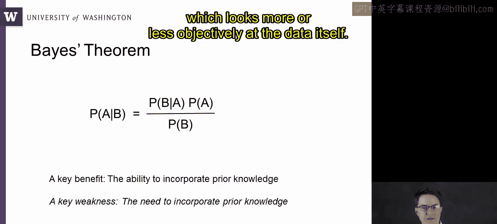

# 大规模数据科学：第2课：贝叶斯与频率派统计推断

在本节课中，我们将要学习统计推断的两种主要思想流派：频率派方法和贝叶斯方法。我们将探讨它们的基本原理、核心差异以及各自的优缺点。

到目前为止，我们讨论的统计推断都基于一个特定的视角，即频率派视角。频率派关注的是在给定零假设的前提下，观察到特定数据样本的概率。这就是P值所提供的信息。

然而，统计学还存在另一个视角，称为贝叶斯方法。贝叶斯方法关注的是在已经看到数据的前提下，出现某种结果的概率。接下来，我们将简要介绍贝叶斯方法，并举例说明其效力。

## 核心差异：什么被视作固定？

两者的差异可以从“什么是固定的”这个角度来理解。

频率派的观点认为，数据是可重复的随机样本。你总是可以按照相同的方式再次进行实验。事实上，你至少需要在概念上如此思考，才能理解这些方法产生的概率。因此，你可以推理出获得某种结果的频率。

在此可重复的过程中，总体的基本参数保持不变。总体是固定的，你只是不断进行实验。

而在贝叶斯方法中，数据是从一个已实现的样本中观察到的，总体的参数是未知的，但可以用概率来描述。因此，它们并非固定的值。然而，数据本身是固定的。你不会考虑回去采集更多数据，你只拥有已经获得的观测值。

## 贝叶斯方法的核心：贝叶斯定理

贝叶斯方法完全基于贝叶斯定理的应用。托马斯·贝叶斯所做的工作，就是将条件概率与先验信念联系起来。这允许你根据对某些事件发生概率的既有信念，在收集到更多数据时更新这些信念。

以下是贝叶斯定理的表述：事件A在事件B已经发生的条件下发生的概率，等于事件B在事件A已经发生的条件下发生的概率，乘以事件A无条件发生的概率，再除以事件B无条件发生的概率。

用公式表示如下：
**P(A|B) = [P(B|A) * P(A)] / P(B)**

如果这个公式目前还不清晰，没关系，我们稍后会详细解释。现在，你需要认识到其关键优势在于能够**纳入先验知识**，而这在频率派方法中是无法做到的。

## 贝叶斯方法的优势与挑战

然而，一个关键的弱点也恰恰在于你需要纳入先验知识。这带来了几个问题。

首先，如果你对所建模的总体一无所知，那么你在先验分布上能做的事情就很有限，很难很好地建模其分布。虽然有一些技术可以推导所谓的“无信息先验”，试图不过度影响结果，同时让你能够应用该定理，但这仍然是一个问题。

其次，或许更隐蔽的是，这也是贝叶斯方法在20世纪早期一度流行后又失宠的原因：你可以利用这个定理，通过代入你自己的先验信念，来证实或否定任何证据的效应。这意味着，对于同一组固定数据，两个拥有不同先验信念、对先验分布建模不同的人，可能会得出不同的结论。这被视为一个重大缺陷，并催生了频率派方法的兴起，后者或多或少更客观地看待数据本身。

## 总结

本节课中，我们一起学习了统计推断的两种范式。频率派方法将参数视为固定值，通过重复抽样来评估数据的概率。贝叶斯方法则将参数视为随机变量，利用贝叶斯定理结合先验知识和观测数据来更新对参数的信念。贝叶斯方法的优势在于能灵活纳入先验信息，但其结论对先验分布的选择敏感，这既是其力量所在，也是其备受争议之处。理解这两种视角的差异，对于全面掌握数据科学中的统计推断至关重要。