# 杜克大学《大规模数据科学（预测分析，交流数据科学结果，第2、3课⧸共3课有视频）｜Data Science at Scale》中英字幕 p25 24_贝叶斯方法的动机.zh_en -BV1xf421Q7bH_p25-

。

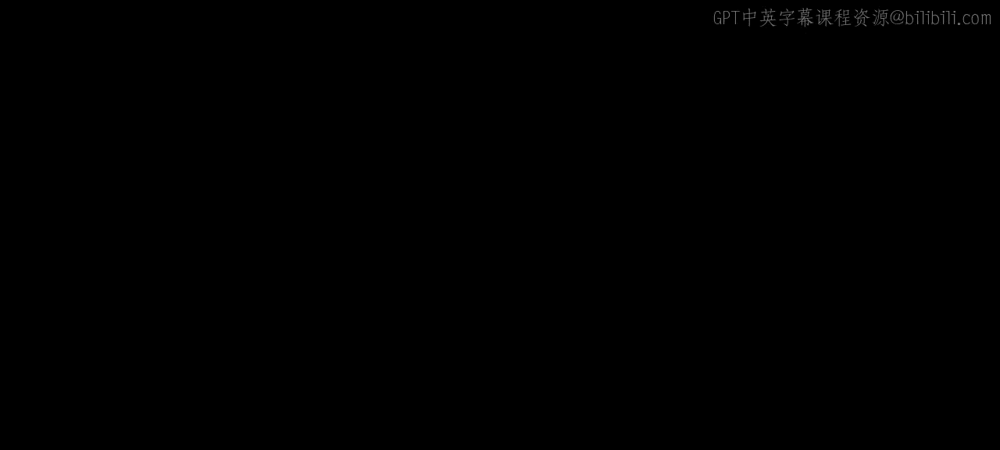

🎼Is spelled out here in a nice essay by Matthews 1998。

 I that different people could use Bayes's theem and get different results。

 And so faced with some experimental evidence per se。

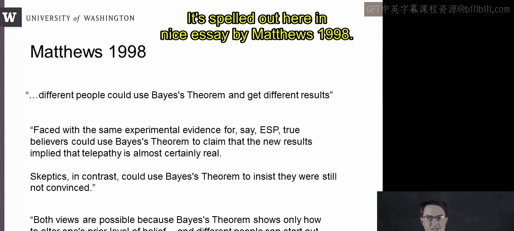

ESP， true believers could use basises theorem to show that the new results confirmed it while skeptics could。

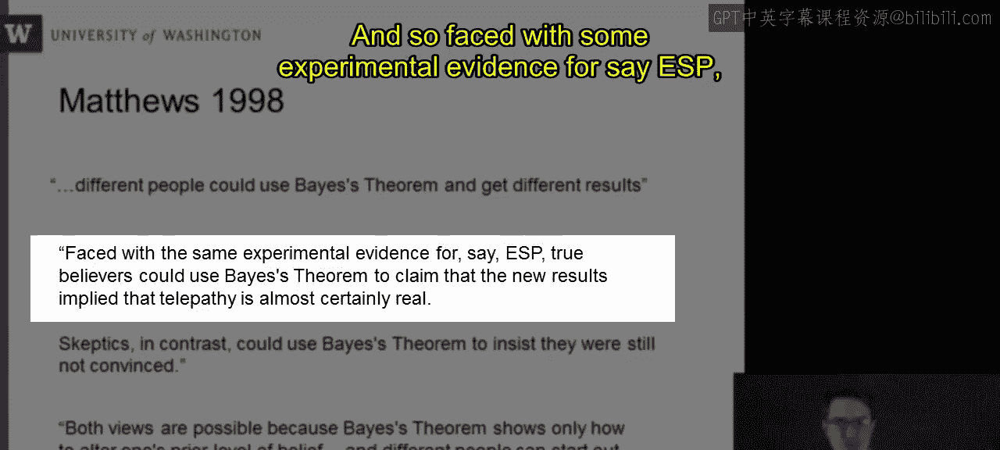

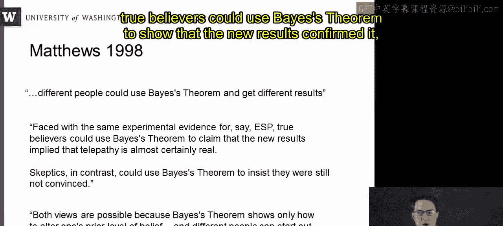

Use it to。Show that the the SP didn't exist。 Okay， and both views are possible because Bayes theorem only shows how to alter one's prior level of beat belief。

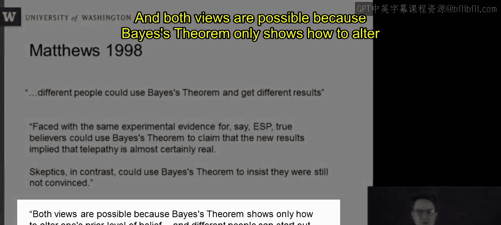

And different people can start out with different opinions。 Okay， so that's the issue。

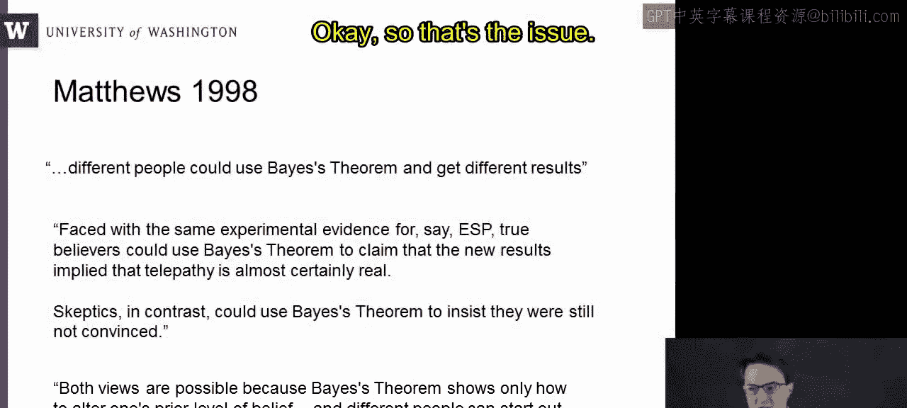

So the frequency approach。laid out by Fisher and others。

 were able to achieve what was thought to be impossible。

 which is a way of judging the significance of experimental data independent of any prior beliefs。所以。

Had found a way that anyone could use to show that the result was too impressive。

 was too statistically significant to be dismissed as a fluke。

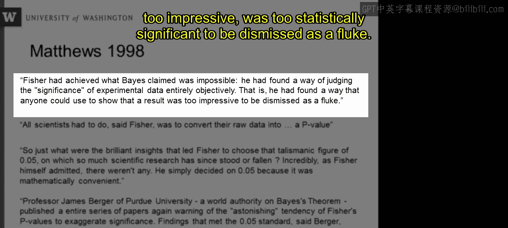

And you， all you had to do was convert your raw data into this thing called a P value。All right。Now。

 you still done some sort of a threshold to measure the significance of this P value。

 And that was written up as 0。05 in by Fisher， you know， in a。

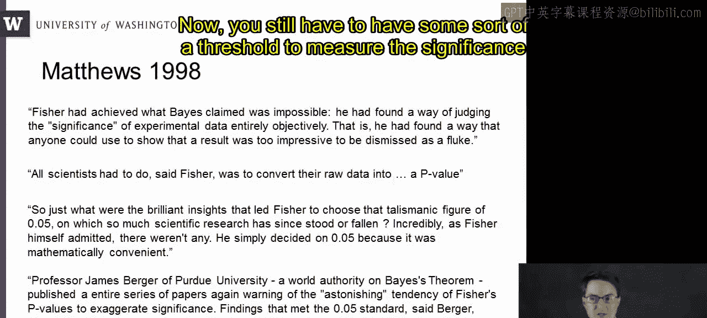

Original paper。So what were the insights that led to this？Particular value is 0。05。 Well。

 Fisher admitted that there weren't any。 He simply decided 0。

05 because it was mathematically convenient。

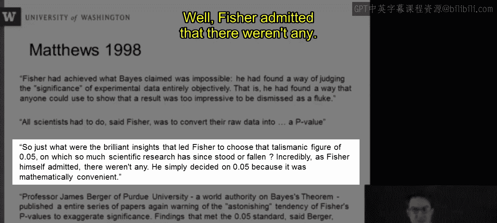

And， you know， in the many people have pointed out， say， from the 60s on。

 there's been periods of time where there's been a significant amount of work showing that this。

Approach with these particular thresholds are able to produce a lot of incorrect conclusions。

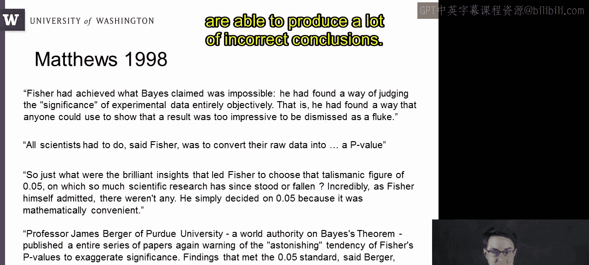

So James Burerger at Purdue wrote an entire series of papers warning about the quote。

 astonishing tendency of Fer' P values to exaggerate significance。

 findings that met the 1 in 20 standard can actually arise when the data provide little very little or no evidence in favor of an effect。

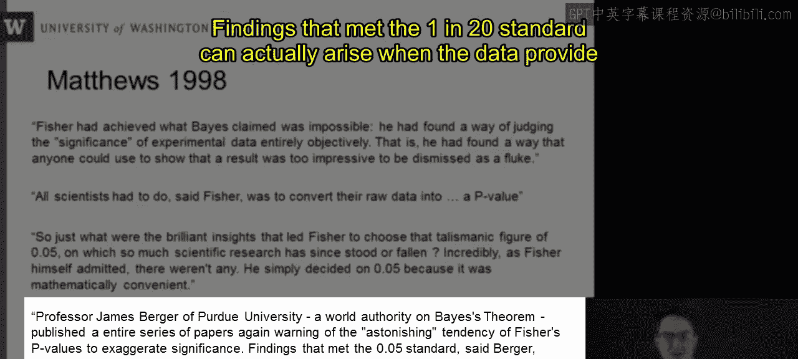

So that's the problem。Perhaps we can say that the pendulum is， in some sense swinging back towards。

The baesing approach one more。Problem with the amazinging approach that I'll bring up that。

IDon't necessarily have a slide on。Which we'll see in a little bit of detail in perhaps the next segment。

Is that these conditional probabilities and these prior probabilities end up for you to model a situation mathematically。

And that a situation may be very difficult to model mathematically。So what you do is you get these。

 what you end up with is these chains of complicated conditional probabilities that need to be integrated in order to apply。

Baess rule。This was computationally intractable。 And there was a norm， a huge number of。

Tricks and simplifications and ideas used to make this more tractable。

OkayBut thanks to the development of methods that allow you to sample these complicated distributions computationally。

This approach is becoming increasingly popular。Okay。

 and there's a lot of thinkers in this space that believe that， you know， for the 21st century。

A combination of frequent andbaing approaches is going to be。Dominant。Okay， so for these reasons。

 we're going to make sure we talk about the Bayesian approach at a very introductory level and leading up to a machine learning algorithm called naive Bays。

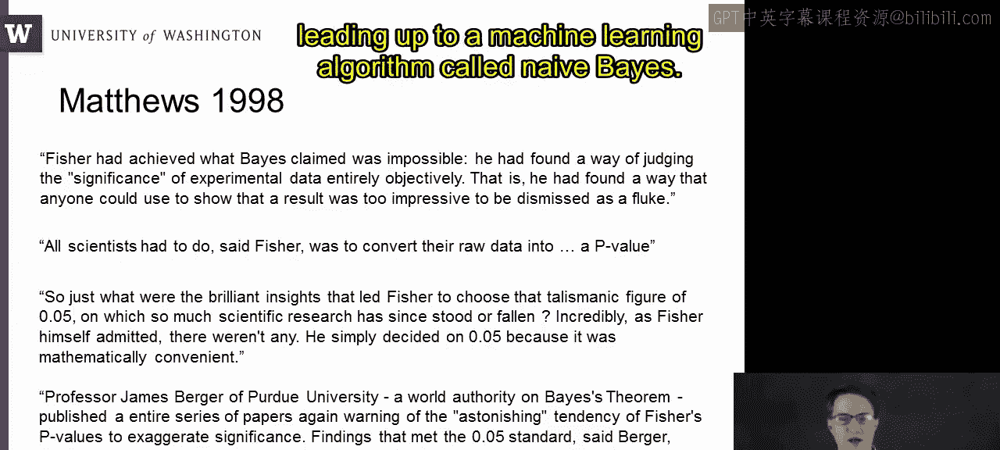