# 大规模数据科学：第2课：贝叶斯方法的动机

在本节课中，我们将探讨统计学中贝叶斯方法的起源、其核心争议，以及它为何在历史上被频率主义方法所取代，如今又重新受到重视。

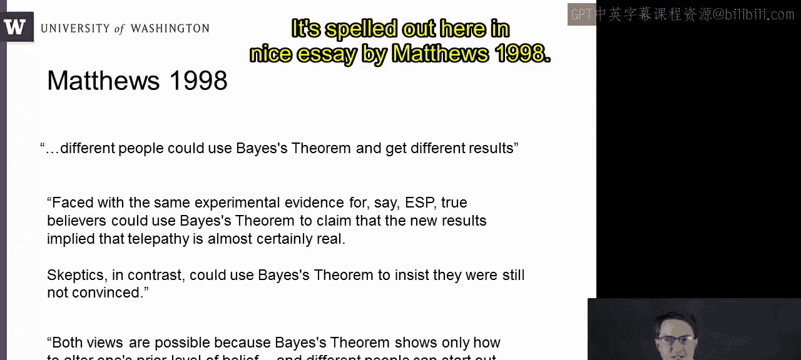

## 贝叶斯定理的争议

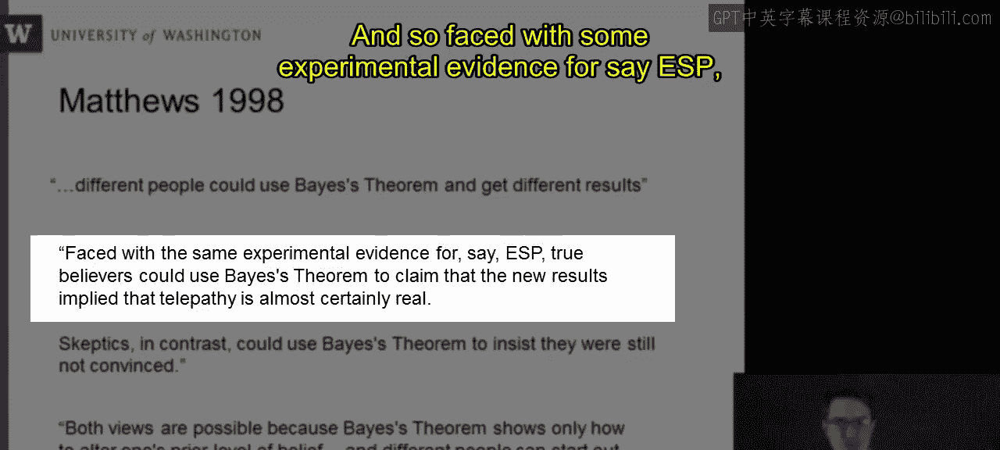

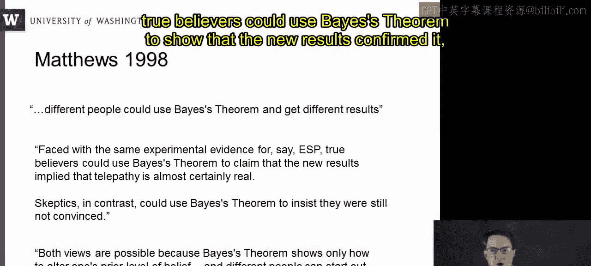

上一节我们介绍了贝叶斯定理的基本形式。本节中我们来看看它在历史上引发的一个核心争议。

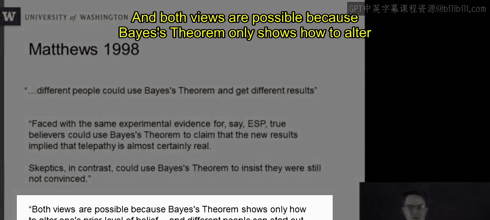

贝叶斯定理允许不同的人基于相同的实验证据得出完全相反的结论。Matthews在1998年的一篇论文中清晰地阐述了这一点。

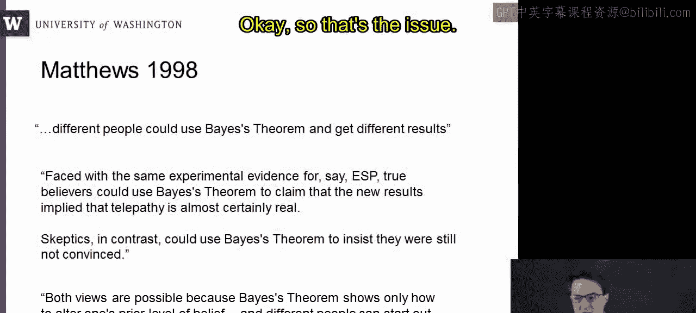

以下是该争议的具体表现：

*   **支持者**：对于超感官知觉（ESP）这样的现象，真正的信徒可以使用贝叶斯定理来证明新的实验结果支持其存在。
*   **怀疑者**：怀疑者同样可以使用贝叶斯定理来证明ESP并不存在。

这两种观点之所以都可能成立，是因为贝叶斯定理只展示了如何根据新证据**更新个人先前的信念水平**。而不同的人在一开始就可以持有不同的先验观点。这就是问题的关键。

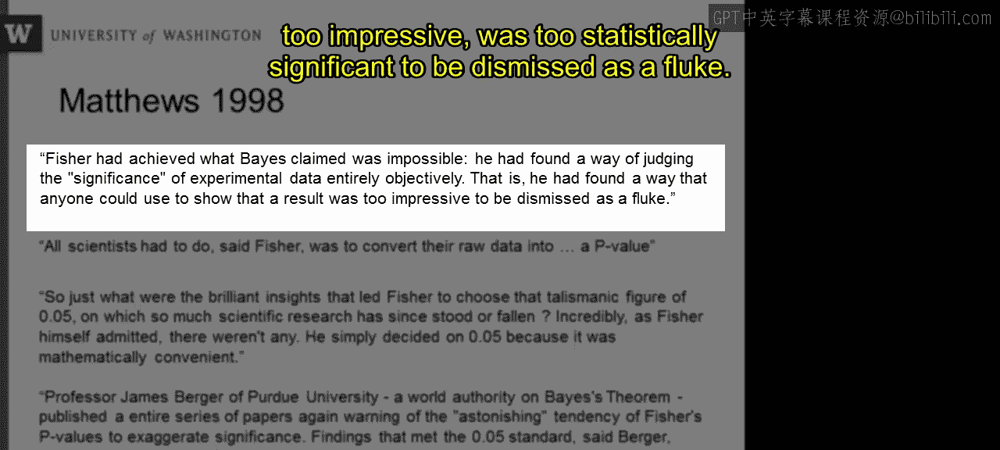

## 频率主义方法的兴起

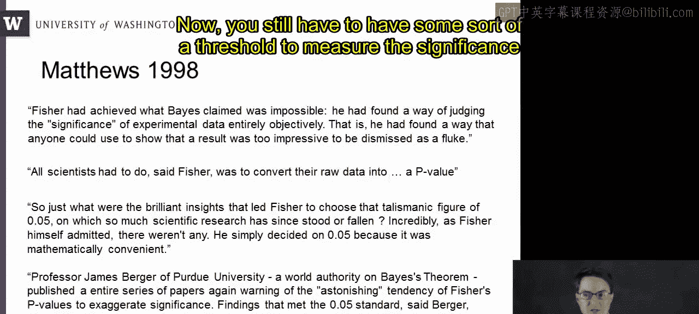

面对贝叶斯方法依赖于主观先验信念的问题，以Fisher为代表的统计学家发展出了频率主义方法。

频率主义方法被认为实现了一个突破：它找到了一种**独立于任何先验信念**来判断实验数据显著性的方法。任何人都可以使用这种方法来证明一个结果在统计上过于显著，不能被轻易视为偶然。

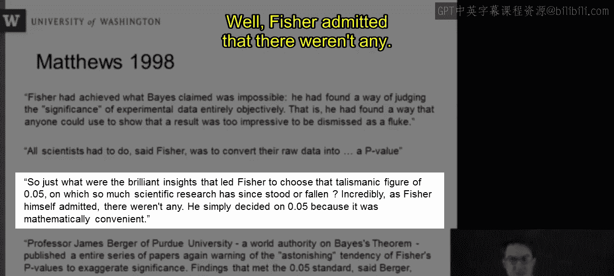

以下是频率主义方法的核心操作：

1.  将原始数据转换为一个称为 **P值** 的指标。
2.  设定一个阈值来衡量这个P值的显著性。Fisher在其原始论文中，将这个阈值设定为 **0.05**。

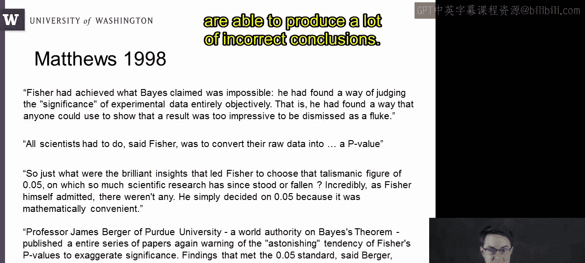

关于这个0.05阈值的来源，Fisher承认并没有特别的洞察。他选择0.05仅仅是因为它在数学上比较方便。

## 频率主义方法的问题

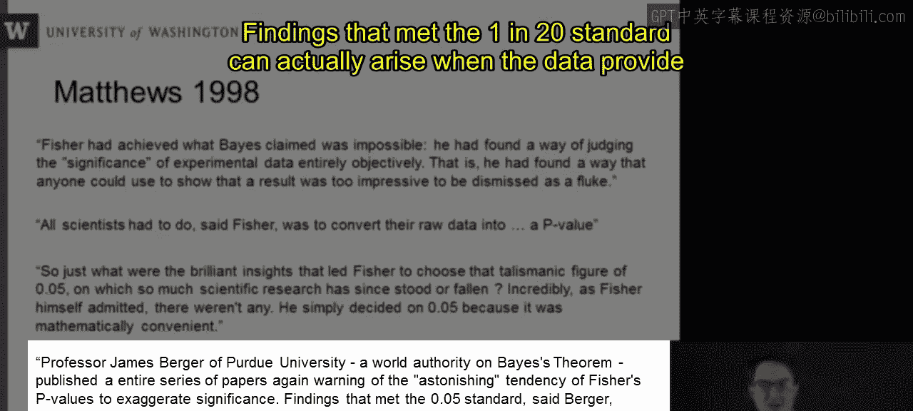

然而，从20世纪60年代起，大量研究开始揭示频率主义方法及其特定阈值（如0.05）所存在的问题。

普渡大学的James Berger撰写了一系列论文，警告了所谓的“Fisher的P值惊人地倾向于夸大显著性”的趋势。那些满足“20分之1”标准（即p<0.05）的发现，实际上可能在数据几乎不提供或完全不支持效应存在的情况下出现。

## 贝叶斯方法的复兴

可以说，在某些意义上，钟摆正再次摆回贝叶斯方法。除了主观性问题，贝叶斯方法还存在另一个挑战，我们将在后续部分详细讨论。

这个挑战是：为了用数学模型描述一个情境，你需要处理这些条件概率和先验概率。对于一个复杂的情境，建立数学模型可能非常困难。其结果是，你最终会得到一系列复杂的、需要积分才能应用贝叶斯规则的条件概率链。

这在计算上是难以处理的。历史上，人们使用了大量的技巧、简化和思路来使其变得可行。

但是，得益于能够通过计算对复杂分布进行采样的方法（如马尔可夫链蒙特卡洛方法）的发展，贝叶斯方法正变得越来越流行。该领域的许多思想家相信，对于21世纪而言，**频率主义与贝叶斯方法的结合**将成为主流。

## 总结

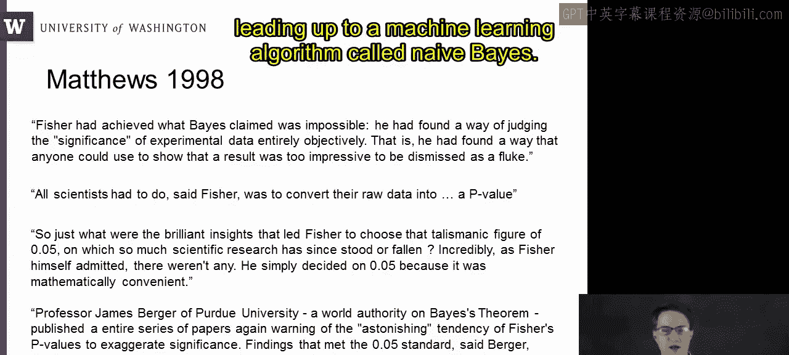

本节课中我们一起学习了贝叶斯方法的历史动机。我们了解到，由于其结论依赖于主观的先验信念，贝叶斯方法曾引发争议并被强调客观性的频率主义方法所取代。然而，频率主义方法（尤其是基于固定P值阈值）也被发现可能导致错误的结论。如今，随着计算能力的提升和新算法的发展，能够结合先验知识与数据的贝叶斯方法正重新获得重视。正是基于这些原因，我们将在入门层面探讨贝叶斯方法，并最终引向一个重要的机器学习算法——朴素贝叶斯。