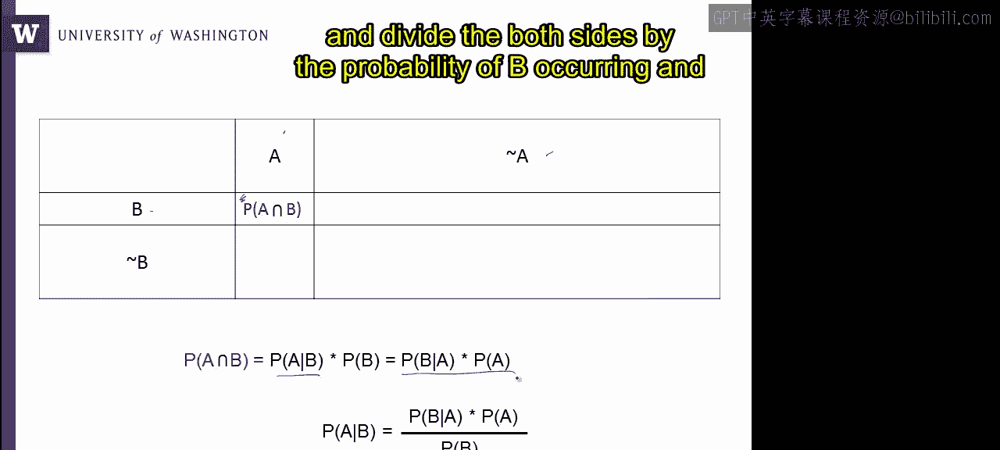
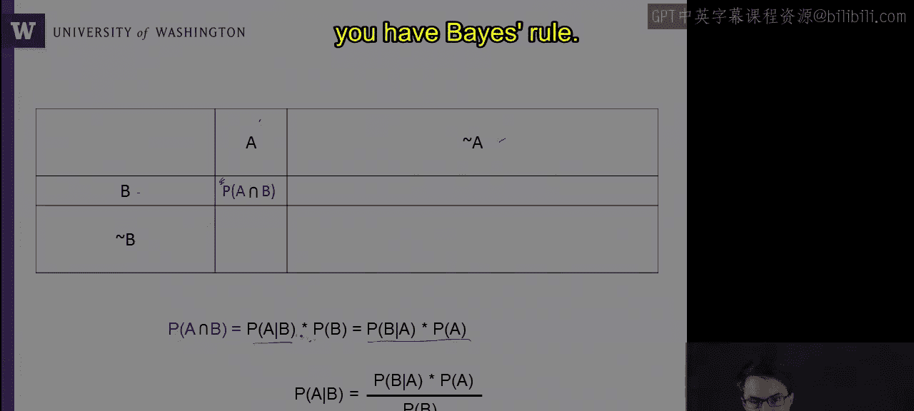

# 杜克大学《大规模数据科学（预测分析，交流数据科学结果，第2、3课⧸共3课有视频）｜Data Science at Scale》中英字幕 p26 25_贝叶斯定理.zh_en -BV1xf421Q7bH_p26-

。

we talked about Bayesian versus frequent approaches to statistics。

 And this cartoon is my attempt at a quick summary。 So the frequent approach is concerned with。

Using the data and only the data to make a decision while the Bayesian approach incorporates prior belief as well as the data。

Okay， and that's both a strength and a weakness。Strength in that， if you have good information。

 you can incorporate it if the weakness in that， you have to actually incorporate information and that it's。

somewhatwhat subjective。Dpenending on who you're talking to， fine。So Bayes's theorem。

 breaking it down。A little more detail。 You've got this terminology you can apply to it。

 So the prior， as we said here in blue， is the probability of the hypothesis being true before you've collected new data。

 right， So what's the in the global population。啊。How many people are above a certain height？

Then the marginal probability is what is the probability of collecting this date。

 this particular data observations under all possible hypotheses？

And then the likelihood is the probability of collecting this data。

 given that our hypothesis is actually true， and then finally the posterior is what we're usually trying to compute。

 which is the probability of our hypothesis being true。Given the data collected， we talked about。

 so let's think about it this way。Arrange this into a grid is it's actually pretty。

Trivial to derive this theorem if you think carefully about what's going on。

So a nice way to explain it is to。Build a two by two grid like this where you have。A。And B。

And not A and not B。And。The box here is the probability of。A and B happening。Well。

 A and B is the probability of A， given that B has already occurred。

 multiplied by the probability that B occurs。RightAnd you should take a moment and convince yourself of that。

Equivalently。It's the probability that B of B occurring given that A has already occurred。

 multipied by the probability that A actually occurs。Okay。So these things are。

Set these two things equal to each other and divide the both sides by probability of B occurring and you have bases rule。

