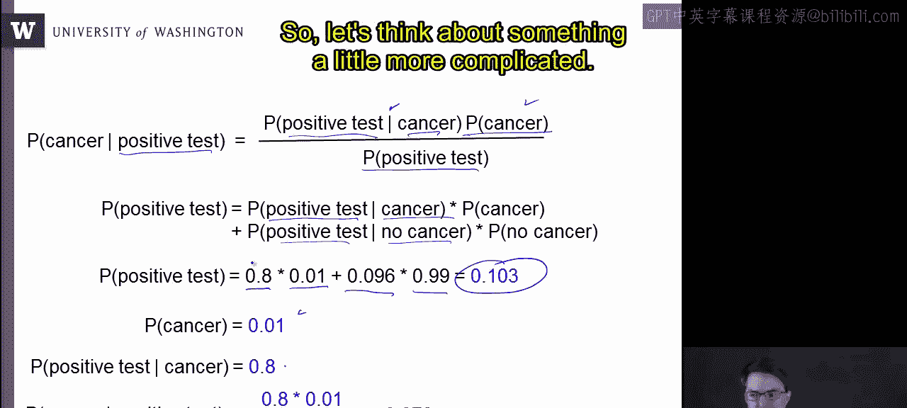

# 杜克大学《大规模数据科学（预测分析，交流数据科学结果，第2、3课⧸共3课有视频）｜Data Science at Scale》中英字幕 p27 26_应用贝叶斯定理.zh_en -BV1xf421Q7bH_p27-

。

All right so let's try this out。It's a question。Say you know that 1% of women at age 40 who participate in routine screening。

Have breast cancer。And let's say you know that 80% of women who actually do have breast cancer will get a positive。

Resolve from the test。Further， say you know that 9。

6% of women who do not have breast cancer will also get。Positive results。

 so these are the false positive rate。Okay， now， given that you know that a woman in this age group had a positive test。

The test came back positive in a routine screening。

 what is the probability that she actually has breast cancer？

And you should take a minute to sort of work this out。So what's sort of remarkable is that。

This is a fairly straightforward application of Bayes's rule。But。Intuitively。

 it's easy to make sort of。Mistakes in in the reasoning and in fact。

 when you ask this there's's been some famous studies that are now somewhat out of date where they asked doctors this question and the doctors came up with wildly wrong answers。

 Only 15% of the doctors they asked were able to answer the question correctly。Okay。So。

Here's how to break it down。Again， with our two by two grade， we've got 1% of cases that have cancer。

And we've got 99， which means we have 99% of。In we do not have cancer。

 this is in the global population right and let's say we just know this right。

 We know that 1% of people all across the board have cancer。

 or at least in this group that we're studying， shouldn't say across the board。Okay。Now。

 we also know that。If you have cancer。There's an 80% chance that when you take the test。

 it'll come back positive。Okay， so the true positive rate is 1% have cancer times 80%。Now。

 we're also given that。啊。If you do not have cancer and you take the test。

You'll get a positive result at a rate of 9。6%。 And so the false positive rate is the。

Rate of not having cancer， 99% times 9。6%。Now， similar for the false。

 negative and true negative tests， 1% times 20 times 1 minus 80。And 99% time is 1 minus9。6 is 90。4。

 Okay， so we have all the information we need。So going back to actually answering the question。

 we can。Write down Bayes's rule。 So what is the probability of having cancer。

 given that we have a positive test result， Well， that's the probability of getting a positive test result。

 given that we have cancer。Multipied by the probability of having cancer overall。

Divided by the probability of a。Positive test overall。So the only one of these terms。

 so we actually know this term straight out， we're given this one。Which is 80%。

And we're given this one， the probability of cancer overall is 1%。 we don't have this denominator。

Given， so we need to figure that out well。That's the chance of a positive test。

In all other occurrences， the chance of a positive test。

 given that we have cancer and the chance of a positive test， given that they don't have cancer。

In each case， multiplied by the probability of that happening， so you can decompose this。So that's 0。

8 times。The 1% probably the event of actually having cancer。Plus。9。6% times 99%。

 which gives you this number of。10。3%。 So that's the overall。

Probability of getting a positive test result。All right。

 and so now you plug this in and you end up with a number of 7。8%。For our for our answer。

 if we have a positive test result， the chance of actually having cancer is 7。8%。

 So this is lower than you might come up with if you don't think about it carefully， right。

 you might think that， boy， I got a positive test result。

 There's something there's this 80% number floating around。 you know， a boy， there's probably a 70。

80% chance that that I have cancer。 But because of the。啊。

Very low percentage of having cancer in the prior probabilities。

The actual number is still pretty low。So it's easy to make mistakes with this stuff。 Now。

 this was a remarkably simple case。 First of all， we're given all this information。 Second of all。

 there's only two possibilities。 There's these sort of binary variables。

So let's think about something a little more complicated。

