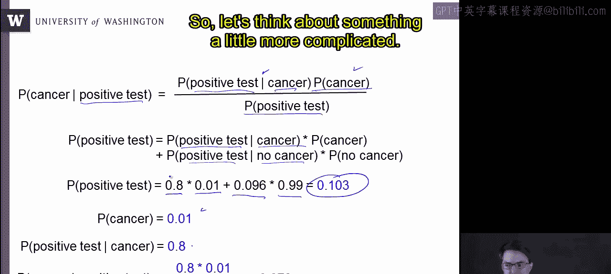

# 大规模数据科学：第2课：应用贝叶斯定理 🧮

在本节课中，我们将学习如何应用贝叶斯定理来解决一个经典的医学诊断问题。我们将通过一个具体的例子，理解如何计算在已知检测结果为阳性的情况下，某人实际患病的概率。这个例子将帮助我们掌握贝叶斯定理的核心思想及其在实际问题中的应用。

## 问题背景

假设我们已知以下信息：
*   40岁参与常规筛查的女性中，有1%患有乳腺癌。
*   真正患有乳腺癌的女性，其检测结果呈阳性的概率为80%（真阳性率）。
*   未患乳腺癌的女性，其检测结果也呈阳性的概率为9.6%（假阳性率）。

现在的问题是：如果一位该年龄段的女性在常规筛查中检测结果呈阳性，那么她实际患有乳腺癌的概率是多少？

## 构建概率表格

为了清晰地分析问题，我们可以使用一个2x2的表格来整理所有已知概率。

以下是基于给定信息计算出的各项联合概率：

*   **真阳性**：患病且检测为阳性。概率为 `1% * 80% = 0.8%`
*   **假阴性**：患病但检测为阴性。概率为 `1% * (1 - 80%) = 1% * 20% = 0.2%`
*   **假阳性**：未患病但检测为阳性。概率为 `99% * 9.6% = 9.504%`
*   **真阴性**：未患病且检测为阴性。概率为 `99% * (1 - 9.6%) = 99% * 90.4% = 89.496%`

## 应用贝叶斯定理

上一节我们整理了所有基础概率，本节中我们来看看如何应用贝叶斯定理来解答核心问题。

我们要求的是 **P(患病 | 检测阳性)**。根据贝叶斯定理，其计算公式为：

**P(患病 | 检测阳性) = [P(检测阳性 | 患病) * P(患病)] / P(检测阳性)**

现在，我们已知：
*   **P(检测阳性 | 患病)** = 80% = 0.8
*   **P(患病)** = 1% = 0.01

我们还需要计算分母 **P(检测阳性)**，即检测结果为阳性的总概率。这可以通过全概率公式计算：

**P(检测阳性) = P(检测阳性 | 患病) * P(患病) + P(检测阳性 | 未患病) * P(未患病)**

代入已知数值：
*   **P(检测阳性 | 未患病)** = 9.6% = 0.096
*   **P(未患病)** = 99% = 0.99

因此：
**P(检测阳性) = (0.8 * 0.01) + (0.096 * 0.99) = 0.008 + 0.09504 = 0.10304**

所以，检测呈阳性的总体概率约为 **10.3%**。

## 计算最终答案

现在，我们将所有数值代入贝叶斯公式：

**P(患病 | 检测阳性) = (0.8 * 0.01) / 0.10304 ≈ 0.0776**

计算结果表明，在检测结果为阳性的条件下，该女性实际患有乳腺癌的概率约为 **7.8%**。

这个结果可能低于许多人的直觉判断。人们可能会因为“80%的真阳性率”而高估患病概率。然而，由于患病的先验概率（1%）非常低，即使检测呈阳性，后验概率仍然相对较低。这正体现了贝叶斯推理的核心：将新证据（检测结果）与先验知识（基础患病率）相结合。

## 总结与思考

本节课中我们一起学习了如何应用贝叶斯定理解决一个具体的概率推理问题。我们通过构建概率表格理清了信息，然后严格遵循贝叶斯公式的步骤，计算出了在阳性检测结果下患病的后验概率。

这个例子虽然只涉及两个状态（患病/未患病）和二元结果（阳性/阴性），但它清晰地展示了贝叶斯定理如何修正我们的信念。在实际的大规模数据科学问题中，变量和状态可能复杂得多，但核心逻辑是相通的：利用数据（证据）来更新我们对未知事物的认知（概率）。理解这个简单案例是处理更复杂贝叶斯模型的重要基础。