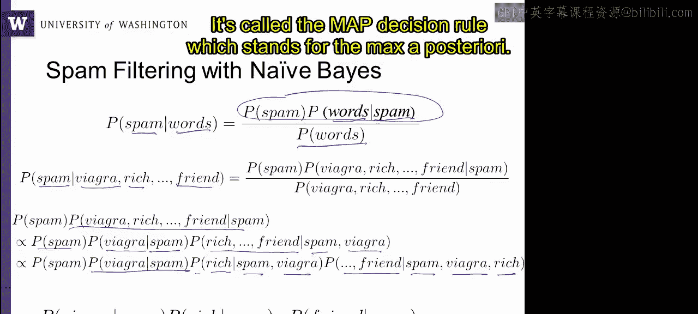

# 杜克大学《大规模数据科学（预测分析，交流数据科学结果，第2、3课⧸共3课有视频）｜Data Science at Scale》中英字幕 p28 27_朴素贝叶斯垃圾邮件过滤.zh_en -BV1xf421Q7bH_p28-

。

Okay， so let's consider a classic application of Bays's rule to a big data problem。

 which is spam filtering okay so here our task is to determine whether an email message is spam。

The probability that an email message is spam。Given。The words in the email message。Okay。

And with Bay's rule， you can express that probability as the probability that the email messages is spam overall。

Multipied by the probability of seeing these particular words in the message。

 given that we already know it' spam。And all that divided by the probability of seeing these words in the message。

Now， the interesting one here is。This numerator。And the reason is is that the probability of words appearing doesn't。

🤢，Involve the unknown label of whether it's spam or not， and so all we're trying to do is。

Get a relative frequency of spam or not spam okay， and so just dividing by a constant factor of the probability of seeing these words doesn't actually change our decision at all So we don't actually care for the actual number。

 We just care about decision of spam or not spam okay。So fine。

 So reexpressing this before we get rid of the denominator， reexpressing this。

 what do we mean by words well？This would， you can rewrite this as probability that the email message is spam。

 given that the word Viaggra appears in the message， given that the word rich appears in the message。

 given that the word something more innocuous， perhaps like friend appears in the message。

 So all the words。In the English language or all the words of interest to us in this test。ok。

So that's reexpressed that way now dis numerator。Can be rewritten in the following way。

 given that it's a conditional probability we can apply。

A chain rule a repeated application of the definition of conditional probability to。Obtain this。

 the probability that it's spam multiplied by。 let's see。

 So this expression rather can be expressed as the probability of seeing the word Viagra。

Given that it's spam multiplied by the probability of seeing all these other words。

Given that it's spam and given that it's Viagra， or given that the email message contains Viaggra。

And you can keep going。This probability time is probability of seeing the word rich。

 given that it's spam and given that it's Viaggra， multiplied by the probability of all the other words。

 given that it is spam， given that it contains the word Viaggra。

 given that it contains the word rich and so on so this is a long complicated conditional probability。

And this is where the naive base assumption comes in。So under the nas assumption， we say that。

The probabilities of these different words appearing an email message are completely independent。

 that it's no more likely for you to see the word rich。When you see the word wealth。Then it is。

You know， without the word wealth there， okay， this isn't true， right。

 obviously words go go together。 There are cooccurrence rates， right。

 but you just ignore that and just treat everything as completely independent。

 which allows you to simplify this expression as just a sequence of probabilities。

 What is the probability of seeing the word viaaggra， given that it's spam。

 what is the probability of seeing the word rich， given that it's spam and so on。 Now。

 how do you get these probabilities。Well， you have data。You have a set of documents。

That had been prelabeled as spam。And you can look at the number of them that contain the word rich and divide by the total number。

Okay。And so， now you can。Calculate。The probability of the two classes。

Spam and not spam and apply a decision procedure to call it。 And in fact， a simple one is just。

Whichever one is more likely， whichever one has the higher probability。

 it's called the map decision rule， which stands for the Mac a posteriori。

