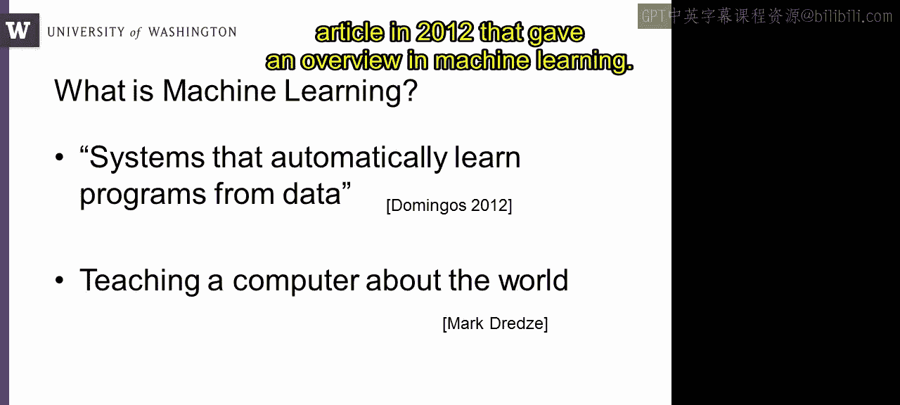
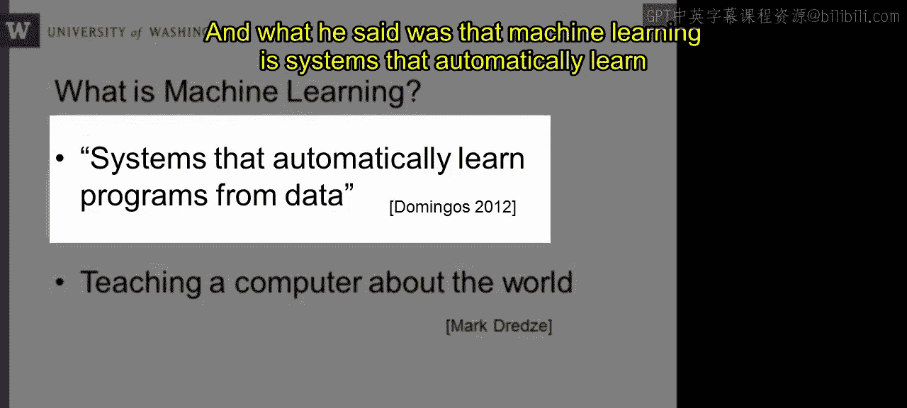
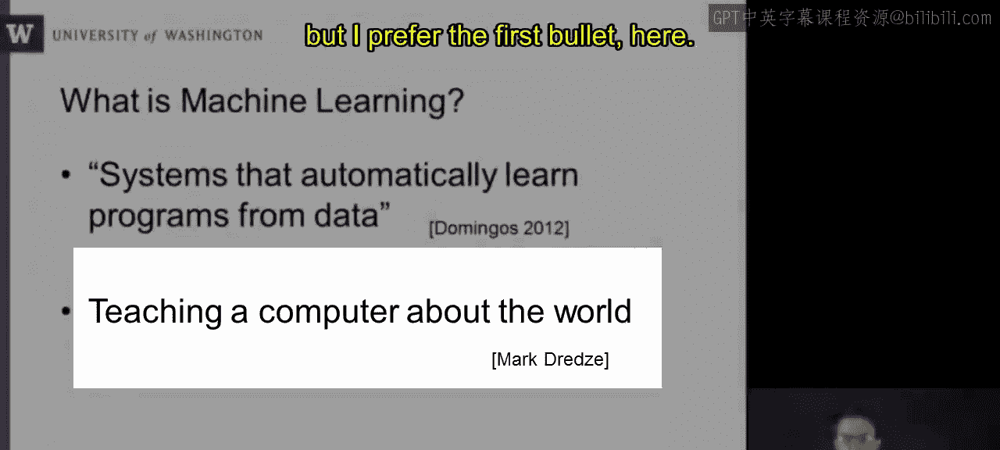
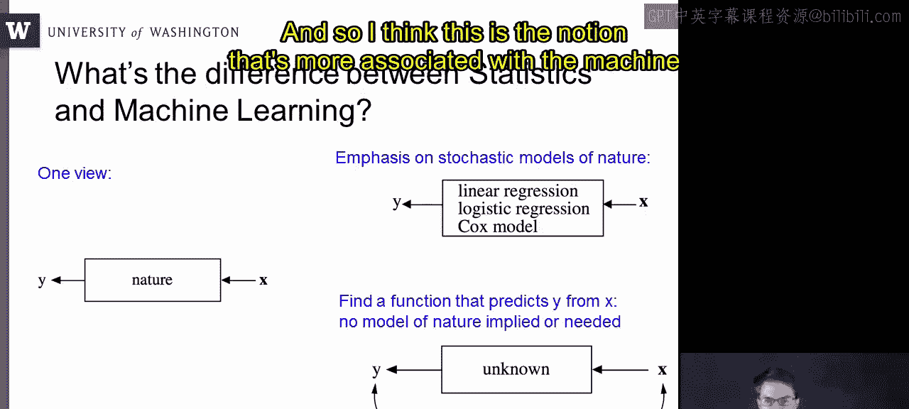

# 杜克大学《大规模数据科学（预测分析，交流数据科学结果，第2、3课⧸共3课有视频）｜Data Science at Scale》中英字幕 p29 28_统计vs机器学习.zh_en -BV1xf421Q7bH_p29-

。

So in the last several segments， we covered selected topics in experiment design， hypothesis testing。

 and statistical estimation。And we motivated these topics by considering the so-called decline effect where scientific results turn out to be less reproducible over time or their effect size。

ItDes over time， under repeated experiments。Okay， and we found that。Things like publication bias。

And the misapplication of statistical methods can explain a lot of this effect Okay。

 and then we also talk about the Bayesian perspective。

Which allows you to incorporate prior knowledge here。

 but opens the door to subjectivity leaking into the analysis， which is one of the reasons why it。

Largely rejected at the beginning of last century， but it's making a resurgence thanks to computational techniques that allow you to do sampling of complex distributions know。

 at scale。 and we didn't go into too much detail there。

 but I hope to get back to before the end of the course。So in the next few segments。

 I want to talk about。More of an algorithmic perspective that is more closely associated with the terms machine learning and data mining。

Okay。So what is machine learning。 So Pedro Domingo here at UW wrote a fantastic communications of the ACM article in 2012 that gave an overview of machine learning。

 And what he said was the machine learning is systems that automatically learn programs from data So what it means here is that when you write a program by hand you're explicitly stating how to map a set of inputs to some desired output you're giving a recipe for doing that but the point is that given enough examples of inputs and desired outputs。

 you can infer the program that maps it as opposed to having to write it explicitly。

 know so the joke is why bother writing programs when can when you can learn them instead maybe another view is teaching a computer about the world。

 but I perhaps prefer the first bullet here。

O。So。It's worth maybe a few minute or just one minute or so talking about what the difference between statistics and machine learning is。

 It's probably not worth putting a lot of time into this or thought into this because， you know。

 terms are。Not initially precise。 And they grew up in some historical context and reflect different cultures rather than being some。

Well defined notion that you can reason about。But there's a paper pretty long ago now in 2001 that talked about a certain kind of difference。

 although they weren't specifically referring to machine learning。

 it captures what I believe to be the real salient difference here Okay and so the model here on the left is that everybody involved in the space is trying to do the following。

 which is。You know。Observe that nature is able to map inputs to outputs。

 and we want to be able to predict that。You know， computationally。Okay。So。

The statisticians will attack this problem by you actually trying to model the world through someastic stochastic process in the paper they talk about data modeling。

 they talk about modeling the data， when the mean is modeling the process that gave rise to the data that you see。

Okay， and so the idea is that once you have a model of the world， you can use it to sort of。

Hypothetically draw more samples and reason about the entire population。 Okay。

 but another view that's maybe this more algorithmic view is， look， you know we。

Recognize that nature is difficult to model and we don't really care if we have an accurate model of it。

 All we're trying to do is measure our performance in predicting the outputs that we've seen from given inputs。

Okay。So' it's not important that the model that we produce， that the program that we generate。

Actually reflects the real process that's going on in nature or not。 we don't claim it does。

 But but what we do claim is that it does a pretty good job making predictions。Anyway， okay。

 and so I think this is the notion that's more associated with the machine learning approach。

All right。