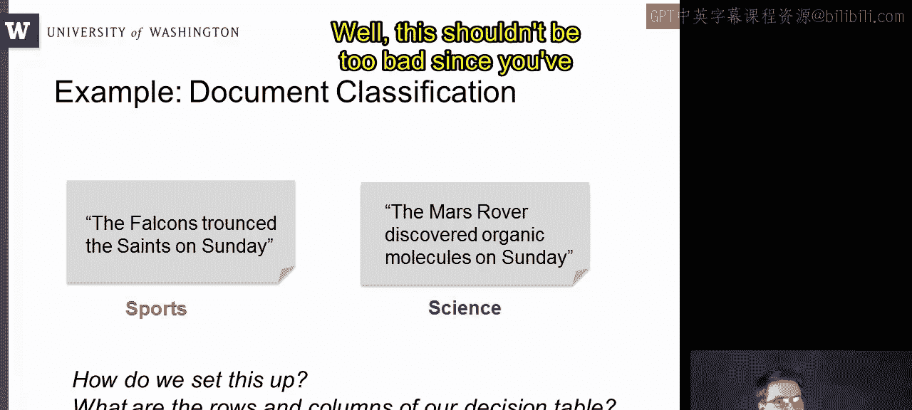

# 杜克大学《大规模数据科学（预测分析，交流数据科学结果，第2、3课⧸共3课有视频）｜Data Science at Scale》中英字幕 p30 29_简单示例.zh_en -BV1xf421Q7bH_p30-

。

So let me give you an example that comes from Whitton that's used pretty ubiquitously to explain some of the concepts of machine learning and we won't use this example too much。

 but it is useful for a variety of purposes so imagine you're trying to predict when someone is going play golf or play tennis or do some other outdoor activity and we imagine that it's a function of the weather and so we take in inputs like the outlook of whether it's sunny or overcast or rainy。

 the temperature， whether it's hot， cool， mild the humidity。

 how windy it is and we want to learn a function that takes in those inputs and produces a yes or no answer。

 whether or not we play say golf and so。The simplest version of this you might do just intuitively is just try to predict it with a simple rule。

 So you might say， look。Maybe we only play when it's sunny， you know， is this true or not， Well， no。

 it's not true because we find we can find examples where we didn' indeed play when it was overcast。

Okay，You might say， well， maybe we don't play if it's rainy and windy。 And that turns out to be true。

 but there's also other times that we don't play as well。 So the pattern that， you know。

 if a function exists that can predict this output， well。

 it's perhaps not something that we can express in just one simple rule。

 which is kind of the limit of what we can do you know， mentally just through intuition。

 the idea is we need some。Pinncipled way of coming up with more complex models when。

 when they're needed。Okay。So fine， so this some terminology。

 this problem is an example of a classification problem where there's a learned attribute and it's categorical。

 It can take two values in this case，0 or1。 If the learned attribute is more of a numeric value。

 for example， what our score at golf was。You know， as a function of the weather。

 if we to try to predict that， that'd be more of a regression。Case。Okay。

 and really not just learned attributes， probably when all the attributes are numerical America。

 becomes more of a classical regression case， although there's ways to handle this。

 And so we've talked about regression in terms of， you know， fitting a curve to data。

 But when you use that fit curve to actually make predictions， that's when it's sort of。

 you can see that it's。是。Anlogous to the classification problem over categorical data。Okay。

So more terminology。The the golf example we just gave is an example of supervised learning。

 where you're given examples of inputs and the desired outputs。

 And we're trying to learn the relationship between them。 So we train a model to do this。

 And there's also a notion of unsupervised learning， which is you're not given any labels whatsoever。

 You're just given the data and you're trying to understand the underlying structure in that data。

 Okay， so this is things like clustering algorithms or dimension reduction algorithms。 If。

 if you've heard those terms before。Let let me give you an example with that can be sort of cast as either supervised learning or unsupervised learning。

It's instructive as an unsupervised learning case for right now。

 So imagine you're just given a big corpus of documents and you're trying to figure out。

You want to make a prediction of what topic a given document pertains to。

 and so you know if you see the phrase the Falcons trouncce the Saintts on Sunday， you might。

Guess that this document is about sports while if you see that the Mars rover discovered organic molecules on Sunday。

 you might guess that this document is about。Science。

 and so you how do you set this problem up as a machine learning problem？You know。

 what are the rows and columns， We just had an example where there were sort of rows and columns we said one for one record。

 we're trying to predict the output given the inputs。 What are the rows and columns here Well。

 this shouldn't be。Too bad since you've seen this before in a couple of assignments now。

