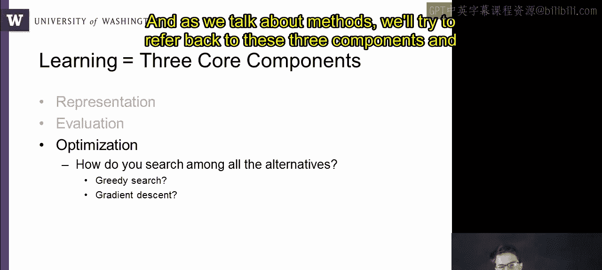
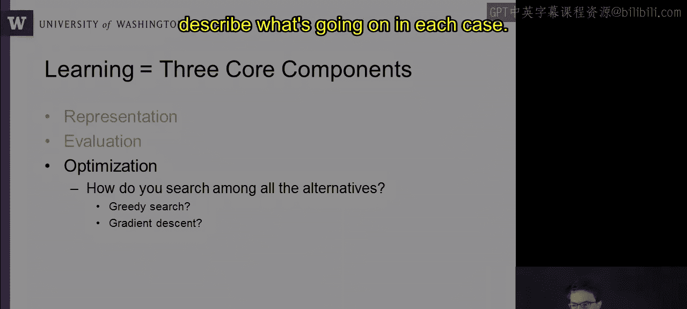

# 杜克大学《大规模数据科学（预测分析，交流数据科学结果，第2、3课⧸共3课有视频）｜Data Science at Scale》中英字幕 p31 30_机器学习问题的结构.zh_en -BV1xf421Q7bH_p31-

。

Okay， so how do we set this up？Imine you had five documents。

That were just represented by these simple phrases here。

 So document  one is just the phrase Romeo and Juliet。 Do2 is Juliet O happyapp dagger。

 Do 3 is Romeo died by the dagger and so on。Well， with some stning and some normalization of the terms。

 we could。啊。Assoociate a column of data with each one of these terms and each document is in a row in this table or matrix。

 and we put a count in each position for the number of times that term appears in the documents and again you've seen this in a couple of different assignments now。

Okay， so given this basic setup， you can think about。

A supervised learning version of the problem or an unsupervised learning problem in different contexts。

 So the supervised version is， you know， you have a corpus of documents and a human has assigned a label。

To each document in the corpus。Okay， and so you want to come up with some sort of model that can predict that label。

Given the text in the document。Okay。An unsupervised learning。Version of this problem is that。

No labels are given， but you want to discover groups of similar documents。 So you want to say that。

 look， all these things have something in common。 We don't know maybe we don't understand that it's about sports。

 but we know that they all something in common。 And these over here。

 maybe we don't know it's about science， but we know they all have something in common。

 Okay and so that would be an unsupervised learning problem in particular。

 sort of a clustering problem。All right， so in all these cases。

 there's going to be three core components to think about and this again comes from。Pedro's article。

 so they are representation， evaluation and optimization。All。

 and so every problem you come into is going to。Have something to say about all three of these。Okay。

Representation is you know what exactly is your classifier right。

 is it a rule like the ones we saw with the golf example。

 right a simple hypothesis of maybe when it's sunny we always play golf right the space of all possible such hypotheses。

 all possible such rules is the representation of this classifier。Okay。

Or is it or each one of those is perhaps a representation？Or you know。

 is it the space of all possible neural networks that map inputs to outputs， right？

Or is it decision tree， which we'll talk about in a little bit。You know。

 or if it's more numerical data， you know， if you've got a。啊啊。

2D scatter plot and you try to draw a line that precisely separates the data such that all the positive examples are on one side of the line and all the negative examples are on another side of the line。

 the space of all possible such lines is the representation here so what what the what are the nuts and bolts。

 What are the units that you're talking about。Okay， fine。 So once you have that figured out。

 you can think about， well， look， how do I judge whether one particular example of this instance of this representation is。

Effective or not how do I know the good ones from the bad ones。So， for example。

 with the rules when you're trying to play golf， I've got a rule that says when it's sunny we play golf and when it's rainy and windy we don't。

 those are two different rules， how do I judge which one's better Well there's different you have to make some sort of a choice about how you're going to evaluate this thing and it could be just the number of errors it makes on some given test set or you could define some notion of precision and recall。

Or if it's more of a regression numerical case， you could talk about the。

Absolute error or the squared error or other variance right。

 They need to make some sort of a decision here。 So now we have， you know。

 if we have the representation， we have a space of possible units and now we have a evaluation method selected where we can take a given instance and determine whether it was any good or not。

Fine。The third piece here is optimization。 So how do you search among this。

Potentially massive space of or potentially infinite space of。Possible hypotheses， okay， so in。

Pretty much no case。 is it going to be feasible to enumerate all possible。

Insts and apply your evaluation technique to find the best one。

 so you're going to have to have some method of searching through this efficiently。Okay。Now。

What's useful， I think， about this breakdown is that it helps make sense of the various terms and methods you'll hear if you sort of scan the machine learning literature is that many times you'll be。

What will be being presented is just an optimization technique that can apply to a variety of different representations and even evaluations and you can plug in your own evaluation and plug in your own representation that it'll still work other times you're talking about a representation that is amenable to a variety of different optimization strategies or particular algorithms okay so it helps make sense to understand which one of these three things you're talking about or if you're talking about something that really denotes all。

Some choice about all three。Okay。And so we're as we talk about methods。

 we'll try to refer back to these three components and describe what's going on in each case。

