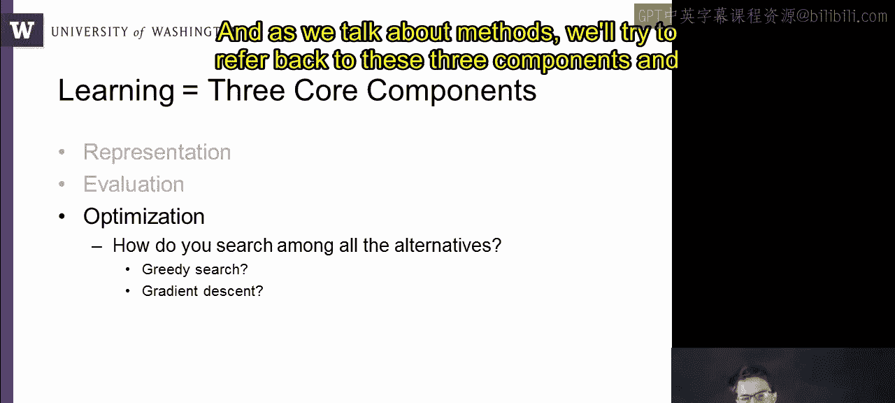
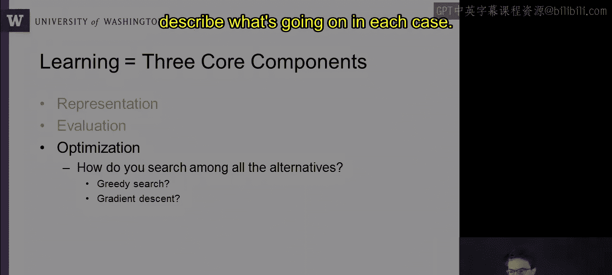

# 大规模数据科学：第2课：机器学习问题的结构


在本节课中，我们将学习如何构建一个机器学习问题。我们将通过一个文档分类的例子，了解从原始数据到模型构建的完整流程，并深入探讨构成机器学习问题的三个核心组件。

## 文档表示：从文本到矩阵

上一节我们介绍了机器学习的基本概念，本节中我们来看看如何将实际问题转化为机器学习可以处理的形式。我们以文档分类为例。

假设我们有五个文档，每个文档由简单的短语表示。例如：
*   文档1：`Romeo and Juliet`
*   文档2：`Juliet O happy dagger`
*   文档3：`Romeo died by the dagger`

经过一些文本处理（如分词和归一化），我们可以将每个独特的词（术语）视为数据的一列，每个文档视为矩阵中的一行。在每个单元格中，我们填入该术语在对应文档中出现的次数。这种表示方法被称为**词袋模型**或**文档-术语矩阵**。

用代码可以表示为：
```python
# 一个简化的文档-术语矩阵示例
doc_term_matrix = [
    [1, 1, 1, 0, 0, 0], # 文档1：Romeo, and, Juliet
    [0, 0, 1, 1, 1, 1], # 文档2：Juliet, O, happy, dagger
    [1, 0, 0, 0, 0, 1]  # 文档3：Romeo, died, by, the, dagger
]
# 列对应术语：[‘Romeo‘, ‘and‘, ‘Juliet‘, ‘O‘, ‘happy‘, ‘dagger‘]
```

## 监督学习与无监督学习

基于这个基本设置，我们可以考虑两种不同的学习范式。

**监督学习版本**：我们有一个文档语料库，并且人类已经为语料库中的每个文档分配了一个标签（例如，“悲剧”、“喜剧”）。目标是构建一个模型，能够根据文档中的文本来预测这个标签。

**无监督学习版本**：没有给出任何标签。我们的目标是发现相似的文档组，即进行聚类。例如，我们可能不知道某些文档都是关于“体育”的，但算法可以发现它们具有某些共同特征。

## 机器学习的三要素

在所有这些情况下，思考问题都需要三个核心组件，这源自Pedro Domingos的经典文章。它们是：**表示**、**评估**和**优化**。每个你遇到的机器学习问题都需要对这三个方面做出决策。

### 1. 表示

表示指的是你的分类器或模型的具体形式。它定义了所有可能假设的集合。

以下是几种常见的表示形式：
*   **规则**：例如在高尔夫例子中，“如果是晴天，我们就打高尔夫”。所有此类可能规则的集合就是一种表示。
*   **神经网络**：所有可能将输入映射到输出的神经网络结构的集合。
*   **决策树**：所有可能的分支判断树结构的集合。
*   **线性分类器**：对于数值数据，例如在二维散点图中，所有可能将正负样本分开的直线的集合。

简而言之，表示就是模型的“螺母和螺栓”，是你用来构建解决方案的基本单元。

### 2. 评估

一旦确定了表示形式，就需要判断这个表示形式下的某个具体实例（即一个具体的模型）是好是坏。我们需要选择一个评估方法来衡量模型的有效性。

根据问题类型，可以选择不同的评估指标：
*   **分类问题**：在给定测试集上的错误数量、精确率、召回率等。
*   **回归问题**：绝对误差、平方误差、方差等。

评估方法为我们提供了一把尺子，用来度量模型性能。

### 3. 优化

优化是指如何在这个可能非常庞大甚至是无限的可能假设空间中进行搜索，以找到评估指标下最好的那个模型。在绝大多数情况下，枚举所有可能的模型实例并应用评估技术来找到最佳者是不可行的。

因此，我们需要一种高效搜索这个空间的方法。优化算法（如梯度下降、遗传算法、贪心算法等）就是用来解决这个问题的工具。

## 理解机器学习方法

这种三分法有助于理解你在机器学习文献中遇到的各种术语和方法。很多时候，你看到的内容可能只是：
*   一种**优化技术**，它可以应用于多种不同的表示和评估方法。
*   一种**表示形式**，它适用于多种不同的优化策略。
*   或者是一个完整的方案，它同时规定了表示、评估和优化的特定选择。

在我们讨论具体方法时，会尝试回溯到这三个组件，并描述在每种情况下发生了什么。

---





本节课中我们一起学习了如何构建一个机器学习问题。我们从文档表示的例子出发，区分了监督学习和无监督学习的不同场景。最重要的是，我们深入剖析了构成任何机器学习方法的三个核心要素：**表示**（模型的形式）、**评估**（衡量模型好坏的标准）和**优化**（寻找最佳模型的方法）。理解这三个组件，将帮助你更有条理地理解和设计机器学习解决方案。