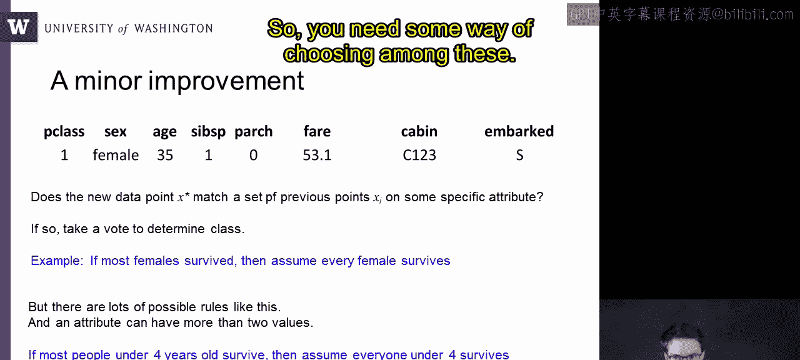

# 杜克大学《大规模数据科学（预测分析，交流数据科学结果，第2、3课⧸共3课有视频）｜Data Science at Scale》中英字幕 p32 31_使用简单规则进行分类.zh_en -BV1xf421Q7bH_p32-

。

Okay， let's consider some specific algorithmic techniques。

One of the data sets I want to use to illustrate these techniques is the passenger list from the Titanic。

 and this is a data that's available out there in the web and has been used for various purposes。

 but it's also available。As a kagle competition and it's one of the competitions you can participate in。

 and it's used for getting started for kind of a training exercise， okay。

So what this is is a one record for each passenger on the Titanic or in the training set a subset。

Along with various attributes that describe that passenger and。

Whether or not they survive the sinking of the ship， okay， and so the columns here are survived。

 which are given to zero or1， zero meaning they did not survive。And P class is the ships class。

 like first class， second class， third class， which sort of deck they were on， gender age。

SIBSP is the number of siblings they had on the ship。PR P ARC H is number of parents and children。

 So number of children， if you're a parent or if you're well， actually either way。

 So total number of parents and children fare is the fare in dollars that they paid。

 Ca is an indication of。啊。Their cabin number。 And you can see that there's a lot of missing values here where either wasn't known。

 And then embarked is a one letter code indicating where they。Got on the ship， okay。So fine。

 So the first thing to do probably when whenever you're tackling these problems is to inspect the data。

 right， So if it's sort of telling you something， you shouldn't ignore it。 And if more importantly。

 if it's not telling anything， that's maybe a sign that it's going to be a。

Tricky to sort learn a pattern automatically。 And so one thing to do is to start plotting scatter plots。

Of these various columns。 And so one idea you might have is well。Maybe women and children first。

 right， Maybe the kids tend tended to survive。 so you can plot age。

 And then maybe you might imagine that people who had paid more for their fare sort of had more influence on this ship。

 And so this is a scatter plot of age versus。Fair， and you can see there's probably not too much of an obvious pattern。

 They're dosing oh blue here， by the way， is survived and red is did not survive。

So you can see that there's。Kind of a cluster of blue around， you know the very young children。

Maybe tend to survive months。 But than that， there's。Not anything's really obvious here， okay？

Or at least that doesn't seem obvious to me。All right， another one you can do is。Age versus sex。

 and I've played a little bit of a trick here where I'm plotting categorical data as a numeric attribute。

 which is a pretty useful trick to do。 And you can see that this is also kind of smeared a little bit here。

 And what I did was add a little bit of a jitter so that you can see the values otherwise you know it's not it's not that someone is sort of。

You know， 0。1 male and 0。9 female or anything， it's just that if you don't add that jitter then all the values end up directly on top of each other and all you see is the last one plotted and so if you spread them out a little bit you can kind of get a sense of how many are red and how many are blue。

Okay， and so one thing that does seem pretty obvious here is that， you know。

 the women and children first。Did sort of hold up right Certainly there's more blue here than there is in here。

 but again， the age doesn't necessarily tell you all that much。So fine。You know。

 a very naive classifier just to sort of illustrate a starting point is。

What's called the rot classifier。 So this is， look， if I see a new record coming in。

 I'm going to go look for an exact match in the in the training set。

 And if I've got something that agrees on every single attribute。

 then I'm gonna assign it to the same class。 If I've seen this example before， then， you know。

 Darn and I know what to do， okay。And if it doesn't， then you have to just guess。Okay。

 so this classifier is not particularly useful。 So a minor improvement on this one is。Following。

 given a new passage that we haven't seen before。啊。

See if it matches an existing example on some particular attribute。And if it does。

 then take a vote among people with the same value and see what they say。

And to use that to determine the class so for example。

 you see a new passenger and you notice that it's female。

 then you can look back at all the other females you have and if there's more females that survived than you you did not survive。

 then you declare that the new passenger must have survived as well。Okay。But you know。

 there's lots of possible rules like this， one for every value of any attribute。

 and know in particular an attribute can have more than just two values， male and female。So。

You need some way of choosing among these。