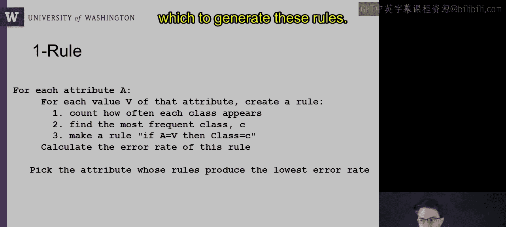

# 杜克大学《大规模数据科学（预测分析，交流数据科学结果，第2、3课⧸共3课有视频）｜Data Science at Scale》中英字幕 p33 32_学习规则.zh_en -BV1xf421Q7bH_p33-

。

So we have the representation of the hypothesistheses and in terms of rules， right。

 each rule is hypothesis。 Okay so that's the representation。 We know we need the evaluation。

 How do we determine which ones are good and which ones aren't。 Well。

 one thing you can do is construct a confusion matrix。

 which is a square matrix with a number of rows and columns。For each。Unique label。

Each you need class label。And the diagonal of the confusion matrix will tell you which labels you got right so for example here。

Using this。One simple rule that looked pretty good when we drew the scatter plot if sex equals female。

 then survive equals yes， otherwise no， we have 468。Instances where we classified。系。

The passenger as having not survived and indeed， they had not survived。

 We have 233 cases where we classified them as having survived and they didn' indeed survive。

 And the other values are when we。Are the mistakes that we made。

 we classified 109 as having survived， who actually did not。

 and we classified 81 as not having survived who actually did， okay。

So this is actually useful for sort of visual inspection。

But it doesn't really give you a single number that you need in order to actually build a program that would do this automatically。

 so what you can also do is just measure the accuracy， which is here， you know 468 plus 233。

 the number we got right over the total number。Covered by the rule。And in fact。

 we didn't have any missing values with male or female。

 so they're all covered by the rule is about 79% correct and 21% incorrect。 So this is not too bad。

 given that it's such a simple model。Okay。Fine， so another scatter plot we could look at。

 maybe an attempt to improve upon it is look at the， you know， whether they were in first class。

 second class or third class。 And here， you know， we don't have sex on here。

 which is a pretty strong indicator， but we do see some interesting patterns。

 It looks like people in first class。Tended to survive more。

 certainly more than people in third class。And then it looks like the kids in second class tended to survive。

More than the adults in second class。 Okay， so this suggests a slightly more complicated。Ru。Okay。

But here's just another example of a simple rule， just for a class itself。

 if you're in first class then you survive， if you're in second class， then you survive。

 but if you're in third class， then you don't。And so now you know the confusion matrix we can build again。

 remember the confusion matrix is just the class label， so it's still just no and yes and no yes。

 and how do we do here， Well， the diagonal tells us 372 plus 223 over the total number is only 67% correct。

 so it's a little bit worse。Okay， so we have a representation of hypotheses。

 and we have an evaluation。Method。But we need some kind of a search strategy。

To consider all these rules。And so for the one rule case。

 you conceivably could just enumerate all of them。 And so one potential search strategy。

 maybe hesitates to call it optimization is。Just to do so。 So the one rule algorithm。Is this。

For each attribute day and for each value of that attribute， create the rule。

 count how often each class appears， find the most frequent class and generate a rule if a equals V then class equals C。

And then you can calculate the error rate of that rule。

Pick the attribute whose set of rules produce the lowest error rate overall。All right。

 and now you'll have one rule now by the way， one rule again refers to actually an attribute。H。

So it's an if thin， if in， if in， if then covering all the values of that attribute。

 not just you know， for male and female， that's not two rules， that's just one rule。Okay。

 so this is kind of an exhaustive search。Strategy for which to generate these rules。

