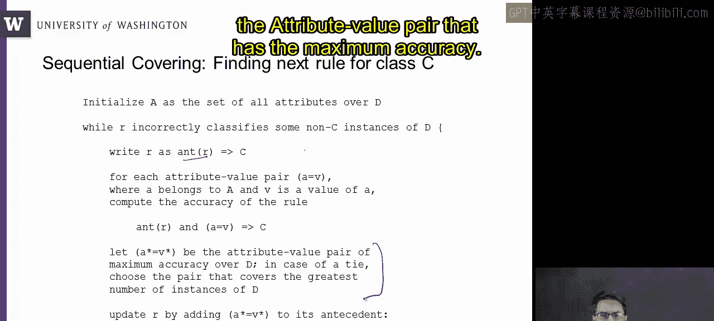

# 杜克大学《大规模数据科学（预测分析，交流数据科学结果，第2、3课⧸共3课有视频）｜Data Science at Scale》中英字幕 p34 33_规则：顺序覆盖.zh_en -BV1xf421Q7bH_p34-

。

So how far can we go with this Well you can imagine having more complex rules with more conditions in them and you can also imagine having a whole set of rules and your class eye now becomes。

Checking this whole set of rules。To determine the class。ok。

So how do we go about building an appropriate set of rules to come up with a classifier？Well， so one。

Approaches the sequential covering， which looks like this。 You start off with the data set D。

And you initialize the rule set R to be empty。And you say for each class， you。

 say survived or not survived， you can construct one rule that correctly classifies some instances in D right so you capture some of the people who survived。

And does not incorrectly classify any。Of the other glasses。Okay。

And then you add that rule to the rule set。And remove from D all the instances that were correctly classified by this rule。

 And so we're going to keep on adding up rules this way。Now， that's great。

 but it doesn't tell you how to actually find that。Next rule。 And so that's what this。

Explains so come up with a set with an initial rule R that just。

Trivially assigns class value to every record。Okay。

 and so while it's while it incorrectly classifies some of the。Non scene this is indeed。

So right R as the antecedent of R。Determinine C。 And so here， the intertecedent initially is。Nothing。

And then for each attribute value pair a equals v， where a is one of the attributes and v is some value of that attribute。

Figure out the accuracy of that rule， just like females predict survival and we've determined the accuracy there with 79% or male determines well we're just even one in class right now。

 so just just survival。Fine， and then。Figure out the attribute value pair that has the max accuracy over d。

And in case of a tie， choose one that covers more cases。All right， so now update。

The rule are with this new condition， a star equals v star。

And remove that attribute from consideration。In the said A。

Okay and then keep going until you are no longer incorrectly classifying some of the nonCat instances of D and now in the next time around the loop。

 antecein na R will be the previous condition and so that's what this notation is just trying to show so you can have the prefix of the rule and keep adding one more conjunction。

 one more condition， I should say one more equality condition to the rule one by one okay。

But the point here is that you're still looking for。啊。Ay value payer that。Has the maximum accuracy。

