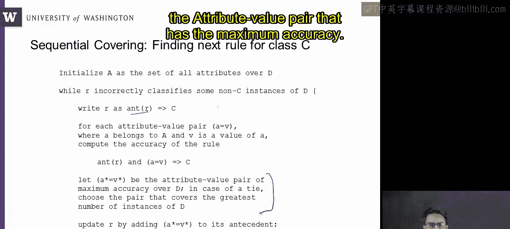

# 大规模数据科学（预测分析，交流数据科学结果，第2、3课⧸共3课有视频）：第34课：规则学习与顺序覆盖算法

在本节课中，我们将学习如何构建一个基于规则的分类器。具体来说，我们将探讨一种名为“顺序覆盖”的算法，它能够从数据中逐步学习出一组规则，用于预测目标类别。

## 从单条规则到规则集

上一节我们介绍了如何使用简单的“如果-那么”规则进行分类。然而，单条规则通常不足以捕捉数据中的所有模式。

那么，我们能走多远呢？你可以想象拥有包含更多条件的更复杂规则。你也可以想象拥有一整套规则。此时，你的分类任务就变成了检查这一整套规则，以确定最终的类别。

## 构建规则集：顺序覆盖算法

那么，我们如何构建一个合适的规则集来创建一个分类器呢？一种方法是使用顺序覆盖算法，其流程如下。

以下是顺序覆盖算法的主要步骤：

1.  从数据集 **D** 开始。
2.  将规则集 **R** 初始化为空集。
3.  对于每个目标类别（例如“幸存”或“未幸存”），重复以下过程：
    *   构建一条能正确分类 **D** 中部分实例的规则（例如，捕捉到一些幸存者），并且不会错误分类任何其他类别的实例。
    *   将这条规则添加到规则集 **R** 中。
    *   从数据集 **D** 中移除所有被这条规则正确分类的实例。
4.  继续以这种方式添加规则，直到处理完所有类别或满足停止条件。

这个方法很好，但它没有告诉你如何实际找到下一条规则。这正是接下来要解释的核心。

## 如何寻找单条规则：规则生长

顺序覆盖算法的关键在于“规则生长”过程，用于生成每一条具体的规则。

以下是规则生长的具体步骤：

1.  初始化一条规则 **r**，其前件（条件部分）为空，直接为所有记录分配目标类别值 **c**（例如，默认预测为“幸存”）。
    *   初始规则：`IF ( ) THEN class = c`
2.  当规则 **r** 仍然错误分类 **D** 中的一些非 **c** 类实例时，执行以下循环：
    *   对于每个尚未在规则中的属性-值对 **(a = v)**，计算仅添加此条件后新规则的准确率。
        *   例如，考虑条件“性别 = 女”，计算规则 `IF (性别=女) THEN 幸存` 在数据集 **D** 上的准确率。
    *   选择能带来**最高准确率**的属性-值对 **(a* = v*)**。如果出现平局，则选择覆盖更多实例的那个。
    *   用这个新条件更新规则 **r**：`r = r ∧ (a* = v*)`（即在现有条件上增加一个“且”关系）。
    *   将属性 **a*** 从后续考虑的属性集合 **A** 中移除，避免重复使用同一属性。
3.  当规则不再错误分类任何非 **c** 类实例，或无法再添加有益条件时，规则生长停止。

这个过程的核心是，你从一个空条件开始，然后贪婪地、一次一个地添加能最大程度提升规则准确率的条件，直到规则变得“纯净”或足够好。

## 算法流程图示

*上图展示了顺序覆盖算法的整体流程：从数据集中学习一条规则，覆盖并移除相关实例，然后在剩余数据上重复此过程。*

*上图展示了单条规则的生长过程：通过逐步添加最佳属性-值对来构建规则的前件（条件部分）。*

## 总结

本节课中，我们一起学习了基于规则的分类方法。我们首先了解了从单条规则扩展到规则集的概念。然后，重点介绍了**顺序覆盖算法**，它通过迭代地“学习规则-移除已覆盖数据”来构建整个规则集。最后，我们深入探讨了算法的核心——**规则生长**过程，该过程以贪心策略逐步添加条件，以构建出准确且纯净的单条规则。这种方法提供了一种直观、可解释的方式来从数据中学习分类模式。