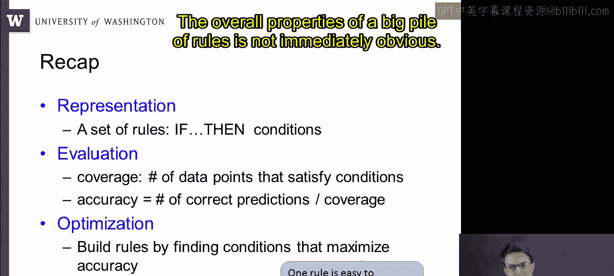

# 杜克大学《大规模数据科学（预测分析，交流数据科学结果，第2、3课⧸共3课有视频）｜Data Science at Scale》中英字幕 p35 34_规则回顾.zh_en -BV1xf421Q7bH_p35-

。

Okay， so in this case， we started from an empty rule。

 and we incrementally added constraints until we。Started incorrectly classifying some negative examples。

But you can do it both ways。 So this top， there's a couple different strategies here。

 one is to go from general to specific， as we just did。

 which is start with the empty rule and add constraints to eliminate negative examples and stop only when all you have left are positives。

But you can also imagine gl。Specific to general， which is。

Starting with a particular instance and constructing a rule that exactly。

Specifies in that particular instance， right， so it has a constraint for every attribute。And you。

Uniquely describes that that one data point。 And then you could remove conditions one by one。

In order to try to cover more positive examples and stop whenever you hit one that covers some negative examples。

Okay， and then you move on to the next rule。Okay， so once you have these sets of rules。

You need to use them to make predictions and one thing that can happen is you can have more than one rule triggered for a particular data point。

 and so you need to have some way of resolving conflict。

 so here you might choose the most specific rule or you might even choose the most general rule。

 or you could apply some domain knowledge in order to assign a priority for each rule and use that to break ties。

All right。So we'll recap of this。Brief introduction to sort of rule based methods is the representation here is a set of these if then rules with。

Vary numbers of conditions。And the evaluation strategy is to come up with the coverage of a rule and measure the accuracy by the number of correct predictions it makes divided by that coverage。

And then the optimization is。The search strategy is to sort of build rules by finding conditions that maximize accuracy one step at a time。

 and there you can either go from general to specific or specific to general。

 and we didn't discuss sort of the various tradeoffs。

Among those choices and so the maybe takeaway for these rule based methods besides using it to build into the next segment is that。

 you know one rule or just a fewer rules is pretty straightforward and pretty easy to interpret a big set of rules。

May not be， right， The overall properties of a big pile of rules is not immediately obvious。

