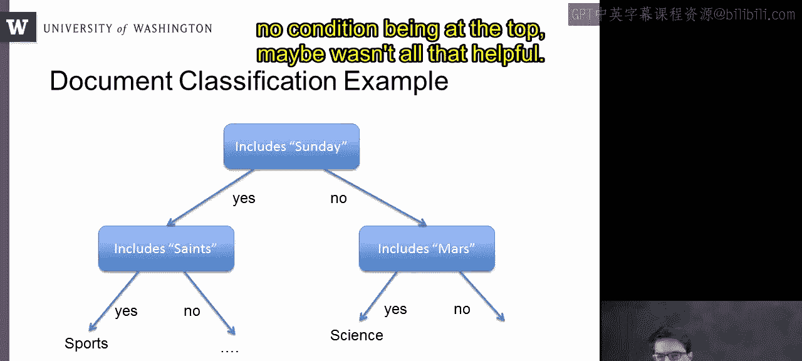

# 杜克大学《大规模数据科学（预测分析，交流数据科学结果，第2、3课⧸共3课有视频）｜Data Science at Scale》中英字幕 p36 35_从规则到树.zh_en -BV1xf421Q7bH_p36-

。

Okay， so again， we can consider how far we can go with these sets of rules and we showed the one big flat list and that gets pretty complex。

Might be hard to interpret。 So one thing we might do is consider grouping redundant conditions right And so this starts to look like a program you might write in any language where you say if。

The passengers in first class then。If they're female， then survive equals yes。

 and if they're male and age less than five， then survive equals。Yes or no or whatever。啊。

They're in second class then have another nestthetic conditions and so on。

 and so this starts to look like。A tree and these decision trees。

Or what we're going to talk about next All right So how this looks。diagrammatically is this， right。

 You sort of drop the each patient patient， each passenger down the tree and。

Each node in the tree makes a decision about where they go based on their attributes。

 and eventually you end up at a particular bucket。Okay。

And so you can imagine here that which attributes you start with on top。A。

Allows you to generate a lot of different kinds of trees， and they'll have different properties。 Now。

 the relationship between one of these decision trees and the sets of rules is that every path from the root represents one rule。

 Okay， so you can always turn it turning a tree into a set of rules is。

Pretty trivial because it just。Draw draw a line from the path to the drawaw a path from the root to the leaf。

 And every time you can do that， you end up generating one rule。

 going the other direction is not necessarily straightforward because there's redundant subrees。

And so on。 you didn't make some decisions about。How to handle that。Alright。

So switching examples for a second， consider going back to this document classification example。

 you can。Build decision trees in this case as well， you can say， look。

 if the document includes the term Sunday， you either have you know yes or no。

 and if it includes the word saints then you have yes or no， and if it does。

 then it's probably talking about sports。And if it includes the word Sun David and includes the words Mars。

 then it's probably talking about science。Sunday， the the include Sunday。

 yes or no condition being at the top maybe wasn't all that helpful and we'll make that。

Notion more precise in a moment。