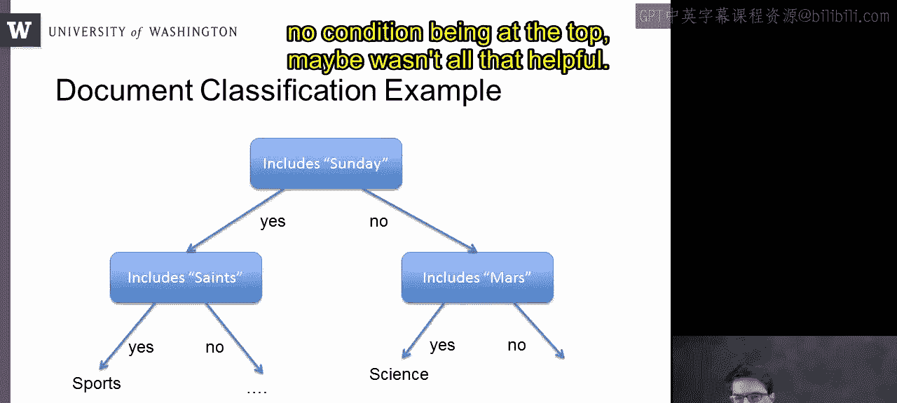

# 大规模数据科学：第2课：从规则到决策树 🌳


在本节课中，我们将学习如何将复杂的规则集转化为更易于理解和管理的决策树结构。我们将探讨规则与树之间的转换关系，并通过实例理解决策树的基本工作原理。

## 规则集的局限性

上一节我们介绍了使用规则集进行预测的方法。然而，一个庞大而扁平的规则列表会变得非常复杂，可能难以解释。

## 引入决策树结构

为了解决上述问题，我们可以考虑对冗余的条件进行分组。这开始类似于用任何编程语言编写的程序：使用 `if...then...` 语句进行嵌套判断。

例如：
```
if (passenger_class == first) {
    if (sex == female) {
        survive = yes;
    } else if (sex == male && age < 5) {
        survive = yes;
    }
} else if (passenger_class == second) {
    // 另一组嵌套条件
}
```

这种嵌套的条件结构开始呈现出**树**的形状，也就是我们接下来要讨论的**决策树**。

## 决策树的工作原理

从图示上看，决策树的工作流程如下：每个样本（如乘客）从树根开始，根据其属性在树的每个节点做出判断，决定下一步的路径，最终到达一个特定的“叶子”节点，即分类结果。


可以想象，选择哪个属性作为树的顶层节点（根节点），将生成许多不同种类的树，并且它们会具有不同的性质。

## 规则与决策树的关系

决策树与规则集之间的关系在于：**从根节点到任意叶子节点的每一条路径都代表一条规则**。

因此，将一棵决策树转化为一组规则是相当简单的，因为只需枚举从根到每个叶子的所有路径即可。每条路径对应一条规则。

然而，反向操作——将一组规则转化为一棵决策树——则不一定简单直接。因为规则中可能存在冗余的条件，需要决定如何处理这些冗余以构建出高效的树结构。

## 另一个示例：文档分类

让我们切换到一个文档分类的示例，以加深理解。在这个案例中，同样可以构建决策树。

例如，可以设定这样的判断：
*   如果文档包含词语 “Sunday”，则进入一个分支；否则进入另一个分支。
*   在包含 “Sunday” 的分支下，如果还包含词语 “Saints”，则可能将其归类为体育主题。
*   在另一个分支下，如果包含词语 “Sun” 和 “Mars”，则可能将其归类为科学主题。



不过，将“是否包含Sunday”这个条件放在树的顶层可能并不是最有帮助的选择。我们将在后续课程中使这个选择标准更加精确。

## 本节总结


本节课中，我们一起学习了如何从复杂的规则集过渡到决策树结构。我们了解到决策树通过树形结构组织判断条件，使模型更直观。每条从根到叶的路径对应一条规则，但将规则集反向构建为树需要考虑冗余问题。最后，我们通过文档分类的例子初步感受了决策树的应用。在接下来的课程中，我们将深入探讨如何构建一个“好”的决策树。