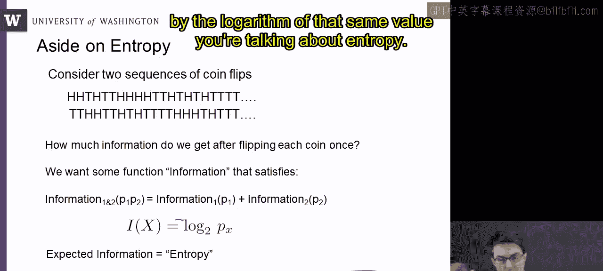

# 杜克大学《大规模数据科学（预测分析，交流数据科学结果，第2、3课⧸共3课有视频）｜Data Science at Scale》中英字幕 p37 36_熵.zh_en -BV1xf421Q7bH_p37-

。

Okay， so in order to make a decision about whether a node in the decision tree is helpful or not。

NowOnce I just claimed that we had an example where one wasn't helpful。

 we need this notion of entropy， okay？And。A way to think about this is consider two different sequences of coin flips。

Okay， and we want to figure out how much information do we get after flipping。

The coin in each sequence once。Hi。So the reason I'm talking about two different sequences is we want to have some kind of relationship between these two different coin flips。

 and so what we want to be true is that the probability of it coming up heads on the one hand and the probability coming up heads on the other hand。

You know， with these two coins。We know that if those events are independent。

 which we assume they are， assuming mean everything's fair about these coins。

 then you can multiply those probabilities together。

And so if we're trying to make up some new function called information。

 then we want information applied to the。Joint probability of those two events to be the same as the information gained from one of the events。

 plus the information gained from the other event。Okay。So let me just say that again。

We're doing an experiment with two different coins simultaneously。

And we're trying to design a function that captures our intuition about what information is， okay？

And it must have this property， right any sensible definition of this of this information function must have the property that if I have two different separate events。

 I should be able to add their information together to get my total。A。

And that should be the same value as applying the information function to the probability that they both happened。

Okay， so with a fair coin flip， it's 0。5 times 0。5。 So information of 0。

25 ought to be the same as information of 0。5 plus the information of 0。5 okay and。

It's here on the slide， the function that gives you that is log base two。Okay。F。

 so that's the information。 Now， what's entropy。 Well entropy measures the amount of unpredictability in。

A set of events， a sequence of events。And so this is the expected value of the information。Okay。

 and expected value， whenever you see expected value， you should always be thinking about。

 I'm going to be multiplying a probability by a value gained if that event occurs。Okay。

And so here you're saying and then adding adding up all those eventities。

 So that's expected value in every circumstance is going to be multiplying probabilities by。Values。

 and so here is no different。So we take。I pause because I see that。 there's a。嗯。Bg on this slide。

 which is。This is。Negative。Because log of a probability， probability is less than one。

 so that's always going to produce a negative number。And we want information to be a positive number。

 So we need to reverse the sign， and it's reflected down here。

 but it wasn't reflected in that definition。Okay， so we understand why information is is the log function and we understand that we want the expected value from a whole sequence of events。

And so that so the formula falls out of it is the probability multiplied by the log of that same probability and then add all those up。

 Okay， and so this guy comes up a lot。 We're going to use it in one particular way。

 but you should keep your eye out for it whenever you see。

You know some values from  zero to 1 multiplied by the logarithm of that same value。

 you're talking about entropy。

